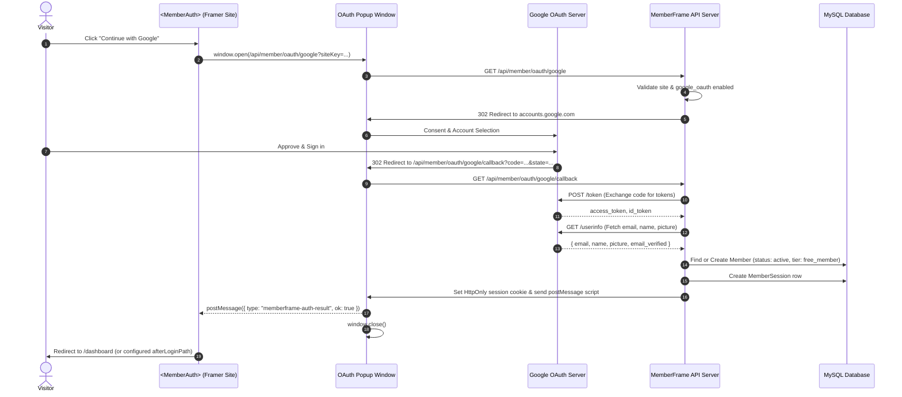

# Google OAuth Sign-In Setup and Runtime Architecture

Authoritative technical and setup documentation for Google OAuth 2.0 authentication in MemberFrame.

---

## 1. Executive Summary

Google Sign-In provides one-click, passwordless authentication for Framer site visitors. Visitors authenticate securely through Google's consent dialog, their email and name are verified by Google, and a corresponding Member record is created or signed in on MemberFrame. Upon successful authentication, the visitor is automatically redirected to their member dashboard.

This document details both the creator configuration workflow (Google Cloud Console credentials, automated redirect URL generation, in-plugin settings) and the end-to-end runtime authorization flow.

---

## 2. User Flows

### Flow A: Creator Configuration Flow (MemberFrame Plugin)

1. **Navigate to Settings:** In the MemberFrame plugin, click on the **Settings** tab and select the **Integration** segment.
2. **Open Google Sign-In Card:** Locate the **Google sign in** accordion row under the **Sign in** category.
3. **Copy Authorized Redirect URL:**
   - The card automatically computes the exact **Redirect URL** for the project (e.g., `http://127.0.0.1:4000/api/member/oauth/google/callback` in local development, or `https://api.memberframe.framefic.com/api/member/oauth/google/callback` in production).
   - The input field is **disabled** (`disabled={true}`, non-focusable, `cursor: not-allowed`) to prevent accidental manual alteration.
   - Click the adjacent **Copy** button to copy this URL directly to your clipboard with one click.
4. **Google Cloud Console Setup:**
   - Go to Google Cloud Console (`console.cloud.google.com`).
   - Create or select your project.
   - Configure the OAuth consent screen with your app name and support email.
   - Create an **OAuth 2.0 Client ID** (Application type: **Web application**).
   - Under **Authorized redirect URIs**, paste the Redirect URL copied from MemberFrame.
   - Obtain your **Client ID** and **Client Secret**.
5. **Save Credentials in MemberFrame:**
   - Paste the **Client id** (e.g., `000000.apps.googleusercontent.com`) into the card.
   - Paste the **Client secret** into the card.
   - Toggle the status switch to **ON**.
   - Click **Save**.
   - Settings are stored securely against the site.

---

### Flow B: End-Visitor Authentication Flow (Published Framer Site)



---

## 3. Step-by-Step Google Cloud Console Setup Guide

Follow these exact steps to generate your Google OAuth credentials:

### Step 1: Open Google Cloud Console
1. Visit [Google Cloud Console](https://console.cloud.google.com/).
2. Sign in with your Google account.
3. Select an existing project or click **New Project**, name it (e.g. `My Framer Membership`), and click **Create**.

### Step 2: Configure OAuth Consent Screen
1. In the left navigation menu, navigate to **APIs & Services** > **OAuth consent screen**.
2. Select **External** user type and click **Create**.
3. Fill in the required fields:
   - **App name:** Your site or brand name (e.g. `MemberFrame Demo`).
   - **User support email:** Your email address.
   - **Developer contact information:** Your email address.
4. Click **Save and Continue**.
5. Under **Scopes**, click **Add or Remove Scopes**, select:
   - `.../auth/userinfo.email`
   - `.../auth/userinfo.profile`
   - `openid`
6. Click **Update**, then click **Save and Continue**.
7. If your app is in "Testing" mode, add your test email under **Test users**.

### Step 3: Create OAuth 2.0 Credentials
1. In the left navigation menu, go to **APIs & Services** > **Credentials**.
2. Click **+ Create Credentials** at the top, and select **OAuth client ID**.
3. Set **Application type** to **Web application**.
4. Name: `MemberFrame Web Client`.
5. Under **Authorized JavaScript origins**, add:
   - Your published Framer site URL (e.g. `https://your-site.framer.app`).
   - For local development: `http://127.0.0.1:4000` and `http://localhost:5173`.
6. Under **Authorized redirect URIs**, add the exact URL copied from MemberFrame:
   - Local development: `http://127.0.0.1:4000/api/member/oauth/google/callback`
   - Production: `https://api.memberframe.framefic.com/api/member/oauth/google/callback`
7. Click **Create**.
8. A modal appears displaying your **Client ID** and **Client Secret**.

### Step 4: Paste into MemberFrame
1. Open the MemberFrame Framer Plugin.
2. Go to **Settings** > **Integration** > **Google sign in**.
3. Paste your **Client ID** and **Client Secret**.
4. Switch the toggle to **ON**.
5. Click **Save**.

---

## 4. Architecture and File Inventory

| Component / Layer | File Path | Role and Responsibilities |
| :--- | :--- | :--- |
| **Plugin UI (Card)** | `src/components/settings/IntegrationCard.tsx` | Collapsible accordion card styled to match Tier creation structure. Auto-generates Redirect URL with one-click copy button. |
| **Plugin Registry** | `src/components/settings/integrationRegistry.ts` | Catalogue definition for `google_oauth`, field schemas, password masking, and category grouping. |
| **Canvas Component** | `src/canvas-components/MemberAuth.tsx` | Embeddable auth widget with "Continue with Google" button, popup management, postMessage receiver, and automatic redirection to `/dashboard`. |
| **Backend Router** | `backend/src/routes/member.ts` | Endpoints `GET /oauth/google` and `GET /oauth/google/callback`. Exchanges code, creates member, issues session. |
| **Tenant Middleware** | `backend/src/middleware/site.ts` | Resolves tenant from query params (`siteKey`, `state`), headers, and origin allowlists. |
| **Database Model** | `backend/prisma/schema.prisma` | Stores `Member` (with nullable `passwordHash` and verified email), `MemberSession`, and `SiteSettings`. |
| **Plugin Styling** | `src/styles/settings.css` | Styles for `.integration-card-bar`, `.integration-tier-form`, chevron animations, and field rows. |

---

## 5. Framer Property Controls Specification

The `<MemberAuth>` canvas component exposes the following property controls in Framer:

| Property | ControlType | Default Value | Description |
| :--- | :--- | :--- | :--- |
| `authMode` | `ControlType.Enum` | `inline` | `inline` (on-page card) or `modal` (overlay popup). |
| `headline` | `ControlType.String` | `"Sign in to continue"` | Title displayed at top of auth card. |
| `welcomeMessage` | `ControlType.String` | `"Use your email or a connected account."` | Subtitle describing sign in options. |
| `emailEnabled` | `ControlType.Boolean` | `true` | Enables or disables email password / OTP fields. |
| `googleEnabled` | `ControlType.Boolean` | `true` | Renders the "Continue with Google" button. |
| `appleEnabled` | `ControlType.Boolean` | `false` | Renders Apple sign-in button when enabled. |
| `githubEnabled` | `ControlType.Boolean` | `false` | Renders GitHub sign-in button when enabled. |
| `discordEnabled` | `ControlType.Boolean` | `false` | Renders Discord sign-in button when enabled. |
| `accentColor` | `ControlType.Color` | `"#5271ff"` | Primary button and hover border color. |
| `borderRadius` | `ControlType.Number` | `10` | Corner radius for cards and input controls. |

---

## 6. Data Contracts and TypeScript Interfaces

### Site Settings Integration Payload
```typescript
export interface StoredIntegration {
  enabled: boolean;
  values: {
    clientId?: string;
    clientSecret?: string;
    redirect_url?: string;
  };
  secretsPresent: string[];
}
```

### State Parameter Payload
```typescript
export interface OAuthStatePayload {
  siteId: string;
  origin: string;
  nonce: string;
  provider: "google";
}
```

### Window PostMessage Contract
When Google OAuth finishes, the popup window executes:
```javascript
window.opener.postMessage(
  {
    type: "memberframe-auth-result",
    ok: true,
  },
  targetOrigin
);
window.close();
```

---

## 7. Verification and Testing Checklist

- [x] **Accordion Bar:** Integration card displays left icon, provider title, connection badge, on/off toggle switch, and chevron.
- [x] **FAQ Toggle:** Clicking the row header toggles expand and collapse states smoothly.
- [x] **Auto-Expand on Enable:** Turning the toggle switch ON automatically expands the card to display fields.
- [x] **Computed Redirect URL:** Redirect URL automatically matches the project base URL and cannot be accidentally misconfigured.
- [x] **One-Click Copy:** Clicking the copy icon copies the Redirect URL to the clipboard and gives visible feedback.
- [x] **Tier Form Hierarchy:** Edit header features title on left, close "X" icon on right, and full-width "Save" button at the bottom.
- [x] **Google Endpoints:** Backend routes `/api/member/oauth/google` and `/api/member/oauth/google/callback` are operational.
- [x] **User Creation:** Google authentication creates an active Member with verified email and free membership tier.
- [x] **Dashboard Redirection:** Successful authentication triggers automated navigation to `/dashboard` (or the configured `afterLoginPath`).
- [x] **Theme Tokens:** Full compliance with `--framefic-*` tokens and zero inline CSS.
