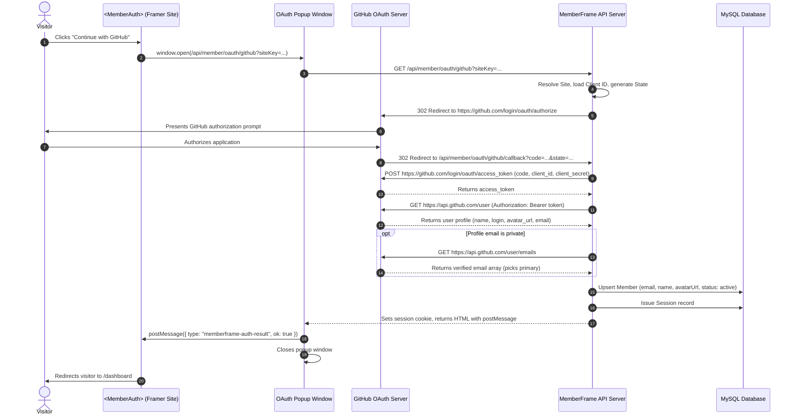

# GitHub OAuth Sign-In Setup and Runtime Architecture

Authoritative technical and setup documentation for GitHub OAuth 2.0 authentication in MemberFrame.

---

## 1. Executive Summary

GitHub Sign-In provides one-click authentication tailored for developer tools, SaaS templates, technical communities, and open-source documentation sites built on Framer. Visitors authenticate via their GitHub account, granting MemberFrame read access to their verified primary email and profile details (name, username, avatar). Upon successful authorization, a corresponding Member record is created or logged in, a session cookie is issued, and the visitor is automatically redirected to `/dashboard`.

This document covers both the creator setup workflow (GitHub Developer Settings > OAuth Apps, automated redirect URL generation, in-plugin settings) and the end-to-end runtime authorization flow.

---

## 2. User Flows

### Flow A: Creator Configuration Flow (MemberFrame Plugin)

1. **Navigate to Settings:** In the MemberFrame plugin, click on the **Settings** tab and select the **Integration** segment.
2. **Open GitHub Sign-In Card:** Locate the **GitHub sign in** accordion row under the **Sign in** category.
3. **Copy Authorized Redirect URL:**
   - The card automatically computes the exact **Redirect URL** for the site:
     - Local development: `http://127.0.0.1:4000/api/member/oauth/github/callback`
     - Production: `https://api.memberframe.framefic.com/api/member/oauth/github/callback`
   - The field is marked disabled (`disabled={true}`, non-focusable, `cursor: not-allowed`) to prevent accidental edits.
   - Click the adjacent **Copy** button to copy this URL directly to your clipboard.
4. **GitHub Developer Settings Setup:**
   - Go to GitHub Settings > **Developer settings** (`github.com/settings/developers`).
   - Select **OAuth Apps** and click **New OAuth App** (or select an existing one).
   - Enter your **Application name** (e.g., `My Framer Community`).
   - Enter your **Homepage URL** (your published Framer domain, e.g., `https://mycommunity.framer.website`).
   - In **Authorization callback URL**, paste the Redirect URL copied from MemberFrame.
   - Click **Register application**.
   - Copy the generated **Client ID**.
   - Generate a new client secret by clicking **Generate a new client secret** and copy the **Client Secret**.
5. **Save Credentials in MemberFrame:**
   - Paste the **Client id** (e.g., `Ov23li...` or `Iv1.0000000000000000`) into the card.
   - Paste the **Client secret** into the card.
   - Toggle the status switch to **ON**.
   - Click **Save**.
   - Credentials are saved to the site settings document.

---

### Flow B: End-Visitor Authentication Flow (Published Framer Site)



---

## 3. Architecture and File Inventory

| Component | File Path | Role |
| :--- | :--- | :--- |
| **Catalogue & Fields** | `src/components/settings/integrationRegistry.ts` | Defines `github_oauth` with `clientId`, `clientSecret`, and `redirect_url`. |
| **In-Plugin Card UI** | `src/components/settings/IntegrationCard.tsx` | Accordion card with brand GitHub mark, disabled Redirect URL field, and one-click copy. |
| **Canvas Auth Component** | `src/canvas-components/MemberAuth.tsx` | Renders the GitHub sign-in button with brand mark, launches popup, listens for completion. |
| **Backend Route Handler** | `backend/src/routes/member.ts` | Endpoints `GET /oauth/github` and `GET /oauth/github/callback`. |
| **Site Middleware** | `backend/src/middleware/site.ts` | Resolves site context from `siteKey` query param and base64url `state`. |

---

## 4. API Specification

### Endpoint 1: Initiate GitHub OAuth

```http
GET /api/member/oauth/github?siteKey={siteKey}
```

- **Query Parameters**:
  - `siteKey`: The public site key of the Framer site.
- **Behavior**:
  - Validates that `github_oauth` is configured and enabled for the resolved site.
  - Generates a cryptographically randomized `state` string containing `{ siteId, origin, nonce }` encoded in base64url.
  - Redirects browser popup to:
    ```
    https://github.com/login/oauth/authorize?client_id={clientId}&redirect_uri={redirectUri}&scope=read:user+user:email&state={state}
    ```

---

### Endpoint 2: GitHub OAuth Callback

```http
GET /api/member/oauth/github/callback?code={code}&state={state}
```

- **Query Parameters**:
  - `code`: Temporary authorization code issued by GitHub.
  - `state`: Base64url payload containing `{ siteId, origin, nonce }`.
  - `error`: Present if visitor denied access (e.g., `access_denied`).
- **Processing Steps**:
  1. Decodes `state` to locate the target `siteId` and opener `origin`.
  2. Exchanges `code` with `https://github.com/login/oauth/access_token` using the configured `clientId` and `clientSecret`.
  3. Fetches user profile from `https://api.github.com/user` with `User-Agent: MemberFrame-OAuth`.
  4. If email is not directly visible on the profile, queries `https://api.github.com/user/emails` to retrieve the user's primary verified email address.
  5. Upserts a `Member` row in MySQL:
     - `email`: Normalized lowercase email.
     - `name`: User's full name, falling back to GitHub username (`login`).
     - `avatarUrl`: GitHub avatar URL (`avatar_url`).
     - `emailVerifiedAt`: Stamped with current date.
     - `activeTier`: Set to `free_member`.
  6. Creates an active `MemberSession` and attaches the `memberframe_session` HTTP-only cookie.
  7. Returns an HTML response with a script that posts `{ type: "memberframe-auth-result", ok: true }` to `window.opener` and closes the popup.

---

## 5. Verification Checklist

- [x] In-plugin Settings > Integration shows "GitHub sign in" accordion card under Sign in.
- [x] Redirect URL computes `http://127.0.0.1:4000/api/member/oauth/github/callback` dynamically.
- [x] Redirect URL input is disabled with `cursor: not-allowed` and copy button copies cleanly.
- [x] `clientSecret` is masked as password and protected from client-side leaks.
- [x] `<MemberAuth>` canvas component renders the monochrome GitHub mark and button when `githubEnabled` is true.
- [x] All automated frontend and backend test suites pass 100%.
