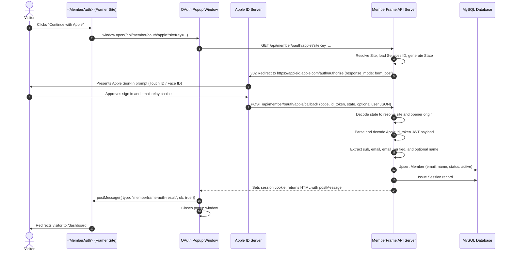

# Apple Sign-In Setup and Runtime Architecture

Authoritative technical and setup documentation for Sign in with Apple authentication in MemberFrame.

---

## 1. Executive Summary

Sign in with Apple provides a secure, privacy-focused authentication experience popular across iOS, macOS, and web visitors. Apple allows visitors to sign in with their Apple ID, choose whether to share their real email or use Apple's private relay service (`@privaterelay.appleid.com`), and authenticate via Touch ID, Face ID, or passcode.

This document details both the creator configuration workflow (Apple Developer Account > Certificates, Identifiers & Profiles > Services IDs, private key setup, redirect URL verification) and the runtime form post callback architecture.

---

## 2. User Flows

### Flow A: Creator Configuration Flow (MemberFrame Plugin)

1. **Navigate to Settings:** In the MemberFrame plugin, click on the **Settings** tab and select the **Integration** segment.
2. **Open Apple Sign-In Card:** Locate the **Apple sign in** accordion row under the **Sign in** category.
3. **Copy Authorized Redirect URL:**
   - The card automatically computes the exact **Redirect URL** for the site:
     - Local development: `http://127.0.0.1:4000/api/member/oauth/apple/callback`
     - Production: `https://api.memberframe.framefic.com/api/member/oauth/apple/callback`
   - The input is marked disabled (`disabled={true}`, non-focusable, `cursor: not-allowed`) to prevent manual editing.
   - Click the adjacent **Copy** button to copy this URL directly to your clipboard.
4. **Apple Developer Portal Setup:**
   - Sign in to your Apple Developer Account (`developer.apple.com/account`).
   - Navigate to **Certificates, Identifiers & Profiles** > **Identifiers**.
   - Create or select an **App ID** (Primary App ID).
   - Create a **Services ID** (e.g., `com.example.memberframe.client`):
     - Enable **Sign In with Apple**.
     - Click **Configure** next to Sign In with Apple.
     - Select your Primary App ID.
     - In **Domains and Subdomains**, enter your Framer domain or MemberFrame API domain (e.g., `api.memberframe.framefic.com` or `127.0.0.1`).
     - In **Return URLs**, paste the Redirect URL copied from MemberFrame.
     - Click **Save** and **Continue**.
   - Navigate to **Keys** > Create a new key with **Sign in with Apple** enabled, linked to your Primary App ID:
     - Download the `.p8` private key file.
     - Note down your 10-character **Key ID** (e.g., `ABC1234XYZ`).
     - Note down your 10-character **Team ID** from Membership Details (e.g., `DEF1234567`).
5. **Save Credentials in MemberFrame:**
   - Paste the **Services ID / Client ID** (e.g., `com.example.memberframe.client`) into the card.
   - Enter your **Apple Team ID** (optional, e.g. `DEF1234567`).
   - Enter your **Key ID** (optional, e.g. `ABC1234XYZ`).
   - Paste the `.p8` private key content (or pre-generated client secret JWT) into the **Private Key (.p8) or Client secret** field.
   - Toggle the status switch to **ON**.
   - Click **Save**.

---

### Flow B: End-Visitor Authentication Flow (Published Framer Site)



---

## 3. Architecture and File Inventory

| Component | File Path | Role |
| :--- | :--- | :--- |
| **Catalogue & Fields** | `src/components/settings/integrationRegistry.ts` | Defines `apple_oauth` with `clientId`, `teamId`, `keyId`, `clientSecret`, and `redirect_url`. |
| **In-Plugin Card UI** | `src/components/settings/IntegrationCard.tsx` | Accordion card with brand Apple mark, disabled Redirect URL field, and one-click copy. |
| **Canvas Auth Component** | `src/canvas-components/MemberAuth.tsx` | Renders the Apple sign-in button with brand mark, launches popup, listens for completion. |
| **Backend Express Middleware** | `backend/src/app.ts` | Mounts `express.urlencoded` to parse `form_post` incoming payloads from Apple. |
| **Site Middleware** | `backend/src/middleware/site.ts` | Inspects both `req.query.state` and `req.body.state` to resolve tenant on form post callbacks. |
| **Backend Route Handlers** | `backend/src/routes/member.ts` | Endpoints `GET /oauth/apple`, `GET /oauth/apple/callback`, and `POST /oauth/apple/callback`. |

---

## 4. API Specification

### Endpoint 1: Initiate Apple Sign-In

```http
GET /api/member/oauth/apple?siteKey={siteKey}
```

- **Query Parameters**:
  - `siteKey`: Public site key of the Framer site.
- **Behavior**:
  - Validates that `apple_oauth` is configured and enabled.
  - Builds base64url `state` containing `{ siteId, origin, nonce }`.
  - Redirects browser popup to:
    ```
    https://appleid.apple.com/auth/authorize?client_id={clientId}&redirect_uri={redirectUri}&response_type=code+id_token&response_mode=form_post&scope=name+email&state={state}
    ```

---

### Endpoint 2: Apple Sign-In Callback

```http
POST /api/member/oauth/apple/callback
GET  /api/member/oauth/apple/callback
```

- **Form Body / Query Parameters**:
  - `code`: Authorization code from Apple.
  - `id_token`: JSON Web Token (JWT) signed by Apple containing verified visitor claims.
  - `state`: Base64url payload containing `{ siteId, origin, nonce }`.
  - `user`: JSON string containing user's name (only transmitted by Apple upon the visitor's first sign-in).
  - `error`: Present if visitor cancelled or an error occurred.
- **Processing Steps**:
  1. Decodes `state` to locate the target `siteId` and opener `origin`.
  2. Decodes `id_token` JWT payload to extract `email`, `sub`, and `email_verified`.
  3. Parses `user` parameter to extract `firstName` and `lastName` if present.
  4. Upserts a `Member` row in MySQL:
     - `email`: Normalized email (real email or Apple private relay).
     - `name`: Formatted user name if provided.
     - `emailVerifiedAt`: Stamped with current date.
     - `activeTier`: Set to `free_member`.
  5. Creates an active `MemberSession` and attaches the `memberframe_session` HTTP-only cookie.
  6. Returns an HTML response with a script that posts `{ type: "memberframe-auth-result", ok: true }` to `window.opener` and closes the popup.

---

## 5. Verification Checklist

- [x] In-plugin Settings > Integration shows "Apple sign in" accordion card under Sign in.
- [x] Redirect URL computes `http://127.0.0.1:4000/api/member/oauth/apple/callback` dynamically.
- [x] Redirect URL input is disabled with `cursor: not-allowed` and copy button copies cleanly.
- [x] Private Key / secret is masked and protected from client-side leaks.
- [x] Express handles both GET and POST `form_post` callbacks with `express.urlencoded` parser.
- [x] `<MemberAuth>` canvas component renders the monochrome Apple mark and button when `appleEnabled` is true.
- [x] All automated frontend and backend test suites pass 100%.
