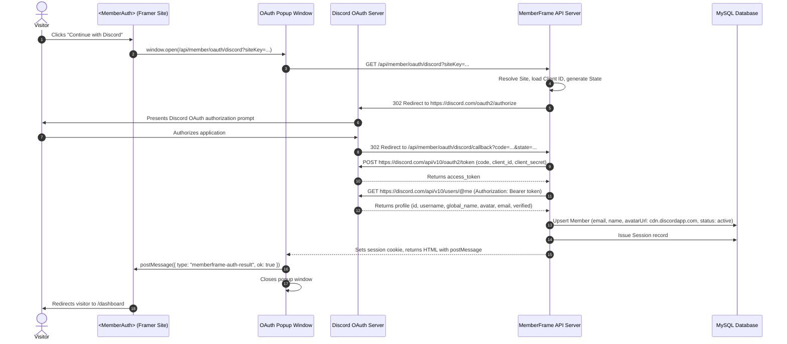

# Discord OAuth Sign-In Setup and Runtime Architecture

Authoritative technical and setup documentation for Discord OAuth 2.0 authentication in MemberFrame.

---

## 1. Executive Summary

Discord Sign-In provides one-click authentication ideal for web3, gaming, streaming, and creator community sites built on Framer. Visitors authenticate via their Discord account, allowing MemberFrame to read their verified email address, username, global display name, and avatar image. Upon successful authentication, a corresponding Member record is created or signed in, a session cookie is issued, and the visitor is automatically redirected to `/dashboard`.

This document details both the creator configuration workflow (Discord Developer Portal > Applications > OAuth2, redirect URL generation, in-plugin settings) and the end-to-end runtime authorization flow.

---

## 2. User Flows

### Flow A: Creator Configuration Flow (MemberFrame Plugin)

1. **Navigate to Settings:** In the MemberFrame plugin, click on the **Settings** tab and select the **Integration** segment.
2. **Open Discord Sign-In Card:** Locate the **Discord sign in** accordion row under the **Sign in** category.
3. **Copy Authorized Redirect URL:**
   - The card automatically computes the exact **Redirect URL** for the site:
     - Local development: `http://127.0.0.1:4000/api/member/oauth/discord/callback`
     - Production: `https://api.memberframe.framefic.com/api/member/oauth/discord/callback`
   - The field is marked disabled (`disabled={true}`, non-focusable, `cursor: not-allowed`) to prevent accidental manual alterations.
   - Click the adjacent **Copy** button to copy this URL directly to your clipboard.
4. **Discord Developer Portal Setup:**
   - Go to the Discord Developer Portal (`discord.com/developers/applications`).
   - Click **New Application** and enter an application name (e.g., `My Framer Hub`).
   - In **General Information**, locate and copy your **Application ID** (this is your Client ID).
   - In the left sidebar, navigate to **OAuth2**.
   - Under **Client Secret**, click **Reset Secret** (or copy your existing one) and copy the **Client Secret**.
   - Under **Redirects**, click **Add Redirect** and paste the Redirect URL copied from MemberFrame.
   - Click **Save Changes**.
5. **Save Credentials in MemberFrame:**
   - Paste the **Client id (Application ID)** into the card.
   - Paste the **Client secret** into the card.
   - Toggle the status switch to **ON**.
   - Click **Save**.
   - Credentials are saved to the site settings document.

---

### Flow B: End-Visitor Authentication Flow (Published Framer Site)



---

## 3. Architecture and File Inventory

| Component | File Path | Role |
| :--- | :--- | :--- |
| **Catalogue & Fields** | `src/components/settings/integrationRegistry.ts` | Defines `discord_oauth` with `clientId`, `clientSecret`, and `redirect_url`. |
| **In-Plugin Card UI** | `src/components/settings/IntegrationCard.tsx` | Accordion card with brand Discord mark, disabled Redirect URL field, and one-click copy. |
| **Canvas Auth Component** | `src/canvas-components/MemberAuth.tsx` | Renders the Discord sign-in button with brand mark, launches popup, listens for completion. |
| **Backend Route Handlers** | `backend/src/routes/member.ts` | Endpoints `GET /oauth/discord` and `GET /oauth/discord/callback`. |
| **Site Middleware** | `backend/src/middleware/site.ts` | Resolves site context from `siteKey` query param and base64url `state`. |

---

## 4. API Specification

### Endpoint 1: Initiate Discord OAuth

```http
GET /api/member/oauth/discord?siteKey={siteKey}
```

- **Query Parameters**:
  - `siteKey`: Public site key of the Framer site.
- **Behavior**:
  - Validates that `discord_oauth` is configured and enabled.
  - Generates a cryptographically randomized `state` string containing `{ siteId, origin, nonce }` encoded in base64url.
  - Redirects browser popup to:
    ```
    https://discord.com/oauth2/authorize?client_id={clientId}&redirect_uri={redirectUri}&response_type=code&scope=identify+email&state={state}&prompt=consent
    ```

---

### Endpoint 2: Discord OAuth Callback

```http
GET /api/member/oauth/discord/callback?code={code}&state={state}
```

- **Query Parameters**:
  - `code`: Temporary authorization code issued by Discord.
  - `state`: Base64url payload containing `{ siteId, origin, nonce }`.
  - `error`: Present if visitor denied access.
- **Processing Steps**:
  1. Decodes `state` to locate target `siteId` and opener `origin`.
  2. Exchanges `code` with `https://discord.com/api/v10/oauth2/token` using the configured `clientId` and `clientSecret`.
  3. Fetches user profile from `https://discord.com/api/v10/users/@me`.
  4. Generates avatar URL from Discord CDN:
     `https://cdn.discordapp.com/avatars/{userId}/{avatarHash}.png`.
  5. Upserts a `Member` row in MySQL:
     - `email`: Normalized lowercase email.
     - `name`: User's global display name, falling back to username.
     - `avatarUrl`: Discord CDN avatar URL.
     - `emailVerifiedAt`: Stamped with current date if verified.
     - `activeTier`: Set to `free_member`.
  6. Creates an active `MemberSession` and attaches the `memberframe_session` HTTP-only cookie.
  7. Returns an HTML response with a script that posts `{ type: "memberframe-auth-result", ok: true }` to `window.opener` and closes the popup.

---

## 5. Verification Checklist

- [x] In-plugin Settings > Integration shows "Discord sign in" accordion card under Sign in.
- [x] Redirect URL computes `http://127.0.0.1:4000/api/member/oauth/discord/callback` dynamically.
- [x] Redirect URL input is disabled with `cursor: not-allowed` and copy button copies cleanly.
- [x] `clientSecret` is masked as password and protected from client-side leaks.
- [x] Discord CDN avatar format (`cdn.discordapp.com/avatars/...`) is parsed and stored.
- [x] `<MemberAuth>` canvas component renders the monochrome Discord mark and button when `discordEnabled` is true.
- [x] All automated frontend and backend test suites pass 100%.
