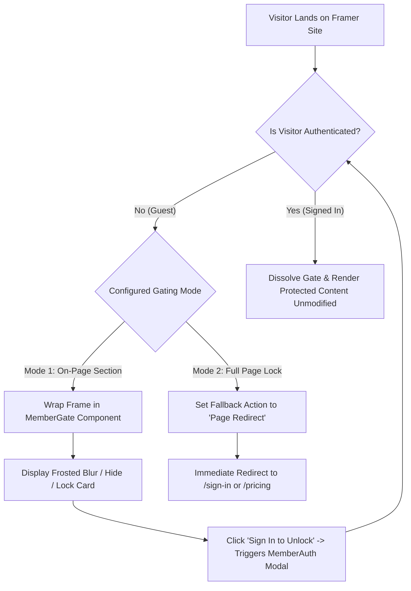

# Feature Plan 1: Lock Pages & On-Page Content

> **Feature ID**: FP-01  
> **Feature Name**: Lock Pages & On-Page Content  
> **Status**: Completed (Implemented & Verified)  
> **PRD Cross-Reference**: Feature F01 (`<MemberGate>`), Feature F04 (`Live Preview Studio`), Feature F05 (`<MemberAuth>`)  
> **Priority**: Core Gating Milestone 1

---

## 1. Executive Summary & Core Objective

The primary objective of this feature is to provide bulletproof content and page gating for Framer websites with zero code overrides:

- **Logged-Out Visitors (Guests)**: Cannot view protected pages or on-page content. They encounter a frosted blur overlay, a custom lock card, hidden elements, or an automatic redirect to a sign-in/pricing page.
- **Logged-In Members**: Once authenticated, the gates automatically dissolve and reveal the protected content.

### Phased Delivery Strategy

Per product direction, implementation is decoupled into two sequential stages:

1. **Stage 1 (Immediate Milestone — Auth-Only Gating)**: Deliver simple, robust binary gating:
   - **Guest (Logged Out)**: Locked.
   - **Any Signed-In Member**: Unlocked.
2. **Stage 2 (Subsequent Milestone — Tier-Based Gating)**: Activate multi-tier hierarchy (`Free`, `Silver`, `Gold`, `VIP`) where higher-ranking tiers inherit access to lower-tier content.

---

## 2. In-Plugin Live Preview Studio Architecture

### 2.1. The Live State Simulator Bar (`[Guest] [Free] [Silver] [VIP] [Failed]`)

In the MemberFrame plugin under the **Builder** tab, the **Live Preview Studio** renders a true-scale visual simulation of `<MemberGate>`. Below the preview is the 5-state switcher bar:

```
┌────────────────────────────────────────────────────────┐
│  Live Preview Studio (True Scale Render)               │
│  ┌──────────────────────────────────────────────────┐  │
│  │  Protected Frame Preview                         │  │
│  └──────────────────────────────────────────────────┘  │
│  [ Guest ]  [ Free ]  [ Silver ]  [ VIP ]  [ Failed ]  │ <── State Switcher Bar
│  "Signed in on the free plan, with no paid tier."      │
└────────────────────────────────────────────────────────┘
```

#### Purpose & Creator Use Case

When a designer configures `<MemberGate>` in Framer, they must be able to visually verify how the gate renders for different visitors **before publishing their website**, with zero network latency and without needing real test accounts:

1. **`Guest`**: Simulates an unauthenticated visitor who has **not signed in** (`session = null`). Demonstrates the locked state (Frosted blur + "Members Only Content" lock card).
2. **`Free`**: Simulates a visitor who has signed in on a free membership (`activeTier = "free_member"`). If the gate requires _"Any signed in"_, the preview dissolves and reveals the content.
3. **`Silver`**: Simulates a paid Tier 1 subscriber (`activeTier = "tier_1"`).
4. **`VIP`**: Simulates a top-tier VIP member (`activeTier = "vip"`). Passes all lower tier gates.
5. **`Failed`**: Simulates a subscriber whose credit card payment failed and whose grace period has ended (`status = "past_due"`). Demonstrates how payment-lapsed subscribers are blocked.

> **Key Architecture Detail**: The state switcher runs 100% client-side in memory inside Framer via simulated fixtures (`buildSimulatedSession`). It makes zero network calls and works offline.

---

### 2.2. Difference: Preview Bar vs. Manage > Tiers Dropdown

A frequent question is why the options on the **Preview Bar** differ from the **Manage > Tiers** dropdown:

| Dimension           | Builder Preview Switcher (`StateSwitcher.tsx`)        | Manage Tab > Tiers (`TierEditor.tsx`)                             |
| :------------------ | :---------------------------------------------------- | :---------------------------------------------------------------- |
| **Domain**          | **Visitor Authentication & Billing Lifecycle States** | **Purchasable Membership Plans (Pricing Tiers)**                  |
| **Available Items** | `Guest`, `Free`, `Silver`, `VIP`, `Failed`            | `free_member`, `tier_1` (Silver), `tier_2` (Gold), `vip`          |
| **Commercial Role** | Visual test fixtures for designers inside Framer.     | Real subscription products sold for money ($/mo, $/yr, lifetime). |
| **Persistence**     | In-memory React state (`SimulatedState`).             | Database records (`SiteTierRecord`).                              |

#### Why `Guest` and `Failed` are NOT in the Tier Dropdown:

- `Guest` is an authentication status (unauthenticated visitor), not a purchasable plan.
- `Failed` is a billing status (`status: "past_due"`), not a plan.
- A creator cannot sell a "Guest" or "Failed" subscription, but **must** test how the paywall treats those users. Hence, `Guest` and `Failed` exist only in the visual simulator bar.

---

## 3. Gating Modes: On-Page Content vs. Full Pages



### 3.1. Mode 1: On-Page Content Locking (Sections, Videos, Frames)

- **Canvas Component**: `<MemberGate>` (`src/canvas-components/MemberGate.tsx`).
- **Creator Workflow**:
  1. Open MemberFrame plugin -> **Builder** tab -> select **Member Gate**.
  2. Set **Required tier** to **`Any signed in`**.
  3. Click **+ Add to canvas**. The plugin deploys and inserts `<MemberGate>` onto the canvas.
  4. In Framer's native properties panel, connect the target frame (section, video, article body) to the **Protected Frame** slot (`contentSlot: ControlType.ComponentInstance`).
  5. Select the locked state behavior:
     - **`Frosted Blur`** (Default): Keeps background visible with a customizable CSS blur (e.g., 8px) and a lock card overlay.
     - **`Hide Completely`**: Collapses the frame so it leaves zero blank space.
     - **`Lock Card`**: Replaces the frame with a clean "Members Only" card.

### 3.2. Mode 2: Full Page Locking (Page Guards & Automatic Redirection)

- **Approach A (Instant Page Redirection)**:
  - Place `<MemberGate>` on the protected page (e.g. `/dashboard` or `/tutorials`).
  - Set **Locked State** to **`Page Redirect`** and set **Redirect Target** to `/sign-in` or `/pricing`.
  - If a visitor is not signed in, `<MemberGate>` immediately executes `window.location.assign(redirectUrl)` before any page content renders.
- **Approach B (Full Page Canvas Wrapper)**:
  - Wrap the root layout frame of the entire page inside `<MemberGate>`'s `Protected Frame` slot.
  - Unauthenticated visitors see the entire page blurred with a central login card.

---

## 4. Technical Architecture & File Inventory

### 4.1. Core Files

| File Path                                              | Role                                                                                    |
| :----------------------------------------------------- | :-------------------------------------------------------------------------------------- |
| `src/canvas-components/MemberGate.tsx`                 | Canvas-native gate component deployed to creator's Framer project. Zero code overrides. |
| `src/canvas-components/MemberAuth.tsx`                 | Passwordless OTP and Google SSO authentication modal on canvas.                         |
| `src/components/studio/PreviewStudio.tsx`              | In-plugin Live Preview Studio host.                                                     |
| `src/components/studio/StateSwitcher.tsx`              | 5-state simulation bar (`Guest`, `Free`, `Silver`, `VIP`, `Failed`).                    |
| `src/components/studio/previews/MemberGatePreview.tsx` | Real-time preview component mirroring `<MemberGate>`.                                   |
| `src/components/tabs/BuilderTab.tsx`                   | Builder tab UI containing component selector, customizer, and deploy CTA.               |
| `src/services/canvasComponentCodeGenerator.ts`         | Code generator that injects configuration into deployed `.tsx` files.                   |
| `src/services/framerCanvasService.ts`                  | Wrapper around Framer Canvas API (`createCodeFile`, `addComponentInstance`).            |
| `src/utils/entitlement.ts`                             | Shared parity entitlement resolver (`isEntitled`).                                      |

### 4.2. Runtime Session Contract (`MemberGate.tsx`)

1. `<MemberGate>` renders in locked state by default on load (fails closed, no flash of unauthenticated content).
2. It requests session verification via HTTP-only cookie:
   ```typescript
   fetch(`${CONFIG.apiBaseUrl}/api/member/session`, {
     credentials: "include",
     headers: { Accept: "application/json" },
   });
   ```
3. **Session Outcomess**:
   - `200 OK` with valid session -> Evaluates `isEntitled()`. If `requiredTier === "signed_in"`, immediately returns `true` and unlocks content.
   - `401 Unauthorized` / Network failure -> Returns `false`. Renders locked fallback state or executes redirect.

### 4.3. Seamless Sign-In Integration

- When a visitor clicks **"Sign in to unlock"** on `<MemberGate>`'s lock card:
  - A custom event `memberframe:open-auth` is dispatched.
  - `<MemberAuth>` catches the event and opens its modal overlay.
  - After OTP verification or Google SSO, `<MemberAuth>` dispatches `memberframe:session-updated`.
  - `<MemberGate>` refreshes its cached session and dissolves the lock instantly without requiring a full page reload.

---

## 5. Verification & Testing Strategy

### 5.1. Automated Test Suite

Run the test suite via:

```bash
cmd /c npm test
```

- **`test/entitlement.test.ts`**: Validates that when `requiredTier = "signed_in"`, `isEntitled` returns `false` for `guest` (null session), and `true` for all signed-in states (`free`, `silver`, `vip`).
- **`test/memberGateParity.test.ts`**: Ensures that the canvas copy of `isEntitled` in `MemberGate.tsx` remains byte-for-byte identical with `src/utils/entitlement.ts`.
- **`test/canvasCodeGenerator.test.ts`**: Validates that generated code accurately embeds default configuration.

### 5.2. Manual Verification Script (Inside Framer Desktop)

1. **Builder Tab Preview Studio**:
   - Set `Required tier` to `Any signed in`.
   - Click **Guest** -> Verify that the preview displays the Frosted Blur and Lock Card.
   - Click **Free** -> Verify that the preview transitions to Unlocked ("Unlocked. This member meets the tier requirement.").
   - Click **Silver** and **VIP** -> Verify that both render Unlocked.
   - Click **Failed** -> Verify that it returns to Locked.
2. **Canvas Deployment**:
   - Click **+ Add to canvas** -> Verify that `MemberGate.tsx` appears under Framer Assets / Code.
   - Connect a test frame to the `Protected Frame` property control in Framer's sidebar.
   - Test toggling `Locked State` between `Frosted Blur`, `Hide Completely`, `Lock Card`, and `Page Redirect`.
