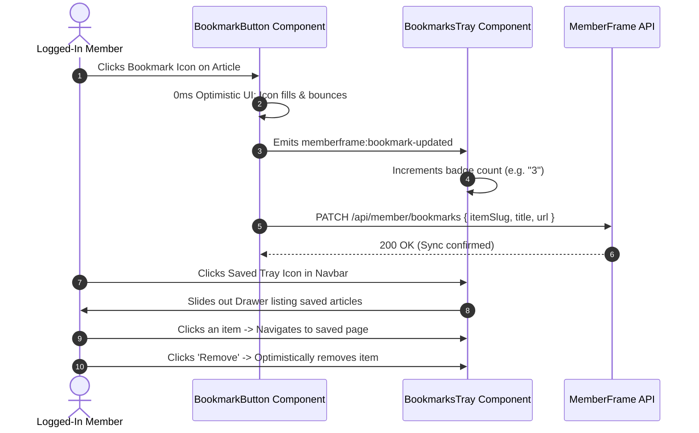

# Feature Plan 10: Member Bookmarking & Saved Items Tray

> **Feature ID**: FP-10  
> **Feature Name**: Member Bookmarking & Saved Items Tray  
> **Status**: Planned (Phase 4 Roadmap)  
> **PRD Cross-Reference**: Feature F14 (`<BookmarkButton>`, `<BookmarksTray>`), Task 7.1 in [IMPLEMENTATION-STATUS.md](file:///d:/project/Framer%20APP/memberframe/docs/IMPLEMENTATION-STATUS.md)  
> **Priority**: Member Retention & Engagement (P2)  

---

## 1. Executive Summary & Market Differentiator

In resource libraries, curation directories, template marketplaces, and multi-lesson academies, visitors frequently find high-value content they want to save for later:

* **Competitor Weakness**: Only **FrameAuth** offers bookmarking, and creators widely report that its implementation is rigid, slow to load, and nearly impossible to style to match Framer templates. Neither **Thenty** nor **Outseta** supports bookmarks.
* **The MemberFrame Advantage**: MemberFrame provides an elegant canvas pair:
  1. `<BookmarkButton>`: A lightweight, optimistically animated save button dropped on any CMS card or article page.
  2. `<BookmarksTray>`: A slide-out drawer or floating tray displaying the member's saved library with instant search and one-click removal.

---

## 2. Visitor Experience & User Flows



### 2.1. Unauthenticated Click Handling
* If an unauthenticated guest clicks `<BookmarkButton>`:
  * The button does **not** fail silently.
  * It triggers the `<MemberAuth>` modal with an informative message: *"Sign in or create an account to save this item to your bookmarks."*
  * Once the member signs in, the item is automatically saved.

### 2.2. Rapid Double-Click & De-duplication
* If a member rapidly double-clicks the button, client-side de-duplication ensures the item is not added twice or corrupted.

---

## 3. Technical Implementation & Components

### 3.1. Authored Canvas Components
File locations:
* `src/canvas-components/BookmarkButton.tsx`
* `src/canvas-components/BookmarksTray.tsx`

#### `<BookmarkButton>` Framer Property Controls:
```typescript
addPropertyControls(BookmarkButton, {
  itemSlug: {
    type: ControlType.String,
    title: "Item Slug",
    defaultValue: "framer-design-system",
  },
  itemTitle: {
    type: ControlType.String,
    title: "Item Title",
    defaultValue: "Framer Design System Template",
  },
  iconShape: {
    type: ControlType.Enum,
    title: "Icon Style",
    options: ["bookmark", "heart", "star"],
    optionTitles: ["Bookmark Ribbon", "Heart", "Star"],
    defaultValue: "bookmark",
  },
  activeFillColor: {
    type: ControlType.Color,
    title: "Filled Color",
    defaultValue: "#5271ff",
  },
  showLabel: {
    type: ControlType.Boolean,
    title: "Show Label",
    defaultValue: false,
  },
  labelText: {
    type: ControlType.String,
    title: "Button Label",
    defaultValue: "Save",
    hidden: (props) => !props.showLabel,
  },
});
```

#### `<BookmarksTray>` Framer Property Controls:
```typescript
addPropertyControls(BookmarksTray, {
  drawerSide: {
    type: ControlType.Enum,
    title: "Drawer Side",
    options: ["right", "left"],
    optionTitles: ["Right Slide-Out", "Left Slide-Out"],
    defaultValue: "right",
  },
  emptyStateText: {
    type: ControlType.String,
    title: "Empty Message",
    defaultValue: "You haven't bookmarked any items yet.",
  },
  maxItems: {
    type: ControlType.Number,
    title: "Max Visible",
    defaultValue: 50,
    min: 10,
    max: 200,
  },
  showBadge: {
    type: ControlType.Boolean,
    title: "Count Badge",
    defaultValue: true,
  },
});
```

### 3.2. Data Contracts (`BookmarkItem`)
```typescript
interface BookmarkItem {
  itemSlug: string;
  title: string;
  url: string;
  savedAt: number; // Unix timestamp
}
```

```
PATCH /api/member/bookmarks
Headers: Cookie: mf_session=...
Body:
  {
    "action": "add" | "remove",
    "item": {
      "itemSlug": "framer-design-system",
      "title": "Framer Design System Template",
      "url": "/templates/design-system"
    }
  }
Response:
  200 OK -> { "bookmarks": BookmarkItem[], "totalCount": 4 }
  401 Unauthorized -> Prompts sign-in
```

### 3.3. Accessibility & Animation Polish
* **Keyboard Navigable**: The tray traps focus when open and closes on the `Escape` key (`role="dialog"` with `aria-modal="true"`).
* **Smooth Micro-Interactions**: The button incorporates a subtle scale pulse (`scale(1.2) -> scale(1.0)`) on save, implemented via CSS keyframes with zero inline styles.

---

## 4. Verification & Testing Checklist

### Automated Unit Tests
* **`test/bookmarks.test.ts`**:
  * Assert that rapid toggling (add, remove, add within 200ms) resolves to the mathematically correct final state without duplicate entries.
  * Assert that unauthenticated calls revert optimistic state and dispatch the auth prompt event.
  * Assert that network timeouts trigger an optimistic rollback with a user-facing toast notification.
  * Assert zero inline styles (`npm run lint:css`).

### Manual Verification in Framer Canvas
1. Place `<BookmarkButton>` on a test blog or template card.
2. Place `<BookmarksTray>` in the navigation bar.
3. As a logged-in member, click the bookmark button:
   * Verify the ribbon fills with the configured accent color instantly.
   * Verify the tray badge count increments by 1.
4. Click the tray button:
   * Confirm the slide-out drawer opens smoothly.
   * Confirm the saved article title, URL link, and delete button appear.
   * Click **Remove**: confirm the item disappears from the tray and the card button un-fills.
5. Test accessibility: confirm hitting `Escape` closes the tray immediately.
