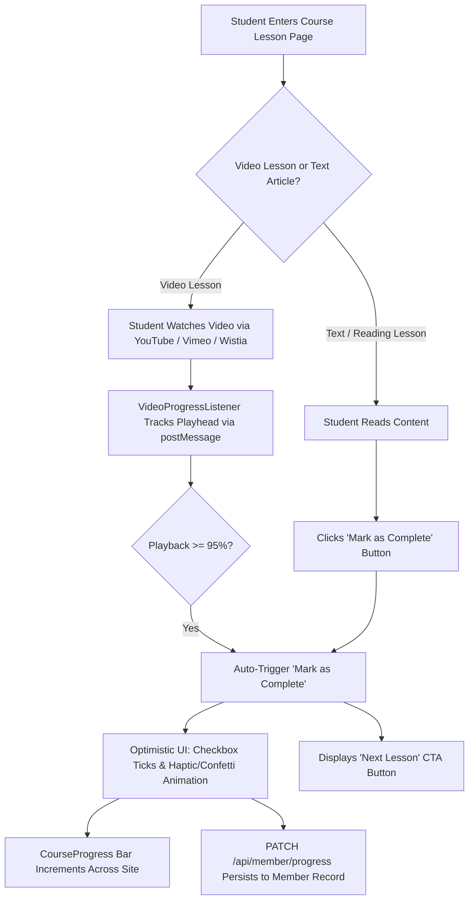

# Feature Plan 11: LMS Mark as Complete (Course Progress Suite)

> **Feature ID**: FP-11  
> **Feature Name**: LMS Mark as Complete & Course Progress Suite  
> **Status**: Planned (Phase 2 Roadmap)  
> **PRD Cross-Reference**: Feature F11 (`Creator LMS Suite`), Tasks 4.1 & 4.2 in [IMPLEMENTATION-STATUS.md](file:///d:/project/Framer%20APP/memberframe/docs/IMPLEMENTATION-STATUS.md)  
> **Priority**: Creator Niches & Course Platform Parity (P1)  

---

## 1. Executive Summary & Problem Solved

Thousands of creators use Framer to build course websites, video academies, and design bootcamps. However, static Framer sites lack interactive learning management tools:

* **The Problem**: On competitor platforms (**Thenty**, **Subscription Payments**, and **Outseta**), there is zero lesson completion tracking. Course students cannot save their place, cannot see what they have finished, and cannot track their progress.
* **Competitor Weakness**: **FrameAuth** provides only a primitive, standalone checkbox with no progress bar visualization, no video integration, and no lesson sequencing.
* **The Solution**: MemberFrame delivers an integrated **LMS Course Trio** on the Framer canvas:
  1. `<LessonChecklist>` / Mark as Complete Button: Manual check-off with celebratory feedback.
  2. `<CourseProgress>`: Real-time animated percentage bar (`80% Complete`) and lessons count.
  3. `<VideoProgressListener>`: Automatically marks lessons complete when lecture videos reach 95% watch time.

---

## 2. User Flows & Student Journey



### 2.1. Standalone "Mark as Complete" Button Flow
1. At the bottom of each lesson or article, the creator drops the `<LessonChecklist>` button.
2. The student clicks **"Mark as Complete"**.
3. The button state changes instantly to a green checkmark: **"Completed"** (with optional micro-animation and sound effect).
4. A prominent **"Next Lesson ->"** button slides into view to guide the student forward.
5. If the student clicks it again, it toggles back to incomplete and reconciles state.

### 2.2. Automated Video Progress Listener Flow (Zero-Click Completion)
1. The student clicks Play on a video lecture embedded from YouTube, Vimeo, or Wistia.
2. The `<VideoProgressListener>` component listens to secure iframe `postMessage` playback events.
3. When the playhead crosses **95% of video duration**, the component automatically marks the lesson complete.
4. The course progress bar updates in real time in the sidebar header without requiring the student to click anything.

---

## 3. Architecture & File Inventory

### 3.1. The LMS Component Trio
| Component File | Role & Placement | Framer Canvas Usage |
| :--- | :--- | :--- |
| `src/canvas-components/LessonChecklist.tsx` | Lesson toggle & module index | Placed at bottom of lesson pages or in course navigation sidebars. |
| `src/canvas-components/CourseProgress.tsx` | Progress visualization | Placed on student dashboards, course headers, or navigation bars. |
| `src/canvas-components/VideoProgressListener.tsx` | Background video tracker | Invisible listener dropped adjacent to video player iframes. |
| `src/utils/playerBridge.ts` | Player postMessage bridge | Normalizes events across YouTube, Vimeo, and Wistia players. |

### 3.2. Framer Property Controls

#### `<LessonChecklist>` Controls
```typescript
addPropertyControls(LessonChecklist, {
  courseId: {
    type: ControlType.String,
    title: "Course ID",
    defaultValue: "course_framer_mastery",
  },
  lessonId: {
    type: ControlType.String,
    title: "Lesson ID",
    defaultValue: "lesson_01",
  },
  nextLessonUrl: {
    type: ControlType.Link,
    title: "Next Lesson",
  },
  buttonText: {
    type: ControlType.String,
    title: "Button Label",
    defaultValue: "Mark as Complete",
  },
  completedText: {
    type: ControlType.String,
    title: "Completed Label",
    defaultValue: "Completed",
  },
  accentColor: {
    type: ControlType.Color,
    title: "Active Color",
    defaultValue: "#5271ff",
  },
});
```

#### `<CourseProgress>` Controls
```typescript
addPropertyControls(CourseProgress, {
  courseId: {
    type: ControlType.String,
    title: "Course ID",
    defaultValue: "course_framer_mastery",
  },
  totalLessons: {
    type: ControlType.Number,
    title: "Total Lessons",
    defaultValue: 12,
    min: 1,
    max: 200,
  },
  barHeight: {
    type: ControlType.Number,
    title: "Bar Height",
    defaultValue: 8,
    min: 4,
    max: 24,
    unit: "px",
  },
  showPercentageText: {
    type: ControlType.Boolean,
    title: "Show Percent",
    defaultValue: true,
  },
  showCountText: {
    type: ControlType.Boolean,
    title: "Show Count",
    defaultValue: true,
  },
});
```

---

## 4. Technical Implementation & Origin Security

### 4.1. Player Bridge & Strict Origin Validation (`playerBridge.ts`)
PRD Section 14.1 Standard S8 mandates that all `postMessage` handlers validate `event.origin` against an allowlist to prevent cross-origin injection:

```typescript
const ALLOWED_PLAYER_ORIGINS = [
  "https://www.youtube.com",
  "https://player.vimeo.com",
  "https://fast.wistia.net",
];

export function setupPlayerBridge(
  onProgress: (percent: number) => void
): () => void {
  function handleMessage(event: MessageEvent) {
    // 1. Strict allowlist validation
    if (!ALLOWED_PLAYER_ORIGINS.includes(event.origin)) return;

    // 2. Normalize player telemetry (Vimeo, YouTube, Wistia)
    const percent = extractWatchPercentage(event.data);
    if (percent !== null) {
      onProgress(percent);
    }
  }

  window.addEventListener("message", handleMessage);
  return () => window.removeEventListener("message", handleMessage);
}
```

### 4.2. Optimistic UI & Sync Contract
* **Zero Latency Feedback**: Clicking the checkbox updates local state in 0 milliseconds.
* **Persistent Network Sync**:
  ```
  PATCH /api/member/progress
  Headers: { Accept: "application/json", Content-Type: "application/json" }
  Cookie:  mf_session=... (HttpOnly)
  Body:
    {
      "courseId": "course_framer_mastery",
      "lessonId": "lesson_01",
      "completed": true
    }
  Response:
    200 OK -> { "percentComplete": 75, "totalCompleted": 9 }
    401 Unauthorized -> Disables sync, invites visitor to sign in
  ```
* **Offline Resilience**: If the student's internet drops while watching a video or completing a lesson, progress is queued in `localStorage` under `mf_lms_offline_queue` and reconciled automatically when connectivity restores.

---

## 5. Verification & Testing Checklist

### Automated Unit Tests
* **`test/playerBridge.test.ts`**:
  * Assert that messages from unapproved origins (e.g. `https://malicious-site.com`) are rejected.
  * Assert that reaching 95% completion triggers the callback **exactly once** per session, not continuously on every frame tick.
  * Assert calculation of `percentComplete` across edge cases (0 of N, N of N, empty list).

### Manual Verification in Framer Canvas
1. **Manual Checkoff**:
   * Insert `<LessonChecklist>` and `<CourseProgress>` on a course page.
   * Click **Mark as Complete**: verify the button toggles to green "Completed", the checkmark icon appears, and the `<CourseProgress>` bar increments smoothly.
   * Toggle it off: verify the progress bar decrements.
2. **Video Auto-Completion**:
   * Embed a test Vimeo or YouTube video iframe next to `<VideoProgressListener>`.
   * Fast-forward playback to the final 10 seconds (crossing the 95% mark).
   * Verify that the lesson auto-completes and updates the checklist without user intervention.
3. **Cross-Page State Persistence**:
   * Navigate to another lesson page in the course: verify `<CourseProgress>` displays the same completed percentage.
