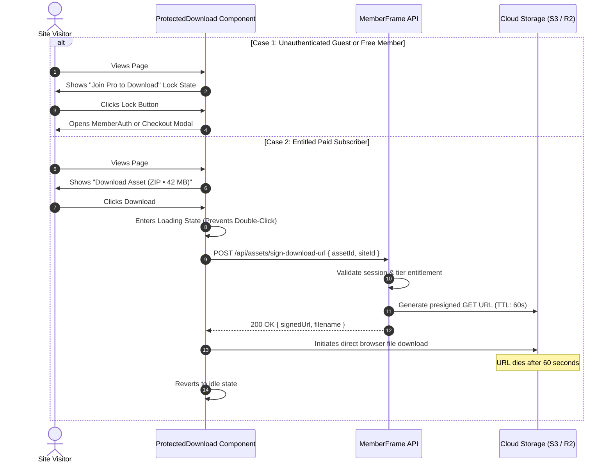

# Feature Plan 12: Upgrade to Download (Expiring Digital Asset Vault)

> **Feature ID**: FP-12  
> **Feature Name**: Upgrade to Download (Expiring Secure Digital Asset Vault)  
> **Status**: Built, 2026-10-17. How it was built, and where it differs from this plan: [18-content-features.md](../development-docs/18-content-features.md)  
> **PRD Cross-Reference**: Feature F10 (`<ProtectedDownload>`), Tasks 5.5 in [IMPLEMENTATION-STATUS.md](file:///d:/project/Framer%20APP/memberframe/docs/IMPLEMENTATION-STATUS.md)  
> **Priority**: Digital Goods & Creator Monetization (P1)  

---

## 1. Executive Summary & Market Vulnerability Solved

Digital creators frequently sell high-value downloadable files on Framer (Figma design files, Notion templates, source code ZIPs, presets, and private PDF ebooks):

* **The Security Flaw in Competitors**: On **FrameAuth** and traditional Framer download setups, creators attach download links to regular buttons. Any visitor with basic browser knowledge can open Chrome DevTools, inspect the button's `href`, copy the direct Google Drive / S3 / CDN link, and share it publicly on Reddit or Discord.
* **The MemberFrame Solution**: MemberFrame introduces `<ProtectedDownload>`, an **Expiring Secure Asset Vault**:
  1. The direct file path and cloud storage bucket are **never exposed** in the client code.
  2. Files are identified strictly by an opaque `assetId`.
  3. Clicking the button initiates an entitlement check and requests a **time-limited presigned URL valid for exactly 60 seconds**.
  4. Once downloaded, the URL expires and cannot be shared or re-used.

---

## 2. Visitor Experience & Gating Flow



---

## 3. Technical Implementation & Architecture

### 3.1. Authored Canvas Component: `<ProtectedDownload>`
File location: `src/canvas-components/ProtectedDownload.tsx`

#### Framer Property Controls:
```typescript
addPropertyControls(ProtectedDownload, {
  assetId: {
    type: ControlType.String,
    title: "Asset ID",
    defaultValue: "asset_figma_system_v2",
  },
  allowedTiers: {
    type: ControlType.Enum,
    title: "Required Tier",
    options: ["signed_in", "tier_1", "tier_2", "vip"],
    optionTitles: ["Any Signed In", "Tier 1: Silver", "Tier 2: Gold", "VIP Member"],
    defaultValue: "tier_1",
  },
  buttonText: {
    type: ControlType.String,
    title: "Download Text",
    defaultValue: "Download Source Files",
  },
  lockedButtonText: {
    type: ControlType.String,
    title: "Locked Text",
    defaultValue: "Upgrade to Download",
  },
  fileMetaLabel: {
    type: ControlType.String,
    title: "File Meta",
    defaultValue: "ZIP • 45.2 MB",
  },
  iconType: {
    type: ControlType.Enum,
    title: "Icon",
    options: ["download", "file", "archive", "code"],
    optionTitles: ["Download Arrow", "Document", "ZIP Archive", "Code"],
    defaultValue: "download",
  },
  accentColor: {
    type: ControlType.Color,
    title: "Button Color",
    defaultValue: "#5271ff",
  },
});
```

### 3.2. Data Contract (`/api/assets/*`)
```
POST /api/assets/sign-download-url
Headers:
  Accept: application/json
  Content-Type: application/json
  Cookie: mf_session=... (HttpOnly)
Body:
  {
    "assetId": "asset_figma_system_v2",
    "siteId": "site_987"
  }
Responses:
  200 OK ->
    {
      "signedUrl": "https://storage.memberframe.com/secure/...&Expires=1760000060&Signature=...",
      "filename": "framer-design-system-v2.zip",
      "expiresInSeconds": 60
    }
  401 Unauthorized -> { "reason": "unauthenticated" }
  403 Forbidden    -> { "reason": "tier_upgrade_required", "requiredTier": "tier_1" }
  404 Not Found    -> { "reason": "asset_not_found" }
```

### 3.3. Security & Anti-Leaking Protections
1. **Zero Storage Bucket Leakage**: The underlying S3 bucket name, R2 endpoint, and raw folder directory are strictly server-side secrets. The client only sees `assetId`.
2. **Strict 60-Second TTL**: The pre-signed URL includes cryptographic signatures that expire 60 seconds after issue. Replaying the URL at 61 seconds results in an immediate AWS/Cloudflare `AccessDenied` error.
3. **Cross-Site Isolation**: The backend verifies that the requested `assetId` strictly belongs to the requesting `siteId`, preventing attackers from downloading another creator's files using valid tokens from a different site.

---

## 4. Verification & Testing Checklist

### Automated Unit Tests
* **`test/protectedDownload.test.ts`**:
  * Assert that replaying a signed URL with timestamp `now > expiresAt` is rejected.
  * Assert that members with insufficient tier rank receive HTTP 403 and never receive a download URL.
  * Assert that button loading state locks out duplicate rapid clicks during signing.
  * Assert that raw storage paths (`s3://...` or `r2.cloudflarestorage.com`) never appear in client bundles.

### Manual Verification in Framer Canvas
1. Insert `<ProtectedDownload>` on a template product page.
2. Configure `Asset ID: test_asset` and `Required Tier: Tier 1: Silver`.
3. In preview as Guest: Confirm button renders locked state (*"Upgrade to Download"*).
4. Click as Guest: Confirm `<MemberAuth>` or checkout modal triggers.
5. Log in as an entitled Silver member: Confirm button renders active state (*"Download Source Files (ZIP • 45 MB)"*).
6. Click download: Verify file begins downloading, inspect network tab to confirm URL carries 60-second expiration signature.
