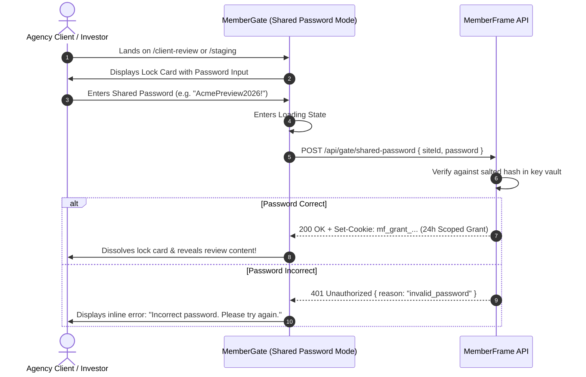

# Feature Plan 13: Shared Password Access (Agency & Client Review Gating)

> **Feature ID**: FP-13  
> **Feature Name**: Shared Password Access (Client Review & Staging Passwords)  
> **Status**: Planned (Phase 3 Roadmap)  
> **PRD Cross-Reference**: Feature F22, Task 6.4 in [IMPLEMENTATION-STATUS.md](file:///d:/project/Framer%20APP/memberframe/docs/IMPLEMENTATION-STATUS.md)  
> **Priority**: Agency & Freelancer Parity (P2)  

---

## 1. Executive Summary & Market Context

Not every gated page on Framer requires an individual membership account:

* **The Agency & Freelancer Dilemma**: Design agencies, template builders, and freelance consultants frequently publish confidential client deliverables, staging prototypes, brand guidelines, or investor presentations on Framer.
* **The Friction of Member Accounts**: Forcing a high-profile corporate client, CEO, or investor to create a personal user account, verify an email OTP code, or set up a password creates enormous friction and looks unprofessional.
* **Competitor Benchmark**: **FrameAuth** supports shared group passwords, and it is one of their most popular agency features. **Thenty** and **Outseta** lack shared password protection entirely.
* **The Solution**: MemberFrame provides a native **Shared Password Gating Mode** built directly into `<MemberGate>`, allowing creators to lock any page or section behind a single password without creating member records.

---

## 2. Visitor Experience & User Flows



### 2.1. Key Operating Rules
1. **Zero Member Records**: Entering a shared password creates **no** member record in the Manage tab and generates no email notifications. It is a pure, frictionless staging gate.
2. **24-Hour Scoped Grant**: Successful validation sets a short-lived scoped cookie (`mf_grant_siteId=...`) valid for 24 hours. The client can refresh the page, close the tab, and return without typing the password again during their session.
3. **Instant Password Revocation**: When the agency finishes the review, changing or rotating the password in the MemberFrame plugin instantly invalidates all active client tokens across the web.

---

## 3. Technical Implementation & Architecture

### 3.1. Mode Toggle in `<MemberGate.tsx>`
Extend `src/canvas-components/MemberGate.tsx` with a gating mode selector:

```typescript
addPropertyControls(MemberGate, {
  gatingMode: {
    type: ControlType.Enum,
    title: "Gating Mode",
    options: ["member_tier", "shared_password"],
    optionTitles: ["Member Subscription", "Shared Password"],
    defaultValue: "member_tier",
  },
  passwordPromptTitle: {
    type: ControlType.String,
    title: "Prompt Title",
    defaultValue: "Client Review Protected",
    hidden: (props) => props.gatingMode !== "shared_password",
  },
  passwordPromptSubtitle: {
    type: ControlType.String,
    title: "Prompt Subtitle",
    defaultValue: "Enter the shared password to view this presentation.",
    hidden: (props) => props.gatingMode !== "shared_password",
  },
});
```

### 3.2. Creator Management in Plugin (`SettingsTab.tsx`)
In MemberFrame's plugin under **Settings > Shared Access**:
* The creator defines the password.
* The password is sent to the backend, salted, and hashed using Argon2id.
* The plugin UI displays only masked bullets (`••••••••`) and a **"Rotate Password"** button; the plaintext password is never retrievable or stored in Framer plugin state.

### 3.3. API Contract
```
POST /api/gate/shared-password
Headers: Accept: application/json, Content-Type: application/json
Body:
  {
    "siteId": "site_agency_456",
    "password": "client-secret-pass"
  }

Responses:
  200 OK -> Set-Cookie: mf_grant_site_agency_456=...; Max-Age=86400; HttpOnly; SameSite=Lax; Secure
            { "valid": true, "expiresInSeconds": 86400 }
  401 Unauthorized -> { "reason": "invalid_password" }
  429 Too Many Requests -> { "reason": "rate_limited", "retryAfterSeconds": 300 }
```

---

## 4. Verification & Testing Checklist

### Automated Unit Tests
* **`test/sharedPassword.test.ts`**:
  * Assert that a shared password grant produces no member database entry.
  * Assert that password rotation increments the site's `grantSalt`, immediately invalidating all existing client cookies.
  * Assert that 5 failed password attempts trigger rate limiting (preventing brute-force guessing).
  * Assert that plaintext passwords never appear in client bundles or network logs.

### Manual Verification in Framer Canvas
1. In the plugin **Settings Tab**, set a test shared password (`FramerPreview2026`).
2. Insert `<MemberGate>` on canvas and set `Gating Mode` to `Shared Password`.
3. In preview as visitor: Confirm the lock card renders a clean password input and submit button.
4. Enter wrong password: Confirm inline error *"Incorrect password"* displays.
5. Enter correct password: Confirm lock dissolves and content reveals.
6. In plugin Settings, click **"Rotate Password"**: Reload preview and confirm the gate immediately locks again.
