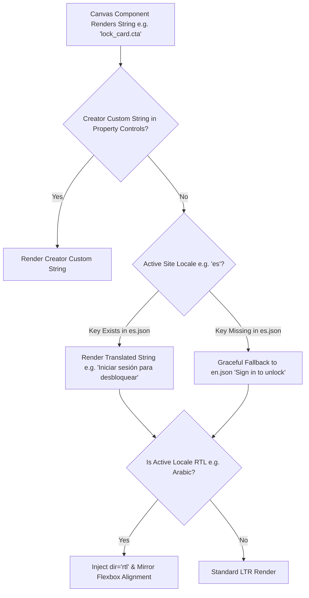

# Feature Plan 14: Multi-Language Localization (Global Multi-Lingual Support)

> **Feature ID**: FP-14  
> **Feature Name**: Multi-Language Localization & RTL Support  
> **Status**: Planned (Phase 4 Roadmap)  
> **PRD Cross-Reference**: Feature F23 (`Multi-Language Localization`), Task 7.5 in [IMPLEMENTATION-STATUS.md](file:///d:/project/Framer%20APP/memberframe/docs/IMPLEMENTATION-STATUS.md)  
> **Priority**: Global Creator Reach & Internationalization (P2)  

---

## 1. Executive Summary & Market Differentiator

Framer is a global design platform with massive user bases in Germany, France, Spain, Latin America, India, Japan, and the Middle East:

* **Competitor Weakness**: **Thenty** and **Outseta** are English-only. **Subscription Payments** only offers manual text field hacks. Only **FrameAuth** supports localization.
* **The Problem**: A German design studio or Spanish course academy cannot use a membership plugin that forces English buttons (*"Sign in to unlock"*, *"Invalid code"*, *"Resend code in 45s"*) onto their local visitors.
* **The MemberFrame Solution**: MemberFrame delivers a turnkey **Multi-Language Architecture**:
  1. Native support for 8 global locales (`en`, `es`, `fr`, `de`, `pt`, `hi`, `ar`, `ja`).
  2. One-click default language selector in the plugin Settings tab.
  3. Right-to-Left (RTL) styling for Arabic and Hebrew.
  4. Seamless locale synchronization with Stripe / Lemon Squeezy checkout sessions.

---

## 2. Localization Architecture & Resolution Pipeline



### 2.1. The Fallback Safety Guarantee
A localization bug should never embarrass a creator:
* If a translation key is missing in a secondary locale (e.g. Hindi or French), the resolver **strictly falls back to standard English**, never rendering ugly developer raw keys like `AUTH_MODAL_ERR_EXPIRED_CODE`.

---

## 3. Technical Implementation & Locale Dictionaries

### 3.1. File Structure (`src/locales/*`)
```
src/
  locales/
    en.json   (English - Base authority)
    es.json   (Spanish)
    fr.json   (French)
    de.json   (German)
    pt.json   (Portuguese)
    hi.json   (Hindi)
    ar.json   (Arabic - RTL)
    ja.json   (Japanese)
```

#### Sample Dictionary: `src/locales/es.json`
```json
{
  "gate": {
    "title": "Contenido exclusivo para miembros",
    "description": "Únete o inicia sesión para acceder a este contenido completo.",
    "cta": "Iniciar sesión para desbloquear",
    "unlocked_note": "Desbloqueado. Eres miembro activo."
  },
  "auth": {
    "headline": "Inicia sesión para continuar",
    "email_placeholder": "nombre@ejemplo.com",
    "continue_email": "Continuar con correo",
    "continue_google": "Continuar con Google",
    "continue_github": "Continuar con GitHub",
    "code_sent": "Enviamos un código de 6 dígitos a",
    "resend_ticker": "Reenviar código en {seconds}s",
    "resend_button": "Reenviar código",
    "invalid_code": "Código incorrecto. Verifica e intenta de nuevo.",
    "expired_code": "El código ha expirado. Solicita uno nuevo."
  },
  "metered": {
    "pill_count": "Artículo {current} de {total} gratuitos este mes",
    "pill_last": "Último artículo gratuito este mes",
    "lock_title": "¿Disfrutando de este artículo?",
    "lock_cta": "Suscríbete para continuar leyendo"
  }
}
```

### 3.2. Right-to-Left (RTL) Layout Adaptation
For Arabic (`ar`) and Hebrew (`he`):
* Root containers automatically receive `dir="rtl"`.
* CSS uses modern logical properties (`margin-inline-start`, `padding-inline-end`, `text-align: start`) instead of hardcoded `left` or `right`.
* Prevents broken lock card alignments or clipped close buttons.

### 3.3. Payment Gateway Checkout Synchronization
When a visitor clicks "Subscribe" or "Upgrade", MemberFrame passes the site's active locale to the backend:
```typescript
POST /api/checkout/session
{
  "tierId": "tier_pro",
  "locale": "es" // Direct Stripe & Lemon Squeezy locale mapping
}
```
Stripe's hosted checkout page and invoices automatically render in Spanish, maintaining complete linguistic continuity across the entire checkout funnel.

---

## 4. In-Plugin Creator Settings (`SettingsTab.tsx`)

Inside MemberFrame's **Settings Tab**:
* **Site Language**: Dropdown selecting from the 8 supported languages.
* **Auto-Detect Visitor Language**: Toggle to inspect `navigator.language` and dynamically present the visitor's native tongue.
* **Per-Component Granular Overrides**: Framer designers can still override any individual string directly in Framer's property controls sidebar for custom brand voice.

---

## 5. Verification & Testing Checklist

### Automated Unit Tests
* **`test/localization.test.ts`**:
  * Assert that every key present in `en.json` exists across all other 7 locale files (Parity check).
  * Assert that missing keys cleanly fall back to English without throwing exceptions.
  * Assert that string interpolation (`{seconds}`, `{count}`) replaces placeholders correctly.
  * Assert that RTL locale (`ar`) injects `dir="rtl"` into rendered markup.

### Manual Verification in Framer Canvas
1. In the MemberFrame Plugin **Settings Tab**, switch site language to **Spanish (`es`)**.
2. Open the **Builder Tab** / Live Preview Studio:
   * Verify that `<MemberGate>` preview displays Spanish copy (*"Contenido exclusivo para miembros"*).
   * Verify that `<MemberAuth>` displays Spanish button labels.
3. Switch site language to **Arabic (`ar`)**:
   * Verify that text direction mirrors to right-to-left.
   * Verify that lock icons and buttons align properly without visual clipping.
