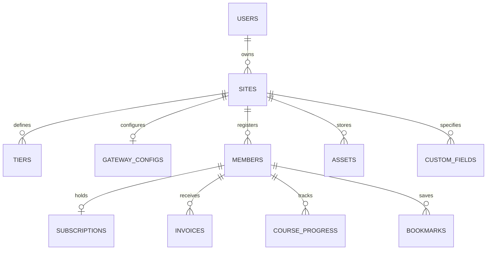
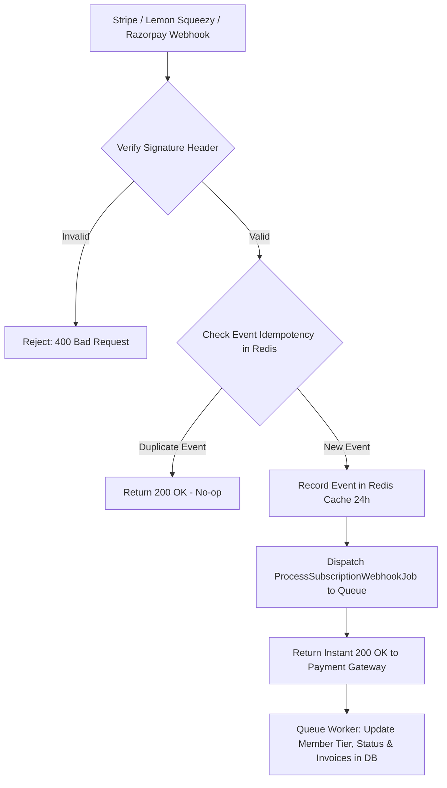
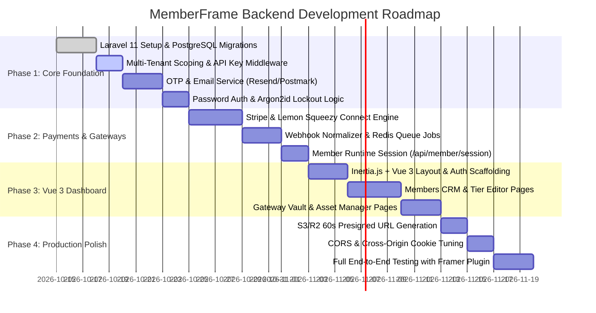

# Feature Plan 15: Backend Architecture & Development Flow (Laravel & Vue)

> **Feature ID**: FP-15  
> **Document Type**: Backend System Architecture, Technical PRD & Implementation Flow  
> **Technology Stack**: Laravel 11.x (PHP 8.3+) + Vue.js 3 (Inertia.js / Pinia) + PostgreSQL 16 + Redis  
> **PRD Cross-Reference**: Sections 6, 10, 11, and 14 of [memberframe-complete-prd.md](file:///d:/project/Framer%20APP/memberframe/docs/memberframe-complete-prd.md), [00-member-data-model.md](file:///d:/project/Framer%20APP/memberframe/docs/development-docs/00-member-data-model.md)  
> **Status**: Comprehensive Specification (Ready for Review & Execution)  

---

## 1. Executive Summary & Stack Justification

MemberFrame's frontend is a high-performance Framer canvas plugin and a collection of 15 canvas-rendered components. However, **all real-world authentication, recurring payment processing, database persistence, and asset security require a 24/7 cloud backend**.

### Why Laravel 11 + Vue 3 (Inertia.js)?
1. **Unmatched Time-to-Market**: Laravel provides out-of-the-box multi-tenancy, rate limiting, encryption, queue workers, and authentication. Building from scratch in Node.js or Go would take 3x to 4x longer.
2. **Inertia.js + Vue 3 for the Creator Web Dashboard**: Inertia eliminates the need to build a complex GraphQL or REST client for the internal dashboard. You build standard Vue 3 components (with Composition API, `<script setup>`, and Tailwind CSS) driven directly by Laravel controllers.
3. **Rock-Solid Background Queues (Redis + Laravel Horizon)**: OTP emails and payment webhooks must never block the client. Laravel's queue engine processes thousands of background jobs with automatic retry, exponential backoff, and failure alerts.
4. **Developer Synergy**: The team already maintains production Laravel projects with Laragon, eliminating any learning curve.

---

## 2. System Topology & Three-Tier Boundary

```
┌────────────────────────────────────────────────────────────────────────────────────────┐
│                              MEMBERFRAME TOPOLOGY                                      │
├───────────────────────────────┬────────────────────────────┬───────────────────────────┤
│ 1. FRAMER PLUGIN & RUNTIME    │ 2. VUE 3 CREATOR DASHBOARD │ 3. LARAVEL 11 CLOUD API   │
│    (Framer Desktop / Canvas)  │    (app.memberframe.com)   │    (api.memberframe.com)  │
├───────────────────────────────┼────────────────────────────┼───────────────────────────┤
│ • In-Plugin 360x640 Cockpit   │ • Multi-Site Overview      │ • PostgreSQL 16 Database  │
│ • Canvas <MemberGate>         │ • Detailed Members CRM     │ • Multi-Tenant Engine     │
│ • Canvas <MemberAuth>         │ • Tier & Pricing Matrix    │ • Stripe/Lemon Webhooks   │
│ • Canvas <MemberDashboard>    │ • Gateway Key Management   │ • 6-Digit OTP Dispatch    │
│ • Canvas <MeteredPaywall>     │ • R2 Asset Vault Uploads   │ • Presigned S3/R2 URLs    │
│ • Canvas LMS & Bookmarks      │ • Revenue & Churn Charts   │ • Redis Queue & Horizon   │
└───────────────────────────────┴────────────────────────────┴───────────────────────────┘
```

---

## 3. Database Schema & Migration Blueprints (PostgreSQL)

The database schema is strictly scoped per site (`site_id`) to ensure complete multi-tenant data isolation:



### 3.1. Core Tables Breakdown

#### 1. `users` (Framer Creators & Agency Accounts)
```sql
CREATE TABLE users (
    id UUID PRIMARY KEY DEFAULT gen_random_uuid(),
    name VARCHAR(255) NOT NULL,
    email VARCHAR(255) UNIQUE NOT NULL,
    password_hash VARCHAR(255) NOT NULL,
    framer_user_id VARCHAR(255) NULL,
    created_at TIMESTAMPTZ DEFAULT NOW(),
    updated_at TIMESTAMPTZ DEFAULT NOW()
);
```

#### 2. `sites` (Tenants: Each Framer Project)
```sql
CREATE TABLE sites (
    id UUID PRIMARY KEY DEFAULT gen_random_uuid(),
    user_id UUID REFERENCES users(id) ON DELETE CASCADE,
    site_name VARCHAR(255) NOT NULL,
    site_url VARCHAR(255) NULL,
    api_key VARCHAR(64) UNIQUE NOT NULL,
    grant_salt VARCHAR(64) NOT NULL DEFAULT gen_random_uuid(),
    shared_password_hash VARCHAR(255) NULL,
    default_locale VARCHAR(10) DEFAULT 'en',
    created_at TIMESTAMPTZ DEFAULT NOW(),
    updated_at TIMESTAMPTZ DEFAULT NOW()
);
```

#### 3. `tiers` (Membership Plans)
```sql
CREATE TABLE tiers (
    id UUID PRIMARY KEY DEFAULT gen_random_uuid(),
    site_id UUID REFERENCES sites(id) ON DELETE CASCADE,
    key VARCHAR(50) NOT NULL, -- 'free_member', 'tier_1', 'tier_2', 'vip'
    name VARCHAR(100) NOT NULL,
    rank INTEGER NOT NULL, -- 0 for Free, 1 for Silver, 2 for Gold, 3 for VIP
    monthly_price_minor INTEGER NULL, -- e.g. 1900 = $19.00
    annual_price_minor INTEGER NULL,
    lifetime_price_minor INTEGER NULL,
    currency VARCHAR(3) DEFAULT 'USD',
    is_active BOOLEAN DEFAULT TRUE,
    created_at TIMESTAMPTZ DEFAULT NOW(),
    updated_at TIMESTAMPTZ DEFAULT NOW(),
    UNIQUE(site_id, key),
    UNIQUE(site_id, rank)
);
```

#### 4. `gateway_configs` (Encrypted Payment Credentials)
```sql
CREATE TABLE gateway_configs (
    id UUID PRIMARY KEY DEFAULT gen_random_uuid(),
    site_id UUID UNIQUE REFERENCES sites(id) ON DELETE CASCADE,
    stripe_publishable_key VARCHAR(255) NULL,
    stripe_secret_key_enc TEXT NULL, -- AES-256-GCM encrypted
    stripe_webhook_secret_enc TEXT NULL,
    lemon_squeezy_api_key_enc TEXT NULL,
    lemon_squeezy_store_id VARCHAR(100) NULL,
    razorpay_key_id VARCHAR(255) NULL,
    razorpay_key_secret_enc TEXT NULL,
    turnstile_site_key VARCHAR(255) NULL,
    turnstile_secret_key_enc TEXT NULL,
    created_at TIMESTAMPTZ DEFAULT NOW(),
    updated_at TIMESTAMPTZ DEFAULT NOW()
);
```

#### 5. `members` (Site Visitors / Subscribers)
```sql
CREATE TABLE members (
    id UUID PRIMARY KEY DEFAULT gen_random_uuid(),
    site_id UUID REFERENCES sites(id) ON DELETE CASCADE,
    email CITEXT NOT NULL,
    email_verified_at TIMESTAMPTZ NULL,
    name VARCHAR(255) NULL,
    avatar_url TEXT NULL,
    password_hash VARCHAR(255) NULL, -- Argon2id. Null for OTP/SSO-only users
    active_tier VARCHAR(50) NOT NULL DEFAULT 'free_member',
    status VARCHAR(20) NOT NULL DEFAULT 'active', -- 'active', 'trialing', 'past_due', 'canceled'
    metadata JSONB DEFAULT '{}'::jsonb, -- Custom profile fields (FP-09)
    failed_login_count INTEGER DEFAULT 0,
    locked_until TIMESTAMPTZ NULL,
    last_login_at TIMESTAMPTZ NULL,
    created_at TIMESTAMPTZ DEFAULT NOW(),
    updated_at TIMESTAMPTZ DEFAULT NOW(),
    deleted_at TIMESTAMPTZ NULL, -- Soft delete
    UNIQUE(site_id, email)
);
```

#### 6. `subscriptions` & `invoices`
```sql
CREATE TABLE subscriptions (
    id UUID PRIMARY KEY DEFAULT gen_random_uuid(),
    site_id UUID REFERENCES sites(id) ON DELETE CASCADE,
    member_id UUID REFERENCES members(id) ON DELETE CASCADE,
    tier_id UUID REFERENCES tiers(id),
    gateway VARCHAR(30) NOT NULL, -- 'stripe', 'lemonsqueezy', 'razorpay'
    gateway_subscription_id VARCHAR(255) NOT NULL,
    status VARCHAR(30) NOT NULL,
    current_period_end TIMESTAMPTZ NOT NULL,
    grace_period_ends_at TIMESTAMPTZ NULL,
    created_at TIMESTAMPTZ DEFAULT NOW(),
    updated_at TIMESTAMPTZ DEFAULT NOW()
);

CREATE TABLE invoices (
    id UUID PRIMARY KEY DEFAULT gen_random_uuid(),
    site_id UUID REFERENCES sites(id) ON DELETE CASCADE,
    member_id UUID REFERENCES members(id) ON DELETE CASCADE,
    gateway_invoice_id VARCHAR(255) NOT NULL,
    amount_minor INTEGER NOT NULL,
    currency VARCHAR(3) DEFAULT 'USD',
    status VARCHAR(20) DEFAULT 'paid',
    pdf_url TEXT NULL,
    paid_at TIMESTAMPTZ DEFAULT NOW()
);
```

#### 7. `otps` (6-Digit Cryptographic Codes)
```sql
CREATE TABLE otps (
    id UUID PRIMARY KEY DEFAULT gen_random_uuid(),
    site_id UUID REFERENCES sites(id) ON DELETE CASCADE,
    email CITEXT NOT NULL,
    code_hash VARCHAR(255) NOT NULL, -- Hashed at rest
    attempts INTEGER DEFAULT 0,
    expires_at TIMESTAMPTZ NOT NULL,
    resend_available_at TIMESTAMPTZ NOT NULL,
    created_at TIMESTAMPTZ DEFAULT NOW()
);
```

---

## 4. Complete REST API Specifications

### 4.1. Member Runtime Endpoints (Published Framer Canvas)
*All responses issue or read HTTP-only `SameSite=None; Secure; HttpOnly` cookies.*

| Method | Endpoint | Purpose | Request Body | Response |
| :--- | :--- | :--- | :--- | :--- |
| `GET` | `/api/member/session` | Resolves member state for `<MemberGate>` | None (Cookie driven) | `200 { member: MemberSessionData, tiers: [] }` or `401` |
| `POST` | `/api/member/send-otp` | Sends 6-digit magic code | `{ email, siteId }` | `200 { expiresInSeconds: 600, resendAfter: 60 }` |
| `POST` | `/api/member/verify-otp` | Verifies code and logs in | `{ email, code, siteId }` | `200 { member }` + `Set-Cookie` |
| `POST` | `/api/member/login-password` | Traditional password sign-in | `{ email, password, siteId }` | `200 { member }` + `Set-Cookie` |
| `POST` | `/api/member/register` | Password account creation | `{ email, password, name, siteId }` | `200 { member }` + `Set-Cookie` |
| `POST` | `/api/member/logout` | Clears session cookie | `{ siteId }` | `200 { success: true }` |
| `GET` | `/api/member/oauth/{provider}` | Starts Google/GitHub OAuth popup | `?siteId=...` | Redirects to Provider OAuth |
| `POST` | `/api/checkout/session` | Creates Stripe/Lemon checkout | `{ tierKey, interval, siteId }` | `200 { checkoutUrl }` |
| `POST` | `/api/member/billing-portal` | Generates single-use Stripe portal | `{ siteId }` | `200 { portalUrl }` |
| `PATCH`| `/api/member/progress` | Syncs LMS course completion | `{ courseId, lessonId, completed }` | `200 { percentComplete }` |
| `PATCH`| `/api/member/bookmarks` | Syncs saved bookmarks | `{ action, item: { slug, title } }` | `200 { bookmarks: [] }` |
| `POST` | `/api/assets/sign-download-url`| Generates 60s presigned S3/R2 link | `{ assetId, siteId }` | `200 { signedUrl, expiresInSeconds: 60 }` |
| `POST` | `/api/gate/shared-password` | Scoped grant for staging review | `{ siteId, password }` | `200 { valid: true }` + 24h Grant Cookie |

### 4.2. Plugin & Site Management Endpoints (Framer Plugin Cockpit)
*Authenticated via Creator Bearer Token or API Key.*

| Method | Endpoint | Purpose |
| :--- | :--- | :--- |
| `GET` | `/api/site/config` | Reads tiers and masked gateway keys for Settings tab |
| `POST` | `/api/site/config` | Updates encrypted gateway keys and site settings |
| `GET` | `/api/site/members` | Paginated member list with search, tier, and status filters |
| `PATCH`| `/api/site/members/{id}` | Updates member tier, grants complimentary access, or revokes |
| `GET` | `/api/site/tiers` | Fetches site tier ladder |
| `POST` | `/api/site/tiers` | Creates a new pricing tier with rank validation |
| `PATCH`| `/api/site/tiers/{id}` | Updates tier pricing, name, and rank |
| `POST` | `/api/site/gateway/validate`| Validates Stripe/Lemon Squeezy secret keys before saving |

---

## 5. Inbound Payment Webhooks Engine

The webhook system normalizes events across gateways into a single idempotent pipeline:



### Supported Webhook Events:
1. `checkout.session.completed` / `subscription_created` -> Sets member `status = "active"`, assigns purchased `active_tier`.
2. `invoice.paid` -> Inserts row into `invoices` table with PDF link.
3. `invoice.payment_failed` -> Enters grace period: `status = "past_due"`, sets `grace_period_ends_at = NOW() + 3 days`.
4. `customer.subscription.deleted` -> Sets `status = "canceled"`, preserves access until `current_period_end`.

---

## 6. Vue 3 + Inertia.js Creator Web Dashboard

Built with **Vue 3 (Composition API `<script setup>`) + Inertia.js + Tailwind CSS**:

### 6.1. Component & Page Structure
```
resources/js/
├── Pages/
│   ├── Auth/
│   │   ├── Login.vue
│   │   └── Register.vue
│   ├── Dashboard/
│   │   └── Overview.vue          (MRR, Active Subscribers, Churn, Quick Stats)
│   ├── Members/
│   │   ├── Index.vue             (Searchable, filterable Member Table)
│   │   └── Show.vue              (Member details, custom fields, invoice history)
│   ├── Tiers/
│   │   ├── Index.vue             (Tier list with drag-and-drop rank ordering)
│   │   └── Partials/TierModal.vue(Create / Edit tier form)
│   ├── Settings/
│   │   ├── Gateways.vue          (Stripe, Lemon Squeezy, Razorpay setup & test)
│   │   ├── CustomFields.vue      (Form builder for custom profile fields)
│   │   └── SharedPassword.vue    (Staging password setup and rotation)
│   └── Assets/
│       └── Index.vue             (R2 / S3 file upload manager, tier assignment)
├── Components/
│   ├── AppLayout.vue             (Sidebar, header, site tenant switcher)
│   ├── StatsCard.vue
│   ├── DataTable.vue
│   └── Badge.vue
└── app.js
```

### 6.2. Key Capabilities of the Web Dashboard
1. **Multi-Site Tenant Switcher**: Agency owners managing 10+ Framer client sites can toggle between sites from a top-nav dropdown with zero re-login.
2. **Comprehensive Member CRM**: Search members by email, name, or custom profile answers (e.g. Company Name). Grant manual VIP status or issue refunds.
3. **Gateway Verification Inspector**: Visual badge showing *"Stripe Connected (Live Mode)"* or *"Test Keys Detected"*.

---

## 7. Step-by-Step Backend Development Flow



### Sprint Breakdown:
* **Sprint 1 (Days 1–5)**: Laravel 11 scaffold, PostgreSQL migrations, multi-tenant middleware, `/api/member/send-otp`, `/api/member/verify-otp`, password auth, and Argon2id lockout rules.
* **Sprint 2 (Days 6–10)**: Stripe / Lemon Squeezy checkout session generation, webhook receiver with Redis idempotency, member session cookie handling (`SameSite=None`), and presigned R2/S3 download URLs.
* **Sprint 3 (Days 11–15)**: Inertia.js + Vue 3 creator dashboard: Overview analytics, Members CRM table with custom fields, and Tier editor.
* **Sprint 4 (Days 16–20)**: Integration testing between the live Laravel backend and the Framer plugin running on localhost / staging Framer canvas.

---

## 8. Verification & QA Standards

### 8.1. Automated Backend Test Suite (Pest / PHPUnit)
```bash
php artisan test
```
* **Authentication Tests**:
  * Assert OTP invalidation after 3 failed attempts.
  * Assert that OTP codes expire at 600 seconds.
  * Assert that account locks for 15 minutes after 5 bad password attempts.
* **Multi-Tenant Isolation Tests**:
  * Assert that Site A cannot access or query members from Site B.
* **Webhook Idempotency Tests**:
  * Send identical Stripe event twice: assert database mutation occurs exactly once.
* **Cookie & CORS Tests**:
  * Assert response headers include `SameSite=None; Secure; HttpOnly`.

### 8.2. Local Testing with Framer Plugin
* Run Laravel local API via Laragon or `php artisan serve`.
* Expose API via **Ngrok** or **Cloudflare Tunnel** (`https://api-dev.memberframe.com`).
* Update `src/config/backend.ts` in the Framer plugin to point to the tunnel.
* Verify live OTP delivery to a real inbox and immediate unlock on the Framer canvas.
