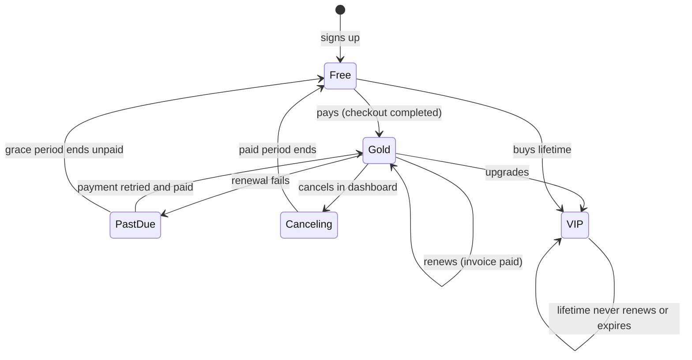
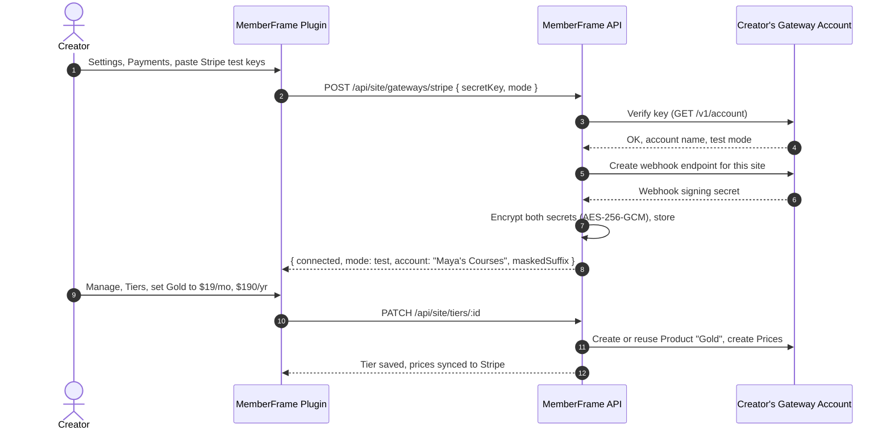
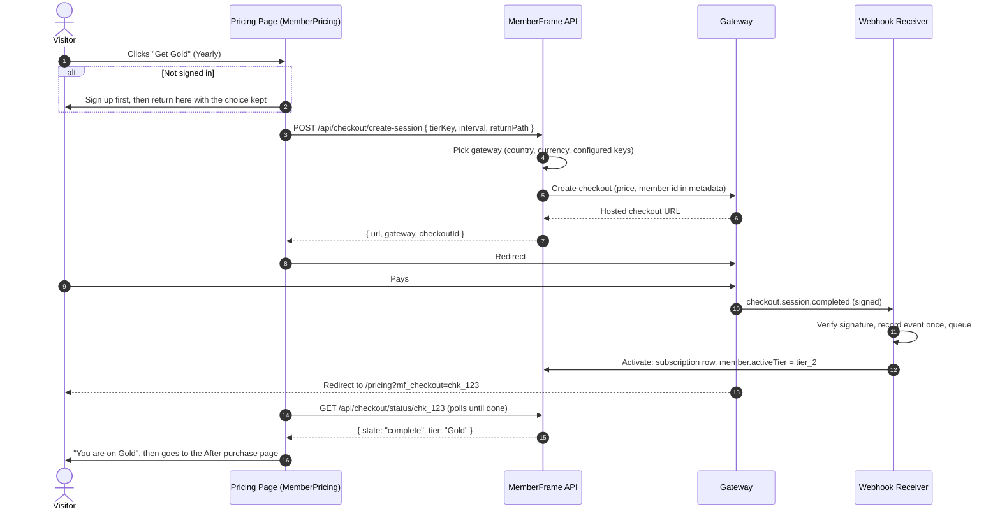

# Feature Plan 16: Payments & Billing

> **Feature ID**: FP-16
> **Feature Name**: Payments & Billing (tri-gateway checkout, paid tiers, subscriptions, test mode)
> **Status**: Built on 2026-10-16, phases 1 to 4: gateways, test and live, lifetime, dashboard billing, grace period, routing by IP with no CDN needed, prices in several currencies, custom tiers on gates (C9), prorated switching, and on-page checkout for Lemon Squeezy and Razorpay. Not built: phase 5. Development doc: [17-payments-and-billing.md](../development-docs/17-payments-and-billing.md). Not yet run against real gateway accounts
> **PRD Cross-Reference**: F02 (tiers), F03 (tri-gateway payments), F06 (billing portal), F18 (grace period), sections 10.4, 10.5, 11, 12.2 of [memberframe-complete-prd.md](../memberframe-complete-prd.md); Phase B3 of [memberframe-backend-prd.md](../memberframe-backend-prd.md); tasks 2.6, 3.1 to 3.3 of [IMPLEMENTATION-STATUS.md](../IMPLEMENTATION-STATUS.md)
> **Priority**: P0. This is the feature that lets a creator earn money, so every paid tier depends on it

---

## 1. What This Feature Is, In Plain Words

The marketing promise has four lines. This is what each one means in the product.

| Promise                                                               | What it means                                                                                                                                 | What a creator does                                              | What a visitor sees                                                                                       |
| :-------------------------------------------------------------------- | :-------------------------------------------------------------------------------------------------------------------------------------------- | :--------------------------------------------------------------- | :-------------------------------------------------------------------------------------------------------- |
| **Multiple payment gateways** (Stripe, Lemon Squeezy, Razorpay / UPI) | The creator connects their **own** gateway accounts. MemberFrame sends each buyer to the gateway that suits them                              | Pastes keys in Settings, Payments                                | A checkout page in their own currency and payment method: cards, Apple Pay, UPI, net banking              |
| **0% platform commission**                                            | Money goes straight from the buyer into the creator's gateway account. MemberFrame never touches it and adds no fee                           | Nothing. It is the default and cannot be turned on               | The price the creator set. Only the gateway's own processing fee applies, which the creator pays as usual |
| **Flexible pricing models**                                           | A tier can be sold monthly, yearly, and as a one-time lifetime purchase, in any combination                                                   | Sets prices on each tier in Manage, Tiers                        | A pricing table with a Monthly / Yearly switch and a Lifetime option                                      |
| **Free staging / test mode**                                          | Every gateway works with its test keys. Test purchases unlock content like real ones, but no money moves and they never mix with live members | Pastes test keys, buys with a test card, checks the gate unlocks | Nothing. Test mode is only used by the creator before launch                                              |

**One sentence:** a creator sets prices on their tiers, connects a gateway, drops a pricing table on a page, and a visitor who pays is moved to that tier automatically, renewed automatically, and moved back to Free when they stop paying.

---

## 2. Two Kinds Of Money. Do Not Mix Them

This is the most common confusion, so it comes first.

|                         | **A. The creator pays MemberFrame**                    | **B. A member pays the creator**                         |
| :---------------------- | :----------------------------------------------------- | :------------------------------------------------------- |
| Who pays whom           | Framer creator pays Framefic for the plugin            | Site visitor pays the creator for a tier                 |
| Price                   | Trial, $4.99/mo, $49.99/yr, $99.99 lifetime (PRD 12.1) | Whatever the creator sets on each tier                   |
| Whose Stripe account    | **Framefic's**                                         | **The creator's own** Stripe, Lemon Squeezy, or Razorpay |
| Where it lives          | PRD F19, Account sheet, `IS_TRIAL` / `IS_LOCKED`       | **This document**                                        |
| What changes on payment | Watermark removed, instance limit lifted               | `Member.activeTier` set to the bought tier               |

This plan is only about **B**. Section 12 says where the two meet: which gateways a creator may use depends on their MemberFrame plan.

---

## 3. Tiers, Explained, And How They Become Paid Plans

### 3.1. What a tier is

A tier is two things at once:

1. **An access level.** It has a `rank`. A higher rank unlocks everything a lower rank unlocks. Gating checks `memberRank >= requiredRank`, so a VIP member passes a Silver gate without the creator configuring anything.
2. **A price list.** It can have a monthly price, a yearly price, and a lifetime price. Any of them can be empty. A tier with no prices at all is free: a visitor gets it by signing up, or the creator grants it by hand.

Your current four tiers, from the screenshot, are already correct as access levels:

| Rank | Tier   | Key           | Today | What to set                                |
| :--- | :----- | :------------ | :---- | :----------------------------------------- |
| 0    | Free   | `free_member` | Free  | Leave free. Every new member lands here    |
| 1    | Silver | `tier_1`      | Free  | Monthly and yearly, for example $9 / $90   |
| 2    | Gold   | `tier_2`      | Free  | Monthly and yearly, for example $19 / $190 |
| 3    | VIP    | `vip`         | Free  | Lifetime only, for example $299            |

They all say "Free" because no price has been entered yet. Open a tier in Manage, Tiers, and fill in the price fields. That part works today and is stored in the `tiers` table.

### 3.2. How a creator uses tiers once payments exist

```
1. Manage, Tiers        Set prices on Silver, Gold, VIP
2. Settings, Payments   Connect Stripe (test keys first)
3. Builder              Insert Member Pricing on a /pricing page
4. Builder              Insert Member Gate around premium sections, Access Tier: Gold
   or Settings, Page Locks: lock /courses to Gold
5. Publish, buy Gold with a test card, watch the gate open
6. Swap test keys for live keys. Launch
```

What happens to a member over time:



**Access is always the tier, never the payment.** Gates, page locks, and the shield only read `activeTier` and `status`. Payments are the thing that changes those two fields. That separation is what lets a creator also grant a tier by hand, for a friend or a refund, without any gateway involved.

### 3.3. What exists today and what does not

| Piece                                                           | State                                                                                     | Where                                                               |
| :-------------------------------------------------------------- | :---------------------------------------------------------------------------------------- | :------------------------------------------------------------------ |
| Tier table with rank, monthly, annual, lifetime price, currency | **Built**                                                                                 | `prisma/schema.prisma` `Tier`, `components/manage/TierEditor.tsx`   |
| Gating by rank                                                  | **Built**                                                                                 | `MemberGate`, Route Shield, `lib/entitlement.ts`                    |
| Manual tier change for a member                                 | **Built**                                                                                 | Manage, Members, flyout                                             |
| Gateway key fields in Settings                                  | **Partly built**: shown as "not available", publishable keys only, secrets are not stored | `integrationRegistry.ts`, `gatewayKeys.ts`, `POST /api/site/config` |
| Plugin `checkoutService.ts`                                     | **Client stub only**, calls an endpoint that does not exist                               | `services/checkoutService.ts`                                       |
| Encrypted secret storage                                        | Not built                                                                                 | Backend PRD B3 item 12                                              |
| Checkout endpoint                                               | Not built                                                                                 |                                                                     |
| Webhook receivers                                               | Not built                                                                                 |                                                                     |
| Subscriptions, payments, invoices tables                        | Not built                                                                                 |                                                                     |
| A pricing table a visitor can click                             | **Not built, and missing from the PRD inventory**                                         | New: `MemberPricing.tsx`, section 9.1                               |
| Billing section in Member Dashboard                             | Placeholder note only                                                                     | `MemberDashboard.tsx` "Billing details arrive with payments"        |
| Grace period and period-end access                              | Not built: the shield and gate only accept `active` and `trialing`                        | Section 10                                                          |
| Custom tier keys on the gate                                    | Blocked by conflict C9: the gate's Access Tier list is fixed                              | Section 9.2                                                         |

---

## 4. The Whole Flow, End To End

### 4.1. Creator setup (once)



### 4.2. A visitor buys



The return page **polls** because the webhook and the redirect race. A buyer can land back on the site a second before the gateway tells MemberFrame they paid. Polling for up to 30 seconds, then showing "Your payment is being confirmed, this can take a minute" is the honest answer.

### 4.3. Renewal, failure, cancel

| Event             | What the gateway sends                                                                                                             | What MemberFrame does                                                                                             |
| :---------------- | :--------------------------------------------------------------------------------------------------------------------------------- | :---------------------------------------------------------------------------------------------------------------- |
| Renewal paid      | Stripe `invoice.paid`, LS `subscription_payment_success`, Razorpay `subscription.charged`                                          | Extend `currentPeriodEnd`, record a payment row, keep `status: active`                                            |
| Renewal failed    | Stripe `invoice.payment_failed`, LS `subscription_payment_failed`, Razorpay `subscription.pending`                                 | `status: past_due`, `gracePeriodEndsAt = now + grace days` (default 3), dunning email. Access continues (F18)     |
| Retry succeeded   | The "paid" events above                                                                                                            | `status: active`, clear grace                                                                                     |
| Gave up           | Stripe `customer.subscription.deleted`, LS `subscription_expired`, Razorpay `subscription.halted`                                  | `activeTier: free_member`, `status: active`, subscription `ended`                                                 |
| Member cancels    | Stripe `customer.subscription.updated` with `cancel_at_period_end`, LS `subscription_cancelled`, Razorpay `subscription.cancelled` | Subscription `canceling`, member keeps the tier until `currentPeriodEnd`, then a scheduled job moves them to Free |
| Refund (one time) | Stripe `charge.refunded`, LS `order_refunded`, Razorpay `refund.processed`                                                         | Lifetime purchase refunded: back to Free. Recurring refunds do not change access by themselves                    |

All of these become **one internal event**, `SubscriptionChanged`, so nothing above the receivers ever branches on the gateway (PRD 10.5).

---

## 5. Gateway By Gateway

Each gateway has a different shape. This table is the reason the backend normalizes them.

|                      | **Stripe**                                                                                    | **Lemon Squeezy**                                                                                                                                                            | **Razorpay**                                                                                                                                     |
| :------------------- | :-------------------------------------------------------------------------------------------- | :--------------------------------------------------------------------------------------------------------------------------------------------------------------------------- | :----------------------------------------------------------------------------------------------------------------------------------------------- |
| Best for             | Global cards, Apple Pay, Google Pay                                                           | EU and anywhere VAT matters: it is the Merchant of Record and files the tax                                                                                                  | India: UPI, UPI Autopay, net banking, RuPay                                                                                                      |
| Creator pastes       | Secret key (`sk_` or restricted `rk_`). The publishable key is not needed for hosted checkout | API key, Store ID                                                                                                                                                            | Key ID (`rzp_`), Key Secret, Webhook Secret                                                                                                      |
| Products and prices  | **MemberFrame creates them** from the tier prices through the API                             | **The creator creates them** in Lemon Squeezy (its API cannot create products). MemberFrame lists the store's variants and the creator links each one to a tier and interval | **MemberFrame creates Plans** from tier prices through the API. One-time uses an Order                                                           |
| Webhook setup        | **Automatic**: MemberFrame registers its endpoint with the creator's key                      | **Automatic**: MemberFrame registers its endpoint with the creator's key                                                                                                     | **Manual**: creator adds the URL in the Razorpay dashboard and pastes the secret. The plugin shows the URL with a copy button and the event list |
| Checkout             | Hosted Checkout Session URL                                                                   | Hosted checkout URL (overlay later)                                                                                                                                          | Phase 2: hosted subscription link (`short_url`) or Payment Link. Phase 3: on-site Checkout.js modal with UPI QR                                  |
| Member self-service  | Stripe Billing Portal session                                                                 | Subscription's `customer_portal` URL                                                                                                                                         | No hosted portal: cancel through MemberFrame, card update through the subscription link                                                          |
| Test mode            | `sk_test_` keys                                                                               | Test mode API key (made in test mode)                                                                                                                                        | `rzp_test_` keys                                                                                                                                 |
| Test payment         | Card `4242 4242 4242 4242`, any future date, any CVC                                          | Card `4242 4242 4242 4242` in test mode                                                                                                                                      | UPI ID `success@razorpay`, or test card `4111 1111 1111 1111`                                                                                    |
| Currency             | Any of 135                                                                                    | The variant's currency                                                                                                                                                       | INR. Other currencies only if the creator's account has international payments enabled                                                           |
| Upgrade or downgrade | Change the subscription item, prorated                                                        | Change the subscription's variant                                                                                                                                            | Update the subscription's plan, applied at the next cycle                                                                                        |

### 5.1. What "price sync" means

A tier price is the source of truth in MemberFrame. A gateway needs its own object to charge against.

- **Stripe**: one Product per tier, one Price per interval. Stripe Prices cannot be edited, so a price change creates a new Price and archives the old one. **Existing subscribers keep the old price** (grandfathering), new buyers get the new one. The plugin says so when a price is edited: "Current members keep their price. New members pay the new one."
- **Razorpay**: one Plan per tier and interval. Same rule: a new price makes a new Plan.
- **Lemon Squeezy**: no sync. The creator links variants. If the variant price and the tier price disagree, the plugin shows a warning on the tier, because the buyer pays the Lemon Squeezy price.

The mapping is stored in `tier_gateway_prices` (section 7), never on the tier itself, so adding a fourth gateway later is a new row, not a migration.

---

## 6. Which Gateway A Buyer Gets

### 6.1. Routing rule

Server side, never in the browser: a country chosen by the browser is a country the browser can lie about, and the gateway choice has tax consequences (F03).

```
country = IP lookup (CDN header if present, else a local GeoLite2 database)

if geolocation routing is off:
    use the gateway the creator marked as Default
elif country == IN and Razorpay is connected and the price has an INR amount:
    Razorpay
elif country in EU or UK and Lemon Squeezy is connected and a variant is linked:
    Lemon Squeezy
else:
    Stripe if connected, otherwise the first connected gateway that has this price

if nothing can sell this tier and interval:
    409 no_gateway, and the pricing table hides that option
```

Every fallback is logged with the reason, so "why did an Indian buyer get Stripe" has an answer in the logs.

### 6.2. Currencies

A tier today has one `currency`. Razorpay realistically needs INR, and a $19 price is not a sensible INR price after conversion.

**Plan:** prices move from three columns on `tiers` to rows in `tier_prices`, one per tier, interval, and currency. The tier editor shows the base currency first and an "Add INR price" action when Razorpay is connected. Routing to Razorpay requires an INR row. The three existing columns are migrated into rows and kept as read-only for one release, then dropped.

---

## 7. Data Model

New tables, all owned by the backend. Money is integer minor units, times are UTC (PRD 11.2).

```prisma
/// One row per site and gateway and mode. Secrets encrypted with AES-256-GCM
/// under a key from the environment. The read shape never includes them.
model GatewayConfig {
  id                 String   @id @default(uuid(7))
  siteId             String
  gateway            String   // stripe | lemonsqueezy | razorpay
  mode               String   // test | live
  publicId           String?  // Stripe account id, LS store id, Razorpay key id
  secretEncrypted    Bytes
  webhookSecretEnc   Bytes?
  webhookEndpointId  String?  // so it can be removed on disconnect
  accountName        String?  // shown in the plugin, "Maya's Courses"
  verifiedAt         DateTime?
  @@unique([siteId, gateway, mode])
}

/// The price list. Replaces the three price columns on Tier.
model TierPrice {
  id          String @id @default(uuid(7))
  tierId      String
  interval    String // month | year | lifetime
  currency    String @db.Char(3)
  amountMinor Int
  isActive    Boolean @default(true)
  @@unique([tierId, interval, currency])
}

/// What each gateway charges against, per mode.
model TierGatewayPrice {
  id             String @id @default(uuid(7))
  tierPriceId    String
  gateway        String
  mode           String
  externalId     String // Stripe price id, Razorpay plan id, LS variant id
  externalProductId String?
  archivedAt     DateTime?
  @@unique([tierPriceId, gateway, mode, externalId])
}

/// A checkout MemberFrame started. Binds the gateway's session to a member and tier,
/// and is what the return page polls.
model Checkout {
  id          String @id @default(uuid(7))
  siteId      String
  memberId    String
  tierKey     String
  interval    String
  gateway     String
  mode        String
  externalId  String   // Stripe session id, LS checkout id, Razorpay subscription or order id
  state       String   // open | complete | expired | failed
  returnPath  String
  createdAt   DateTime @default(now())
  completedAt DateTime?
}

model Subscription {
  id                 String @id @default(uuid(7))
  siteId             String
  memberId           String
  tierKey            String
  interval           String   // month | year | lifetime
  gateway            String
  mode               String
  externalId         String   // gateway subscription id, or order id for lifetime
  externalCustomerId String?
  status             String   // active | past_due | canceling | ended
  currentPeriodEnd   DateTime? // null for lifetime
  gracePeriodEndsAt  DateTime?
  cancelAtPeriodEnd  Boolean @default(false)
  amountMinor        Int
  currency           String
  createdAt          DateTime @default(now())
  endedAt            DateTime?
  @@unique([gateway, externalId])
}

/// Every successful charge. Feeds lifetime spend and the dashboard's history.
model Payment {
  id             String @id @default(uuid(7))
  siteId         String
  memberId       String
  subscriptionId String?
  gateway        String
  mode           String
  externalId     String
  amountMinor    Int
  currency       String
  status         String  // paid | refunded
  invoiceUrl     String?
  paidAt         DateTime
  @@unique([gateway, externalId])
}

/// Idempotency. Insert first; a duplicate insert means "already handled, answer 200".
/// Conflict C22 resolution: a table, not a cache.
model WebhookEvent {
  id          String @id @default(uuid(7))
  gateway     String
  eventId     String
  siteId      String?
  type        String
  receivedAt  DateTime @default(now())
  processedAt DateTime?
  error       String?  @db.Text
  @@unique([gateway, eventId])
}
```

Also on `Member`: `currentPeriodEnd` and `gracePeriodEndsAt` are **read from the member's active subscription** when the session is built, not copied onto the member row. One source of truth.

**Test and live never mix.** Every row above carries `mode`. A member who bought in test mode has a `mode: test` subscription. When the site switches to live, test subscriptions stop granting access (section 11).

---

## 8. API

### 8.1. Creator endpoints (plugin, creator session)

| Method | Path                                       | Purpose                                                                                                                    |
| :----- | :----------------------------------------- | :------------------------------------------------------------------------------------------------------------------------- |
| GET    | `/api/site/gateways`                       | Connected gateways per mode: `{ connected, mode, accountName, maskedSuffix, webhookOk }`. Never a secret                   |
| PUT    | `/api/site/gateways/:gateway`              | Connect or replace keys. Verifies against the gateway, registers the webhook where the gateway allows it, encrypts, stores |
| DELETE | `/api/site/gateways/:gateway?mode=`        | Disconnect. Removes the webhook endpoint MemberFrame created. Refused while live subscriptions exist on it, with a count   |
| POST   | `/api/site/gateways/:gateway/test-webhook` | Asks the creator to trigger a test event and reports whether it arrived. The "is my webhook set up" check                  |
| GET    | `/api/site/gateways/lemonsqueezy/variants` | The store's products and variants, for linking                                                                             |
| PUT    | `/api/site/payments`                       | `defaultGateway`, `autoDetectGeolocation`, `mode` (test or live), `graceDays`, `afterPurchasePath`                         |
| PATCH  | `/api/site/tiers/:id/prices`               | Set the price list. Syncs Stripe Prices and Razorpay Plans, returns per-gateway sync status                                |
| GET    | `/api/site/members/:id/billing`            | A member's subscriptions and payments, for the Manage flyout                                                               |

### 8.2. Member endpoints (published site, member cookie)

| Method | Path                               | Purpose                                                                                                                       |
| :----- | :--------------------------------- | :---------------------------------------------------------------------------------------------------------------------------- |
| GET    | `/api/public/pricing`              | Tiers with active prices for the current mode, and which intervals can actually be bought. Public, cached 60s. No gateway ids |
| POST   | `/api/checkout/create-session`     | `{ tierKey, interval, returnPath }`. Signed in only. Returns `{ url, gateway, checkoutId }`                                   |
| GET    | `/api/checkout/status/:checkoutId` | `{ state, tierName }`. Only the member who started it can read it                                                             |
| GET    | `/api/member/billing`              | Plan, interval, amount, renewal date, `cancelAtPeriodEnd`, last 12 payments                                                   |
| POST   | `/api/member/billing/portal`       | Single-use link to the gateway's own portal (Stripe, LS)                                                                      |
| POST   | `/api/member/billing/cancel`       | Cancel at period end. Used for Razorpay, and as a fallback                                                                    |
| POST   | `/api/member/billing/resume`       | Undo a pending cancel before the period ends                                                                                  |
| POST   | `/api/member/billing/change`       | `{ tierKey, interval }`. Upgrade or downgrade an existing subscription (Phase 4)                                              |

### 8.3. Webhooks (gateway to MemberFrame)

| Path                                            | Verification                                                                       |
| :---------------------------------------------- | :--------------------------------------------------------------------------------- |
| `POST /api/webhooks/stripe/:siteId/:mode`       | `Stripe-Signature` header, the site's stored webhook secret, 5 minute tolerance    |
| `POST /api/webhooks/lemonsqueezy/:siteId/:mode` | `X-Signature`, HMAC SHA256 of the raw body with the site's webhook secret          |
| `POST /api/webhooks/razorpay/:siteId/:mode`     | `X-Razorpay-Signature`, HMAC SHA256 of the raw body with the site's webhook secret |

The order inside every receiver is fixed, and it is the backend PRD 7.4 rule:

1. Read the **raw** body. The route must be mounted before the JSON body parser, or the signature never matches.
2. Verify the signature. Fail: 400, nothing logged beyond the fact.
3. Insert into `webhook_events`. Unique conflict: return 200, do nothing.
4. Return 200 quickly.
5. Process: map to `SubscriptionChanged`, apply in one transaction, mark `processedAt`. A processing error stores `error` and is retried by a job, not by the gateway.

---

## 9. What Changes In The Product

### 9.1. New canvas component: `<MemberPricing>`

The missing piece. Without it, nothing on a site can start a checkout. Built like the other four: shared appearance block, Theme, Colors, Typography, Layout, Labels, fixed size.

**Renders** one card per paid tier, from `GET /api/public/pricing`:

- Interval switch: Monthly / Yearly, with "Save 16%" computed from the two prices. Hidden when no tier has both
- Each card: tier name, price, interval, a features list (a property control per tier, one line per feature), and a button
- Lifetime: its own card or a third switch option, a property control picks
- The member's current tier shows "Current plan" and no button
- A higher tier than the member's shows "Upgrade", a lower one "Switch" (Phase 4; until then "Manage billing" opens the dashboard)

**Button behaviour:**

| Visitor              | Button does                                                                                                                                                                                                |
| :------------------- | :--------------------------------------------------------------------------------------------------------------------------------------------------------------------------------------------------------- |
| Signed out           | Goes to the sign up page with the choice kept in sessionStorage (`memberframe:checkout-intent`). After sign up and confirmation, MemberAuth returns to the pricing page and the checkout starts on its own |
| Signed in, Free      | `POST /api/checkout/create-session`, redirect to the gateway                                                                                                                                               |
| Signed in, paid      | Upgrade or manage, as above                                                                                                                                                                                |
| On the Framer canvas | Nothing. Shows prices from the plugin's tier list so the creator can design with real numbers                                                                                                              |

**Return handling:** on `?mf_checkout=` in the URL, the component replaces itself with a confirming state, polls the status, calls `notifySessionUpdated(true)` (which also clears the Route Shield's session cache), then goes to the After purchase page.

**Property controls:** Interval Default, Show Lifetime, Highlight Tier (adds a "Most popular" badge), Features per tier, Button Labels, After Purchase Page, plus the shared appearance groups.

### 9.2. Member Gate: Access Tier from the site's real tiers (conflict C9)

Today the gate's Access Tier is a fixed list: Any Signed In, Free, Tier 1, Tier 2, VIP. A creator who names tiers "Starter, Pro, Team" cannot pick them. The generator already writes each gate's file, so at deploy it emits the site's actual tier keys and names as the `Enum` options. This must land before custom tier keys are offered.

The gate's lock card button changes too: "Upgrade to unlock" goes to the pricing page (a new Settings path, **Pricing page**, default `/pricing`) instead of the sign in page, and passes the required tier so the pricing table highlights it.

### 9.3. Member Dashboard: real billing

Replaces the placeholder "Billing details and invoices arrive with payments" note:

- Plan name, price, interval, renewal date ("Renews on 14 Nov 2026"), or "Lifetime access" with no date
- Pending cancel: "Your plan ends on 14 Nov 2026" and a **Resume** button
- `past_due`: a warning, "Your latest payment was unsuccessful. Update your billing details within 3 days to keep your access.", and an **Update payment** button (F18)
- **Manage billing** button: gateway portal for Stripe and Lemon Squeezy
- **Cancel plan**: confirmation step, then cancel at period end
- Payment history: date, amount, a receipt link where the gateway gives one

New property controls: Billing Section (on/off), Show Payment History, Allow Cancel.

### 9.4. Plugin

**Settings, Payments** (the existing Payments sub-tab, rebuilt):

```
Mode            [ Test | Live ]          Test purchases never unlock live content
-------------------------------------------------------------------------------
Stripe          Connected, test          Maya's Courses  •••• 4fQ2     [Manage]
Lemon Squeezy   Not connected                                          [Connect]
Razorpay        Connected, test          Webhook not received yet      [Check]
-------------------------------------------------------------------------------
Default gateway        [ Stripe v ]
Route by buyer location  [x]
Grace period           [ 3 ] days
After purchase page    [ /dashboard v ]
Pricing page           [ /pricing v ]
```

Each gateway card opens a short form with only that gateway's fields, a help tooltip on every field (the InfoTip pattern), the webhook URL with a copy button where setup is manual, and a status line. Keys are verified on save, errors show under the field, never as a banner (F03).

**Manage, Tiers:** the tier editor gets a price list (interval, currency, amount), a per-gateway sync line under each price ("Stripe: synced. Razorpay: needs an INR price"), and for Lemon Squeezy a variant picker. Deleting a tier with live subscribers is refused with the count.

**Manage, Members:** real `lifetimeSpend`, the gateway, the plan interval, the renewal date, and a **Comp** action: grant a tier for free with an optional end date, recorded as a `gateway: manual` subscription so it shows up like any other.

**Home tab checklist** gains "Connect a payment gateway" and "Add a pricing table".

---

## 10. Entitlement Changes

PRD 11.3 already specifies the rule, and three places implement it: the backend (`lib/entitlement.ts`), the Route Shield, and the canvas gate. Today all three accept only `active` and `trialing`. They change together, and the parity test (`test/parity.test.ts`) must cover the new cases:

```typescript
const statusOk =
  status === "active" ||
  status === "trialing" ||
  (status === "past_due" && now < gracePeriodEndsAt) ||
  (status === "canceled" && now < currentPeriodEnd);
```

Member status keeps the PRD's four values (`active`, `trialing`, `past_due`, `canceled`). A member whose subscription is `canceling` has member status `canceled` with a future `currentPeriodEnd`, which is exactly the case this line lets through.

The session payload gains `currentPeriodEnd` and `gracePeriodEndsAt` (null when not applicable) so the shield and the gate can apply this without another request.

A scheduled job runs every 5 minutes and ends what has run out: `canceled` past `currentPeriodEnd`, and `past_due` past `gracePeriodEndsAt`. It moves the member to Free and emits `member.downgraded` (F24). The job is a safety net: the gateway's own "ended" webhook normally arrives first.

---

## 11. Test Mode And Free Staging

- **One switch per site:** Settings, Payments, Mode. Test is the default for a new site.
- **Keys per mode:** a gateway can hold test keys and live keys at once. The mode switch picks which set checkouts use. Switching to live does not need the keys to be re-entered.
- **Live needs live keys.** Switching to live is refused, with the reason, until at least one gateway has verified live keys and its webhook has been received once.
- **Test buyers are marked.** Subscriptions created in test mode carry `mode: test`. In live mode they grant nothing, and Manage, Members shows them with a "Test" badge and a "Clear test data" action.
- **Free on every MemberFrame plan.** Test mode with all three gateways works on the MemberFrame trial. That is the "free staging" promise: a creator can build and verify the whole paid flow before paying anything. Live payments follow the PRD entitlement: Stripe on trial, all three on paid plans (decision D3).
- **A sandbox badge on the site.** In test mode, `MemberPricing` shows a small "Test mode" pill on the canvas and on the published site, so a creator never launches with test keys by accident.

---

## 12. Zero Platform Commission, Guaranteed

- No Stripe Connect, no `application_fee_amount`, no LS affiliate split, no Razorpay Route transfer. The creator's own keys charge the buyer directly, so the money never passes through Framefic.
- `test/checkoutService.test.ts` already scans the plugin's payment files for fee-shaped identifiers. The backend gets the same test over `src/services/payments/` and `src/routes/webhooks/`: any identifier containing `application_fee`, `platformFee`, `commission`, or `transfer_data` fails the build.
- The only fees a creator pays are the gateway's own (Stripe's card fee, Lemon Squeezy's Merchant of Record fee, Razorpay's MDR). The plugin says so once, next to the gateway list.

---

## 13. Security

| Rule                                         | How                                                                                                                                                                                         |
| :------------------------------------------- | :------------------------------------------------------------------------------------------------------------------------------------------------------------------------------------------ |
| Secrets never leave the server               | Encrypted at rest (AES-256-GCM, key from `PAYMENTS_ENCRYPTION_KEY`, 32 bytes, rotated with a key id prefix). Read shapes are separate types with no secret field, so a leak is a type error |
| Webhooks are authentic                       | Signature on the raw body before anything is parsed. Per-site secrets, so one site's secret cannot sign another's events                                                                    |
| Webhooks are applied once                    | `webhook_events` unique insert (C22)                                                                                                                                                        |
| Checkout cannot be pointed at another member | The member id comes from the session cookie, never from the request body. `returnPath` must pass `isSafeSitePath`                                                                           |
| A buyer cannot pick a cheaper price          | The client sends `tierKey` and `interval` only. The server looks up the price. No amount ever comes from the browser                                                                        |
| Status polling leaks nothing                 | `GET /api/checkout/status/:id` only answers the member who created it, and returns no gateway ids                                                                                           |
| Disconnect is safe                           | Refused while live subscriptions depend on the gateway. Removing keys would orphan their renewals                                                                                           |
| Rate limits                                  | `create-session`: 10 per member per hour. Portal and cancel: 20 per member per hour                                                                                                         |
| Logs                                         | No card data ever reaches MemberFrame. Gateway payloads are logged with ids only                                                                                                            |

---

## 14. Build Plan

Each phase ends with something a creator can actually use. Phases 1 to 3 are the PRD's F03 promise; 4 and 5 make it complete.

### Phase 1: Stripe, recurring, test mode (the smallest real thing)

**Outcome:** a creator connects Stripe test keys, sets a monthly and yearly price on Gold, drops a pricing table, and a test purchase unlocks a Gold gate on the published site.

| #    | Task                                                                                                                                                                                     | Side        | Files                                                                             |
| :--- | :--------------------------------------------------------------------------------------------------------------------------------------------------------------------------------------- | :---------- | :-------------------------------------------------------------------------------- |
| 1.1  | Encryption helper with key id prefix, and its tests                                                                                                                                      | API         | `src/lib/secretBox.ts`                                                            |
| 1.2  | Migrations: `gateway_configs`, `tier_prices`, `tier_gateway_prices`, `checkouts`, `subscriptions`, `payments`, `webhook_events`. Migrate the three tier price columns into `tier_prices` | API         | `prisma/schema.prisma`, migration                                                 |
| 1.3  | Stripe client wrapper: verify key, create webhook endpoint, sync product and prices, create checkout session                                                                             | API         | `src/services/payments/stripe.ts`                                                 |
| 1.4  | `GET/PUT/DELETE /api/site/gateways`, `PUT /api/site/payments`                                                                                                                            | API         | `src/routes/payments.ts`                                                          |
| 1.5  | `PATCH /api/site/tiers/:id/prices` with Stripe sync                                                                                                                                      | API         | `src/routes/site.ts`                                                              |
| 1.6  | `GET /api/public/pricing`, `POST /api/checkout/create-session`, `GET /api/checkout/status/:id`                                                                                           | API         | `src/routes/checkout.ts`                                                          |
| 1.7  | Stripe webhook receiver: raw body, signature, idempotency, `checkout.session.completed`, `customer.subscription.updated/deleted`, `invoice.paid`, `invoice.payment_failed`               | API         | `src/routes/webhooks/stripe.ts`, `src/services/payments/apply.ts`                 |
| 1.8  | Session payload: `currentPeriodEnd`, `gracePeriodEndsAt`. Entitlement update in all three places and the parity test                                                                     | API, plugin | `lib/entitlement.ts`, `routes/shield.ts`, `MemberGate.tsx`, `test/parity.test.ts` |
| 1.9  | Settings, Payments rebuilt: mode switch, Stripe card, default gateway, grace days, after purchase and pricing pages                                                                      | Plugin      | `components/settings/PaymentsPanel.tsx`, `IntegrationCard.tsx`                    |
| 1.10 | Tier editor price list with sync status                                                                                                                                                  | Plugin      | `components/manage/TierEditor.tsx`                                                |
| 1.11 | `<MemberPricing>` with checkout, sign up hand-off, return polling                                                                                                                        | Canvas      | `canvas-components/MemberPricing.tsx`, generator, Builder entry                   |
| 1.12 | MemberAuth: resume a stored checkout intent after sign up                                                                                                                                | Canvas      | `MemberAuth.tsx`                                                                  |
| 1.13 | Development doc                                                                                                                                                                          | Docs        | `docs/development-docs/16-payments.md`                                            |

**Exit criteria:**

- [ ] A test purchase on the published site moves the member to Gold within 10 seconds of paying
- [ ] Replaying the same Stripe event changes nothing (checked with `stripe events resend`)
- [ ] A forged webhook with a wrong signature is refused and changes nothing
- [ ] Cancel in the Stripe dashboard keeps access until the period end, then the member is Free
- [ ] No secret appears in any response, log line, or plugin state
- [ ] The fee scan finds nothing

### Phase 2: Lifetime, dashboard billing, grace period

| #   | Task                                                                                                  | Side        |
| :-- | :---------------------------------------------------------------------------------------------------- | :---------- |
| 2.1 | One-time checkout (`mode: payment`) for lifetime prices; refund handling                              | API         |
| 2.2 | `GET /api/member/billing`, portal, cancel, resume                                                     | API         |
| 2.3 | Member Dashboard billing section, cancel flow, past due banner                                        | Canvas      |
| 2.4 | Grace period (F18): past due handling, dunning emails at day 0 and the last day, scheduled expiry job | API         |
| 2.5 | Manage, Members: real spend, interval, renewal date, Comp action                                      | Plugin, API |
| 2.6 | Gate lock card goes to the pricing page with the required tier                                        | Canvas      |

**Exit criteria:** a lifetime buyer has no renewal date and no cancel button; a failed test renewal (Stripe test clock) shows the banner, keeps access for 3 days, then removes it; a refunded lifetime purchase returns the member to Free.

### Phase 3: Razorpay and Lemon Squeezy, routing, live mode

| #   | Task                                                                                                               | Side             |
| :-- | :----------------------------------------------------------------------------------------------------------------- | :--------------- |
| 3.1 | Razorpay: verify keys, Plans sync, subscription links, Orders for lifetime, webhook receiver, INR prices           | API              |
| 3.2 | Lemon Squeezy: verify keys, variant listing and linking, checkouts with member id in custom data, webhook receiver | API              |
| 3.3 | Gateway router with country lookup, fallbacks, and logged reasons                                                  | API              |
| 3.4 | Gateway cards for Razorpay (manual webhook with copy button and check) and Lemon Squeezy (variant picker)          | Plugin           |
| 3.5 | Live mode switch with its preconditions; test data badge and clearing                                              | Plugin, API      |
| 3.6 | Gate Access Tier from the site's real tiers (C9)                                                                   | Plugin generator |

**Exit criteria:** an Indian IP buys with `success@razorpay` UPI in test mode and is moved to the tier; an EU IP is sent to Lemon Squeezy; with routing off, everyone gets the default gateway; switching to live is refused without verified live keys.

### Phase 4: Upgrades, downgrades, on-site UPI

| #   | Task                                                                                                                  |
| :-- | :-------------------------------------------------------------------------------------------------------------------- |
| 4.1 | `POST /api/member/billing/change`: Stripe prorated item change, LS variant change, Razorpay plan update at next cycle |
| 4.2 | Pricing table: Upgrade and Switch buttons, with a confirmation that states the charge                                 |
| 4.3 | Razorpay Checkout.js modal on the site, so UPI QR completes without leaving the page (PRD persona Arjun)              |
| 4.4 | Lemon Squeezy overlay checkout                                                                                        |

### Phase 5: Later

Coupons and trial days per tier, guest checkout (buy first, account created from the checkout email), invoices as PDFs, tax IDs on Stripe, outbound webhooks (F24), team seats (F12).

---

## 15. Working Process: How To Build And Test Locally

### 15.1. Setup

1. Create a Stripe account, stay in **Test mode**. Copy the test secret key `sk_test_...`.
2. Install the Stripe CLI. `stripe login`.
3. Backend `.env`: `PAYMENTS_ENCRYPTION_KEY` (generate with `openssl rand -base64 32`).
4. Run the backend and the ngrok tunnel as for sign in. Webhooks from Stripe go to the tunnel URL, or, simpler while developing:
   ```
   stripe listen --forward-to localhost:4001/api/webhooks/stripe/<siteId>/test
   ```
   The CLI prints a `whsec_...` secret. In development the backend accepts it from `STRIPE_CLI_WEBHOOK_SECRET` for the forwarded route.
5. Razorpay: a test account, `rzp_test_` keys, and in its dashboard a webhook to `https://<ngrok>/api/webhooks/razorpay/<siteId>/test`. Lemon Squeezy: test mode, an API key made in test mode, one product with monthly and yearly variants.

### 15.2. The test script for every phase

| Step                                                             | Expect                                                                                            |
| :--------------------------------------------------------------- | :------------------------------------------------------------------------------------------------ |
| Connect Stripe test keys                                         | Card shows "Connected, test" with the account name                                                |
| Set Gold $19/mo, $190/yr                                         | Sync line: "Stripe: synced". Product "Gold" with two prices in the Stripe dashboard               |
| Insert Member Pricing, publish                                   | Three cards, Monthly / Yearly switch, "Test mode" pill                                            |
| Signed out, click Gold                                           | Sign up, confirm email, sign in, checkout opens on its own                                        |
| Pay with `4242 4242 4242 4242`                                   | Back on the site, "Confirming your payment", then "You are on Gold", then the After purchase page |
| Open a Gold locked page                                          | Opens, no flash                                                                                   |
| `stripe trigger invoice.payment_failed` against the subscription | Dashboard shows the past due banner, access continues                                             |
| Advance a Stripe test clock past the grace period                | Member is Free, the Gold page redirects                                                           |
| Cancel from the dashboard                                        | "Your plan ends on ...", Resume button. Access until that date                                    |
| `stripe events resend <id>`                                      | Nothing changes. One row in `webhook_events`                                                      |
| Send a webhook with a broken signature                           | 400, nothing changes                                                                              |

### 15.3. Automated tests

- Each gateway's signature check with real fixture payloads from the gateway docs
- Every webhook type mapped to the right `SubscriptionChanged`
- Idempotency: the same event twice applies once
- Router: country, routing off, missing key, missing INR price
- Entitlement parity: past due inside and outside grace, canceling inside and outside the period, in all three implementations
- Fee scan over all payment code
- The shield behaviour suite (`test/shieldBehaviour.test.ts`) extended with past due and canceling members

---

## 16. Decisions Needed Before Phase 1

| #   | Question                                                                                              | Recommendation                                                                                         | Why                                                                                                                                                                           |
| :-- | :---------------------------------------------------------------------------------------------------- | :----------------------------------------------------------------------------------------------------- | :---------------------------------------------------------------------------------------------------------------------------------------------------------------------------- |
| D1  | Must a visitor sign in before paying?                                                                 | **Yes for Phases 1 to 4.** Guest checkout in Phase 5                                                   | Knowing the member before checkout makes the webhook a simple update. Guest checkout needs account creation from a webhook and a magic link, which is a second flow to secure |
| D2  | Hosted checkout or on-site?                                                                           | **Hosted first**, on-site Razorpay in Phase 4                                                          | Hosted pages are the gateways' PCI and SCA responsibility, work with every payment method on day one, and are one code path: redirect to a URL                                |
| D3  | Which gateways on the MemberFrame trial?                                                              | **All three in test mode; Stripe only in live mode.** Paid plans: all three live                       | Matches PRD F03's entitlement for live money, and makes "free staging" true for every gateway                                                                                 |
| D4  | What happens to a creator's paying members if the creator's MemberFrame plan lapses? (PRD blocker B3) | **Renewals keep running and access keeps working; the creator cannot sell new tiers until they renew** | Locking out paying members punishes the wrong people and creates refund disputes on the creator's account                                                                     |
| D5  | Price changes for existing subscribers                                                                | **Grandfather**: existing members keep their price                                                     | Changing a subscriber's price needs notice by law in several regions, and Stripe and Razorpay both need a new price object anyway                                             |
| D6  | Prices per currency                                                                                   | **`tier_prices` rows per currency**, base currency required, INR optional                              | Razorpay needs INR, and converted prices look wrong. See section 6.2                                                                                                          |
| D7  | Cancel takes effect                                                                                   | **At period end**, never immediately                                                                   | The member paid for the period                                                                                                                                                |

---

## 17. Out Of Scope For This Plan

- Framefic's own plugin billing (PRD F19). Separate Stripe account, separate plan.
- Donations (F13). It will reuse `create-session` with a custom amount, after Phase 2.
- Team seats (F12), which need per-seat quantity on subscriptions.
- Crypto and any gateway beyond the three (PRD non-goals).
- Sales tax calculation on Stripe and Razorpay. Lemon Squeezy handles tax as Merchant of Record; creators who need tax handled should route to it.
