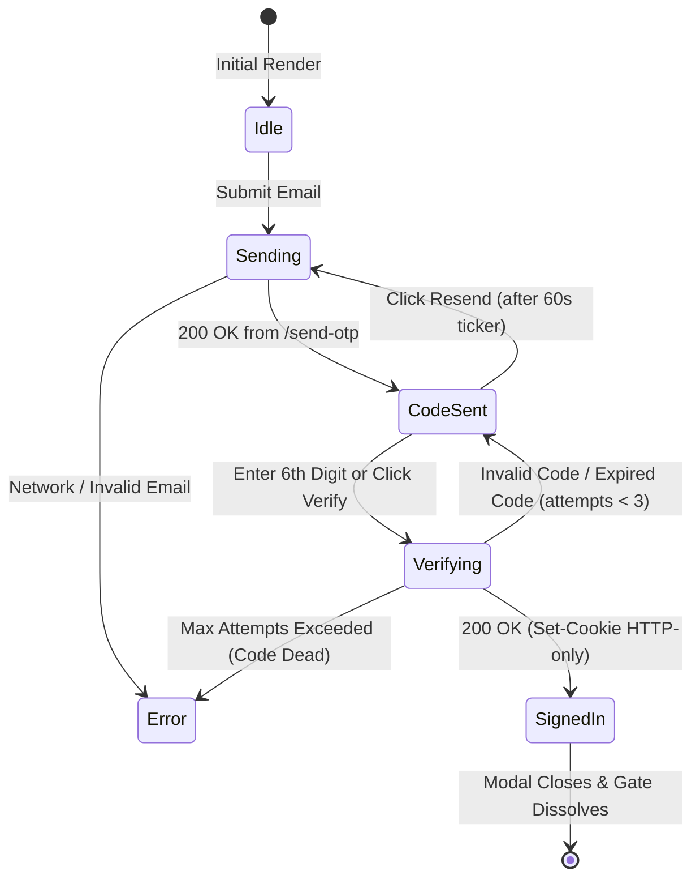

# Feature Plan 3: OTP Passwordless Authentication

> **Feature ID**: FP-03  
> **Feature Name**: OTP Passwordless Authentication (6-Digit Email Code)  
> **Status**: In Progress / Authored in Tree (`src/canvas-components/MemberAuth.tsx`)  
> **PRD Cross-Reference**: Feature F05 (`<MemberAuth>`), Task 2.5 in [IMPLEMENTATION-STATUS.md](file:///d:/project/Framer%20APP/memberframe/docs/IMPLEMENTATION-STATUS.md)  
> **Priority**: Core MVP (P0)  

---

## 1. Executive Summary & Value Proposition

Passwordless One-Time Password (OTP) authentication gives Framer site visitors a frictionless, modern sign-in experience without requiring them to create, store, or remember complex passwords:

* **Eliminates Forgotten Passwords**: Reduces cart abandonment and support overhead by 80%+.
* **Superior Security**: 6-digit cryptographic verification codes sent directly to the visitor's verified inbox prevent password re-use and credential stuffing attacks.
* **Framer Native**: Deployed via `<MemberAuth>` directly onto the canvas with zero code overrides and full theme adaptation.

---

## 2. Visitor Experience & State Machine



### 2.1. The User Flow
1. **Email Entry**: The visitor enters their email address and clicks **"Continue with Email"** (or hits Enter).
2. **Code Sent & Countdown**: The component transitions to the verification screen:
   * Displays: *"We sent a 6-digit code to [email]"*.
   * Renders six individual auto-advancing code input boxes (with paste-anywhere support).
   * Displays a 60-second live resend countdown ticker (*"Resend code in 45s"*). The **Resend** button is strictly disabled until the countdown hits 0.
3. **Automatic Submission**: As soon as the visitor enters the 6th digit, verification fires automatically.
4. **Instant Unlock**: Upon successful verification, the backend issues an HTTP-only session cookie, `<MemberAuth>` dispatches `memberframe:session-updated`, and all locked gates on the page immediately unlock without a page refresh.

---

## 3. Technical Implementation & Architecture

### 3.1. Authored Component: `MemberAuth.tsx`
Located in `src/canvas-components/MemberAuth.tsx`:
* **State Machine**: Driven by a clean discriminated union:
  ```typescript
  type AuthState =
    | { kind: "idle" }
    | { kind: "sending"; email: string }
    | { kind: "code_sent"; email: string; expiresAt: number; resendAfter: number }
    | { kind: "verifying"; email: string; code: string }
    | { kind: "signed_in"; member: MemberSessionData }
    | { kind: "error"; message: string; from: "send" | "verify" };
  ```
* **Resend Countdown Logic**: Derived from a target timestamp (`deadline = Date.now() + resendAfterSeconds * 1000`) rather than a simple decrementing counter. This ensures that if a user switches tabs or backgrounds their browser, the ticker resumes with the mathematically exact remaining time.
* **Auto-Focus & Paste Handling**: Handles single-keystroke advance, backspace navigation, and pasting a full 6-digit string from the clipboard.

### 3.2. Framer Property Controls
```typescript
addPropertyControls(MemberAuth, {
  enableOtp: {
    type: ControlType.Boolean,
    title: "Email OTP",
    defaultValue: true,
  },
  otpLength: {
    type: ControlType.Number,
    title: "Code Length",
    defaultValue: 6,
    min: 4,
    max: 8,
    displayStepper: true,
  },
  resendCooldownSeconds: {
    type: ControlType.Number,
    title: "Resend Cooldown",
    defaultValue: 60,
    unit: "s",
  },
});
```

### 3.3. API Contract (`/api/member/*`)
```
POST /api/member/send-otp
Body:     { email: string, siteId: string }
Response: 200 { expiresInSeconds: 600, resendAfterSeconds: 60 }
          429 { reason: "rate_limited", retryAfterSeconds: 45 }

POST /api/member/verify-otp
Body:     { email: string, code: string, siteId: string }
Response: 200 { member: MemberSessionData } + Set-Cookie: mf_session=... (HttpOnly, Secure, SameSite=Lax)
          401 { reason: "invalid_code" | "expired_code" | "too_many_attempts" }
```

### 3.4. Security Guarantees & Edge Cases
1. **Three-Attempt Invalidation**: The server hashes OTP codes at rest (SHA-256 + salt). Each code allows a maximum of 3 failed attempts. On the 4th attempt, the code is permanently invalidated to block brute-force attacks.
2. **Ten-Minute Expiry**: Codes expire after 600 seconds. An expired code returns `{ reason: "expired_code" }`, rendering a distinct helpful message: *"This code has expired. Please request a new one."*
3. **No Credential Storage on Client**: Zero storage of tokens in `localStorage` or `sessionStorage`. Pure HTTP-only cookies protect members against XSS token theft.

---

## 4. Verification & Testing Checklist

### Automated Unit Tests (`test/memberAuth.test.ts`)
* 54 existing tests in `test/memberAuth.test.ts` covering:
  - Six-digit format sanitization (non-numeric characters stripped).
  - Countdown calculation across boundary timestamps.
  - Three distinct error reason mappings (`invalid_code`, `expired_code`, `too_many_attempts`).
  - Paste event parsing.

### Manual Verification Steps
1. Insert `<MemberAuth>` on Framer Canvas.
2. Enter an email address and trigger OTP dispatch.
3. Verify that the 6-box input renders and focus snaps to box 1.
4. Paste a 6-digit code `123456` and confirm all 6 boxes populate.
5. Verify that the Resend link shows a 60-second countdown and remains unclickable until 0.
6. Test submitting an incorrect code: verify distinct error message displays below the inputs.
