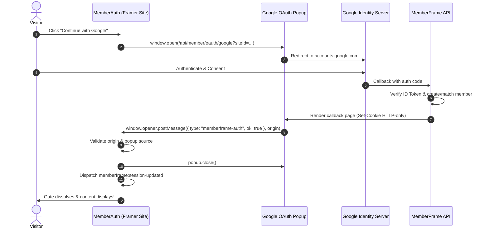

# Feature Plan 4: Google Sign In (SSO)

> **Feature ID**: FP-04  
> **Feature Name**: Google Sign In (OAuth 2.0 / SSO)  
> **Status**: In Progress / Authored in Tree (`src/canvas-components/MemberAuth.tsx`)  
> **PRD Cross-Reference**: Feature F05 (`<MemberAuth>`), PRD Section 14.1 (Security Standard S8), Task 2.5 in [IMPLEMENTATION-STATUS.md](file:///d:/project/Framer%20APP/memberframe/docs/IMPLEMENTATION-STATUS.md)  
> **Priority**: Core MVP (P0)  

---

## 1. Executive Summary & Market Context

Google Single Sign-On (SSO) is the single most widely used consumer and creator sign-in method on the web. Every direct competitor in the Framer ecosystem (**FrameAuth**, **Thenty**, and **Outseta**) supports Google authentication.

* **One-Click Authentication**: Visitors authenticate in under 3 seconds without typing an email or password.
* **Framer-Native Popup Architecture**: Unlike Outseta (which redirects visitors away to external hosted pages) or script embeds that cause white screen flickers, MemberFrame executes Google OAuth in an isolated child popup, keeping the visitor anchored on the Framer website.

---

## 2. Technical Architecture & Secure Popup Flow



---

## 3. Security-Critical Implementation Details

### 3.1. Strict Origin Validation on `postMessage` (PRD S8)
The OAuth completion handshake occurs via `window.postMessage`. A flawed message handler is a major security vulnerability (allowing malicious scripts or rogue extensions to inject fake auth confirmations).

As authored in `src/canvas-components/MemberAuth.tsx`, the listener verifies **three non-negotiable checks**:

```typescript
function handleAuthMessage(event: MessageEvent) {
  // 1. Strict equality origin check (prevents subdomain/suffix spoofing)
  const expectedOrigin = new URL(CONFIG.apiBaseUrl).origin;
  if (event.origin !== expectedOrigin) return;

  // 2. Exact window handle validation (must be the popup we opened)
  if (!popupRef.current || event.source !== popupRef.current) return;

  // 3. Payload shape validation
  if (event.data?.type === "memberframe-auth" && event.data?.ok === true) {
    popupRef.current?.close();
    popupRef.current = null;
    onAuthSuccess();
  }
}
```

### 3.2. Browser Popup Blocker Detection
If a visitor's browser (Safari, Chrome, Brave) blocks popups, `window.open` returns `null` or an unopened handle.
* Instead of failing silently, `<MemberAuth>` immediately transitions to an informative inline notice:
  *"Popup was blocked. Please allow popups for this site to sign in with Google."*
* A fallback direct-link CTA is rendered allowing the visitor to trigger the popup on demand.

### 3.3. Google Brand Identity Compliance
Google publishes strict Third-Party Brand Guidelines for Sign-In buttons:
* **Glyph**: Monochrome or official multi-color "G" mark, SVG format only. Zero unicode emojis.
* **Copy**: Standardized button text: *"Continue with Google"* or *"Sign in with Google"*.
* **Contrast & Theme**: Light theme displays dark text on neutral/subtle surface; dark theme displays white text on dark surface, maintaining WCAG AA minimum contrast of 4.5:1.

---

## 4. Framer Property Controls Specification

Configured in `MemberAuth.tsx`:
```typescript
addPropertyControls(MemberAuth, {
  enableGoogle: {
    type: ControlType.Boolean,
    title: "Google SSO",
    defaultValue: true,
  },
  googleButtonVariant: {
    type: ControlType.Enum,
    title: "Google Style",
    options: ["outline", "filled"],
    optionTitles: ["Outline Surface", "Brand Gradient Fill"],
    defaultValue: "outline",
    hidden: (props) => !props.enableGoogle,
  },
});
```

---

## 5. Verification & Testing Checklist

### Automated Unit Tests
* **`test/memberAuth.test.ts`**:
  * Assert that `postMessage` listener uses exact equality comparison (`===`) against `expectedOrigin`.
  * Assert that button does not render when `enableGoogle: false`.
  * Assert that blocked popup (`window.open` returns null) triggers inline error state.
  * Assert zero inline styles (`npm run lint:css`).

### Manual Verification in Framer Canvas
1. In the Framer Designer, select `<MemberAuth>` and toggle `Google SSO` on/off.
2. Confirm the Google button appears/disappears dynamically.
3. Test theme switching: verify the Google button adapts seamlessly between Framer light and dark mode.
4. On a staging site, click "Continue with Google" -> verify popup opens, completes OAuth, closes automatically, and unlocks `<MemberGate>` on the parent window.
