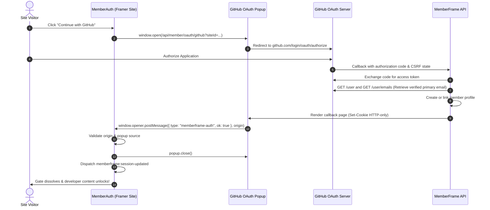

# Feature Plan 5: GitHub Sign In (SSO)

> **Feature ID**: FP-05  
> **Feature Name**: GitHub Sign In (OAuth 2.0 / SSO)  
> **Status**: In Progress / Authored in Tree (`src/canvas-components/MemberAuth.tsx`)  
> **PRD Cross-Reference**: Feature F05 (`<MemberAuth>`), PRD Section 8 Feature Index, Task 2.5 in [IMPLEMENTATION-STATUS.md](file:///d:/project/Framer%20APP/memberframe/docs/IMPLEMENTATION-STATUS.md)  
> **Priority**: Competitive Parity & Developer Niching (P1)  

---

## 1. Executive Summary & Market Differentiator

Among all Framer membership platforms, **GitHub SSO is a major competitive differentiator**:

* **Competitor Gap**: Only **FrameAuth** supports GitHub SSO. Neither **Thenty** nor **Outseta** supports GitHub.
* **Target Audience**: Extremely high-value creator niche: developer tool documentations, engineering courses, UI kit/code template sellers, and tech community hubs built on Framer.
* **Seamless Developer DX**: Allows developers and technical designers to sign in with their existing GitHub credentials with zero friction.

---

## 2. Technical Architecture & OAuth Flow



---

## 3. Implementation Specifications

### 3.1. Canvas Component Property Controls
Inside `src/canvas-components/MemberAuth.tsx`:
```typescript
addPropertyControls(MemberAuth, {
  enableGithub: {
    type: ControlType.Boolean,
    title: "GitHub SSO",
    defaultValue: false, // Off by default for general sites, toggleable for tech sites
  },
  githubButtonLabel: {
    type: ControlType.String,
    title: "GitHub Label",
    defaultValue: "Continue with GitHub",
    hidden: (props) => !props.enableGithub,
  },
});
```

### 3.2. GitHub Brand Guidelines & UI Standards
* **Mark**: Official monochrome Octocat SVG glyph (inherits CSS `currentColor`).
* **Strict Prohibitions**: Zero unicode emoji or non-standard logo modifications.
* **Button Styling**:
  * Light Theme: Neutral high-contrast surface (`#24292f` dark fill with white text, or clean neutral outline).
  * Dark Theme: Deep charcoal surface (`#161b22`) with light text (`#f0f6fc`), satisfying WCAG AA contrast ratio (> 7:1).

### 3.3. Email Privacy & Secondary Email Handling
Unlike Google (where the primary email is always exposed in ID tokens), GitHub users often set their email address to **private** (`user@users.noreply.github.com`).
* **Backend Contract**: The backend requests the `user:email` scope and explicitly queries `GET https://api.github.com/user/emails` to find the member's verified primary address.
* If only a private noreply email exists, the backend securely keys the member account to the noreply email while storing their public GitHub handle (`githubUsername`) in `metadata.socialLinks.github`.

---

## 4. Verification & Testing Checklist

### Automated Unit Tests
* **`test/memberAuth.test.ts`**:
  * Assert that GitHub button renders only when `enableGithub: true`.
  * Verify that OAuth provider string passed to backend is `"github"`.
  * Ensure `postMessage` listener applies the exact same strict origin verification for GitHub as for Google.
  * Assert zero inline styles (`npm run lint:css`).

### Manual Verification in Framer Canvas
1. In the Framer Designer, toggle `GitHub SSO` to active.
2. Confirm the GitHub button renders with proper Octocat glyph and label.
3. Test theme switching (Light / Dark mode): verify contrast and styling remain pristine.
4. Test OAuth popup on staging site: authorize app on GitHub -> verify popup closes and parent page unlocks immediately.
