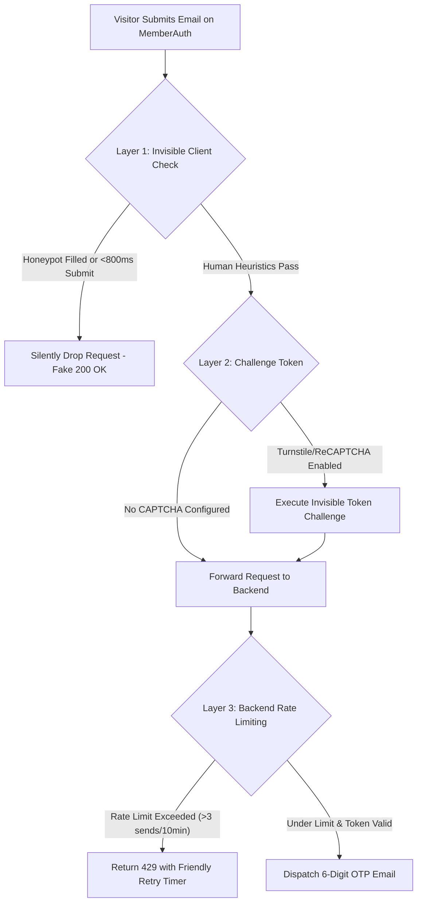

# Feature Plan 6: ReCAPTCHA & Bot Defense on Auth Endpoints

> **Feature ID**: FP-06  
> **Feature Name**: ReCAPTCHA & Bot Defense on Auth Endpoints  
> **Status**: Planned (Phase 2 Roadmap)  
> **PRD Cross-Reference**: Feature F21, Task 4.10 in [IMPLEMENTATION-STATUS.md](file:///d:/project/Framer%20APP/memberframe/docs/IMPLEMENTATION-STATUS.md)  
> **Priority**: Core Security & Fraud Prevention (P1)  

---

## 1. Executive Summary & Problem Solved

Unprotected authentication and sign-in surfaces represent the single largest operational cost liability for a membership platform:

* **The Email Bombing Attack Vector**: Every time an unauthenticated user hits `POST /api/member/send-otp`, the backend sends an email via SendGrid, Postmark, or Resend. Automated bot scripts exploit this to launch "email bombing" attacks on arbitrary third-party victims.
* **Financial & Deliverability Hazard**: Attackers can trigger thousands of emails in minutes, burning the creator's email sending quota, incurring significant transactional email costs, and damaging the site's domain sending reputation.
* **The Solution**: A multi-layered bot defense architecture combining **invisible heuristic protections**, **backend rate limiting**, and **turnkey Cloudflare Turnstile / Google ReCAPTCHA v3** integration.

---

## 2. Multi-Layered Defense Architecture



### 2.1. Layer 1: Invisible Client-Side Traps (Zero Friction for Humans)
* **CSS-Hidden Honeypot Field**: An invisible field `<input name="mf_auth_hp" tabIndex={-1} autoComplete="off" />` that is hidden from sighted users and accessibility trees. Automated scrapers and bot scripts fill every available field; any request with a populated honeypot is silently dropped.
* **Submission Velocity Defense**: Records the timestamp when `<MemberAuth>` is mounted. Human beings require at least 1.5–3 seconds to read the form and enter an email; any form submission occurring under 800 milliseconds is flagged as automated bot activity.

### 2.2. Layer 2: Cloudflare Turnstile & Google ReCAPTCHA v3
* **Invisible by Default**: Runs in the background without forcing visitors to click blurry traffic lights or fire hydrants.
* **Creator Configuration in Plugin Settings**:
  * In MemberFrame's **Settings Tab**, creators can input their **Cloudflare Turnstile** or **Google ReCAPTCHA v3** Site Key & Secret Key.
* **Dynamic Widget Injection**:
  * If configured, `<MemberAuth>` loads the invisible script tag and obtains a one-time challenge token before calling `/send-otp`.
  * The backend verifies the token with Cloudflare / Google before dispatching any email.
* **Theme Synchronization**: If a visual challenge is triggered, the widget automatically adapts to the site's current theme (`light` or `dark`).

### 2.3. Layer 3: Backend Rate Limiting & Abuse Defense
* **Per-IP Rate Limit**: Maximum 5 OTP requests per IP per 10 minutes.
* **Per-Email Rate Limit**: Maximum 3 OTP requests per destination email address per 10 minutes.
* **No User Enumeration**: When rate limited, the response does not disclose whether the email belongs to an existing paying member.
* **Actionable User Message**: Legitimate members who hit the limit see a polite, human-readable notification:  
  *"Too many requests. Please wait 4 minutes before requesting another code."*

---

## 3. Implementation Specifications

### 3.1. In-Plugin Settings Configuration (`SettingsTab.tsx`)
Add to `src/components/tabs/SettingsTab.tsx`:
* **Bot Defense Provider**: Dropdown (`None`, `Cloudflare Turnstile (Recommended)`, `Google ReCAPTCHA v3`).
* **Site Key Input**: Plaintext site key.
* **Secret Key Vault**: Securely saved to the backend key vault alongside Stripe keys.

### 3.2. Framer Canvas Component Integration (`MemberAuth.tsx`)
```typescript
interface SendOtpRequest {
  email: string;
  siteId: string;
  botDefenseToken?: string;
  honeypot?: string;
  elapsedMs: number;
}
```

### 3.3. API Contract Additions
```
POST /api/member/send-otp
Request:
  {
    "email": "visitor@example.com",
    "siteId": "site_123",
    "botDefenseToken": "0x4AAAAAA...",
    "elapsedMs": 2450
  }

Responses:
  200 OK  -> { "expiresInSeconds": 600, "resendAfterSeconds": 60 }
  400 Bad Request -> { "reason": "bot_detected" } (Silent fake 200 for honeypot)
  429 Too Many Requests -> { "reason": "rate_limited", "retryAfterSeconds": 240 }
```

---

## 4. Verification & Testing Checklist

### Automated Unit Tests
* **`test/memberAuth.test.ts`**:
  * Assert that a populated honeypot prevents API call dispatch.
  * Assert that submissions under 800ms are flagged.
  * Assert that HTTP 429 response renders the friendly cooldown timer with pluralized minutes/seconds.
  * Assert zero inline styles (`npm run lint:css`).

### Manual Verification in Framer Canvas & Browser
1. In the MemberFrame Plugin **Settings Tab**, enter test Turnstile/ReCAPTCHA keys.
2. In the published Framer site, submit an email through `<MemberAuth>`:
   * Verify that the invisible challenge token is attached to the payload.
   * Verify that the email arrives in the destination inbox.
3. Test Rate Limiting: Trigger 4 requests in rapid succession -> verify the 4th request renders the countdown message and blocks email dispatch.
