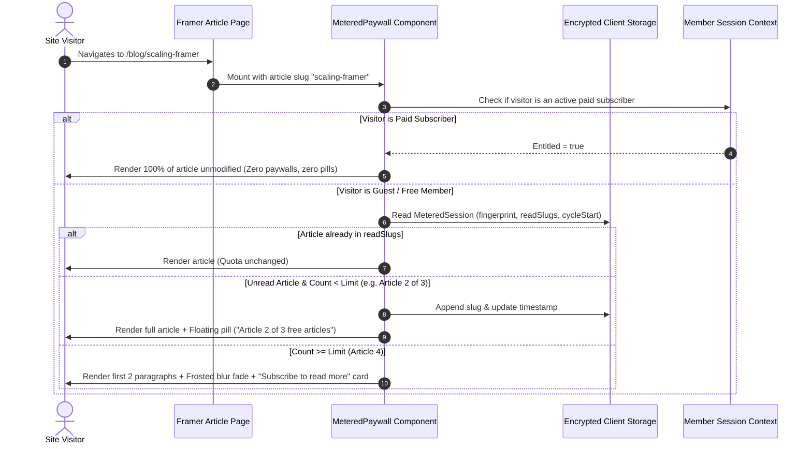

# Feature Plan 7: Soft Paywall (Read More & Metered Content)

> **Feature ID**: FP-07  
> **Feature Name**: Soft Paywall (Read More & Dynamic Metered Reading)  
> **Status**: Built, 2026-10-17. How it was built, and where it differs from this plan: [18-content-features.md](../development-docs/18-content-features.md)  
> **PRD Cross-Reference**: Feature F07 (`<MeteredPaywall>`), Feature F08 (`Schema.org SEO Paywall Injection`), Tasks 3.4 & 3.5 in [IMPLEMENTATION-STATUS.md](file:///d:/project/Framer%20APP/memberframe/docs/IMPLEMENTATION-STATUS.md)  
> **Priority**: Conversion & Monetization Growth (P1)  

---

## 1. What is a Soft Paywall? (Core Concept & Value Proposition)

In subscription publishing and digital memberships, paywalls come in two fundamental flavors:

```
┌───────────────────────────────────────┐       ┌───────────────────────────────────────┐
│             HARD PAYWALL              │       │             SOFT PAYWALL              │
│       (All-or-Nothing Gating)         │       │    (Metered / Teaser / "Read More")   │
├───────────────────────────────────────┤       ├───────────────────────────────────────┤
│ • Zero content visible to guests.     │       │ • Visitors read 2–3 paragraphs free   │
│ • Bounce rate: 85–95% on cold traffic │       │   or 3 free articles/month.           │
│ • Zero organic Google SEO discovery.  │       │ • Allows reader to experience value.  │
│ • Best for: Private client dashboards │       │ • Preserves full Google SEO rankings. │
│   and sensitive SaaS tools.           │       │ • Best for: Publications, blogs,      │
│                                       │       │   courses, research, newsletters.     │
└───────────────────────────────────────┘       └───────────────────────────────────────┘
```

A **Soft Paywall (Read More / Metered Paywall)** removes the harsh barrier of entry for first-time visitors by letting them taste the content before requiring a paid membership or account creation.

---

## 2. Key Use Cases

### 2.1. The "Read More" Partial Teaser (Curiosity Hook)
* **Creator Scenario**: An agency publishes in-depth design case studies or tutorials.
* **Visitor Experience**:
  * The visitor lands from Twitter/LinkedIn and reads the headline, hero image, and the first 2 introductory paragraphs.
  * At paragraph 3, the article gently fades into a sleek frosted-glass gradient overlay.
  * A prominent lock card appears directly inline: *"Read More: Join MemberFrame to unlock the complete 3,000-word breakdown and design files."*
* **Why it Converts**: Visitors who read the first 2 paragraphs are already engaged; asking them to subscribe *after* they are hooked generates **3x to 5x higher conversion rates** than an empty locked screen.

### 2.2. The Metered Reading Quota (Medium & New York Times Model)
* **Creator Scenario**: A digital publication wants casual readers to enjoy 3 free articles per month before subscribing.
* **Visitor Experience**:
  * **Article 1**: The reader views the article. A discreet bottom pill appears: *"Article 1 of 3 free articles this month"*.
  * **Article 2 & 3**: The counter updates dynamically (*"Article 2 of 3"*, *"1 free article remaining"*).
  * **Article 4**: The meter runs out. The article blurs out after paragraph 2 with a lock card: *"You've reached your free monthly article limit. Subscribe to continue reading."*
* **Deduplication**: If the reader re-opens Article 1 tomorrow, it does **not** consume an additional credit.

### 2.3. SEO Preservation & Google Search Traffic (PRD Feature F08)
* **The Fatal Flaw of Hard Paywalls**: If you hide text completely from unauthenticated visitors, Googlebot also cannot see the text, destroying Google Search rankings. If you serve full text to Googlebot but hide it from humans, Google flags the site for **cloaking penalties**.
* **The Soft Paywall Advantage**: The article HTML remains semantically complete on the page for Googlebot crawling, while simultaneously injecting **Schema.org JSON-LD paywall metadata** (`isAccessibleForFree: "False"`). Google rewards the content with rich news snippets and top search rankings, while human visitors see the frosted "Read More" paywall.

---

## 3. Visitor Journey & Architecture Flow



---

## 4. Technical Implementation & Component Specification

### 4.1. Authored Canvas Component: `<MeteredPaywall>`
File location: `src/canvas-components/MeteredPaywall.tsx`

#### Framer Property Controls:
```typescript
addPropertyControls(MeteredPaywall, {
  contentSlot: {
    type: ControlType.ComponentInstance,
    title: "Article Body",
  },
  freeQuotaCount: {
    type: ControlType.Number,
    title: "Free Articles",
    defaultValue: 3,
    min: 1,
    max: 10,
    step: 1,
    displayStepper: true,
  },
  quotaPeriod: {
    type: ControlType.Enum,
    title: "Reset Window",
    options: ["weekly", "monthly"],
    optionTitles: ["Every 7 Days", "Every 30 Days"],
    defaultValue: "monthly",
  },
  blurIntensity: {
    type: ControlType.Number,
    title: "Blur Amount",
    defaultValue: 8,
    min: 2,
    max: 24,
    unit: "px",
  },
  showCounterPill: {
    type: ControlType.Boolean,
    title: "Show Counter Pill",
    defaultValue: true,
  },
  ctaLabel: {
    type: ControlType.String,
    title: "Unlock Button",
    defaultValue: "Subscribe to continue reading",
  },
  cardTitle: {
    type: ControlType.String,
    title: "Lock Title",
    defaultValue: "Enjoying this article?",
  },
  cardDescription: {
    type: ControlType.String,
    title: "Lock Message",
    defaultValue: "You have reached your free reading limit for this month.",
  },
});
```

### 4.2. Storage & Deduplication Engine (`src/utils/meteredStorage.ts`)
```typescript
interface MeteredSession {
  deviceFingerprint: string;
  articlesRead: string[]; // List of visited article slugs
  cycleStartTimestamp: number; // Unix timestamp for quota cycle start
  quotaLimit: number;
}
```
* **Storage Resilience**: Stored in `localStorage` under `mf_metered_v1`, obfuscated with lightweight encryption to prevent casual tampering.
* **Cycle Reset**: If `Date.now() - cycleStartTimestamp > 30 * 86400 * 1000`, the reading list resets automatically.
* **Slug Isolation**: Reads `window.location.pathname` or a Framer CMS slug to identify the article. Re-reading an article does not consume quota.

### 4.3. Schema.org JSON-LD SEO Injector (`src/utils/schemaInjector.ts`)
When `<MeteredPaywall>` renders, it injects structured metadata into `<head>`:
```html
<script type="application/ld+json">
{
  "@context": "https://schema.org",
  "@type": "Article",
  "isAccessibleForFree": "False",
  "hasPart": {
    "@type": "WebPageElement",
    "isAccessibleForFree": "False",
    "cssSelector": ".memberframe-metered-protected"
  }
}
</script>
```
This tells Googlebot that the page is legitimate paywalled journalism, enabling full indexing without cloaking penalties.

---

## 5. Verification & Testing Strategy

### Automated Unit Tests
* **`test/meteredStorage.test.ts`**:
  * Assert that re-visiting the same article slug does not decrement remaining quota.
  * Assert that cycle reset triggers exactly after the configured 7-day or 30-day window.
  * Assert that pluralization copy formats properly (*"1 free article remaining"* vs *"2 free articles remaining"*).
  * Assert that storage payload stays well under browser storage limits for 500+ slugs.

### Manual Verification in Framer Canvas
1. Insert `<MeteredPaywall>` on a test Framer article page.
2. Connect the article frame to the `Article Body` slot.
3. Set `Free Articles` to 2.
4. **Visit Article A**: Confirm full content renders and floating bottom pill shows *"Article 1 of 2 free articles this month"*.
5. **Visit Article B**: Confirm full content renders and pill displays *"Article 2 of 2 (Last free article)"*.
6. **Visit Article C**: Confirm top paragraphs display, followed by a smooth frosted fade-out, lock card overlay, and *"Subscribe to continue reading"* button.
7. Click "Sign In" with an active member account: Confirm the paywall dissolves instantly and content reveals completely.
