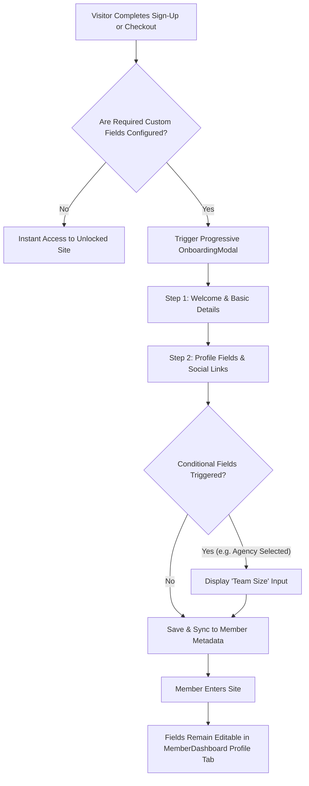

# Feature Plan 9: Custom Profile Fields (Member Data & Onboarding)

> **Feature ID**: FP-09  
> **Feature Name**: Custom Profile Fields (Custom Member Attributes & Onboarding)  
> **Status**: Planned (Phase 3 Roadmap)  
> **PRD Cross-Reference**: Feature F16 (`<OnboardingModal>`), PRD Section 8, Task 6.3 in [IMPLEMENTATION-STATUS.md](file:///d:/project/Framer%20APP/memberframe/docs/IMPLEMENTATION-STATUS.md)  
> **Priority**: Creator Customization & CRM Parity (P2)  

---

## 1. Executive Summary & Market Context

Every membership business has unique data collection needs beyond just email and password:
* A **design community** needs a portfolio link, Figma username, and Twitter handle.
* A **B2B SaaS or coaching club** needs company name, job role, phone number, and team size.
* A **regional association** needs country, shipping address, or member accreditation number.

Competitors (**FrameAuth**, **Thenty**, and **Outseta**) all offer custom member fields, but force members through rigid, cluttered signup forms that kill conversion rates.

**The MemberFrame Solution**: A flexible **Custom Profile Fields System** paired with an optional **Progressive Onboarding Flow** (`<OnboardingModal>`). Creators can collect custom data during onboarding or let members manage it anytime directly inside their `<MemberDashboard>`.

---

## 2. Supported Field Types & Creator Management

In MemberFrame's plugin under **Manage > Custom Fields**, creators can configure custom attributes:

| Field Type | Input Control | Example Use Case | Validation Rules |
| :--- | :--- | :--- | :--- |
| **Short Text** | Standard Text Input | Job Title, Company Name | Min/Max character lengths |
| **Long Text / Bio**| Multiline Text Area | About Me, Member Bio | Max 500 characters |
| **URL** | Web Address Input | Portfolio URL, GitHub / LinkedIn | URL format validation (`https://...`) |
| **Phone Number** | International Phone Input | WhatsApp / SMS notifications | E.164 phone regex format |
| **Dropdown / Select**| Select Menu | Industry, Experience Level | Creator-defined options list |
| **Boolean Checkbox**| Toggle / Checkbox | "Subscribe to VIP Newsletter" | True / False |
| **Number** | Numeric Stepper | Years of Experience, Team Size | Min, Max integer boundaries |

---

## 3. Member Experience & User Flows



### 3.1. Progressive Onboarding Flow (`<OnboardingModal>`)
* Instead of intimidating visitors with 15 form fields on the initial sign-in page, MemberFrame keeps sign-in fast (1 click via Google/OTP), then introduces a pleasant multi-step modal:
  * **Step 1**: Welcome message + Name & Avatar upload.
  * **Step 2**: Role, Company, & Portfolio URL.
  * **Step 3**: Optional questionnaire.
* **Skip Option**: Optional steps display a *"Skip for now"* button so members never feel trapped.
* **Mid-Flow Reload Resilience**: Answers are saved optimistically to `sessionStorage`. If a member accidentally refreshes their browser, they resume on the exact same step with their answers preserved.

### 3.2. Profile Self-Service (`<MemberDashboard>`)
* Custom fields automatically populate in the `<MemberDashboard>` **Profile Tab**.
* Members can update their company name, website link, or phone number anytime with instant save feedback.

### 3.3. Creator Visibility in Plugin Cockpit (`ManageTab.tsx`)
* Custom fields are automatically visible in the **Manage Tab**:
  * Member table includes custom columns or a detailed flyout sheet (`MemberFlyout.tsx`).
  * Creators can search, filter, and export member records with all custom metadata intact.

---

## 4. Technical Architecture & Data Schema

### 4.1. Data Schema (`MemberProfileRecord`)
```typescript
interface CustomFieldDefinition {
  id: string;
  key: string; // e.g. "company_name"
  label: string; // e.g. "Company Name"
  type: "text" | "textarea" | "url" | "phone" | "select" | "boolean" | "number";
  required: boolean;
  options?: string[]; // For "select" fields
  placeholder?: string;
  order: number;
}

interface MemberMetadata {
  [key: string]: string | number | boolean | null;
}
```

### 4.2. API Contract
```
GET /api/site/custom-fields?siteId=...
Response: 200 { fields: CustomFieldDefinition[] }

PATCH /api/member/profile
Headers: Cookie: mf_session=...
Body:
  {
    "name": "Jordan Okafor",
    "metadata": {
      "company_name": "Acme Design Co",
      "portfolio_url": "https://jordan.design",
      "experience_level": "Senior (5+ years)"
    }
  }
Response: 200 { success: true, member: MemberSessionData }
```

---

## 5. Verification & Testing Checklist

### Automated Unit Tests
* **`test/customFields.test.ts`**:
  * Validate field input format rules (valid URLs, phone numbers, numeric bounds).
  * Assert that required fields block submission with actionable inline field errors.
  * Assert that conditional fields mount and unmount dynamically based on dependency state.
  * Assert that `metadata` is serialized cleanly and preserves UTF-8 characters.

### Manual Verification in Framer Canvas
1. In the MemberFrame Plugin **Settings / Custom Fields**, configure two fields: `Company Name` (Required Text) and `Portfolio URL` (Optional URL).
2. Insert `<OnboardingModal>` on canvas:
   * Verify that the fields display with proper labels and placeholders.
   * Attempt submitting with an empty `Company Name`: verify inline error appears.
   * Enter valid details and submit: verify successful completion and modal dismissal.
3. Open `<MemberDashboard>`: verify that the newly entered company name and URL appear in the member profile view.
4. Open the plugin **Manage Tab**: confirm the custom attributes appear on the member's details drawer.
