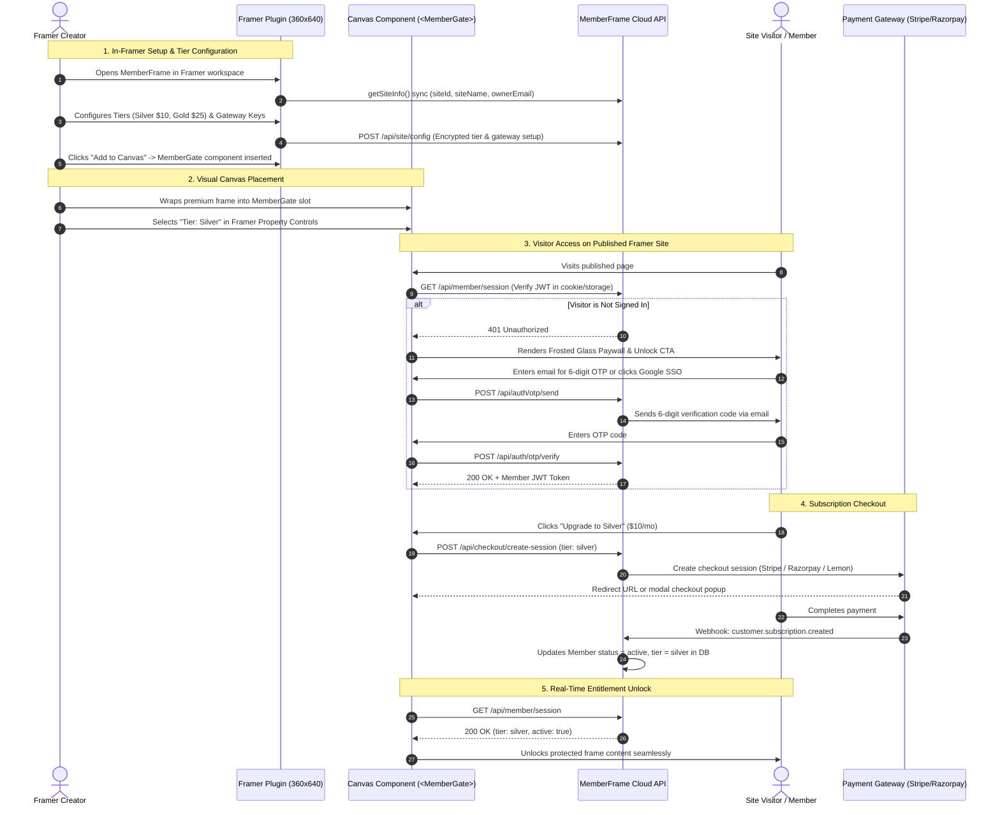

# MemberFrame: Final Feature Specifications and Implementation Architecture

The authoritative product feature specification, user flows, technical implementation blueprints, and data schemas for the MemberFrame Framer plugin.

---

## 1. Executive Summary and Product Identity

MemberFrame is a native Framer membership and subscription platform engineered specifically for creators, agencies, and digital publishers. It bridges the divide between visual canvas design and secure recurring monetization.

### The In-Framer-First Mandate
Existing membership solutions like FrameAuth and Outseta force website creators to leave Framer and configure their membership tiers, payment webhooks, and customer records on an external dashboard. MemberFrame eliminates this friction completely. 

**100% of management lives inside the Framer workspace:**
* Creators configure tiers, prices, and payment gateway keys directly inside the 360x640 plugin panel.
* Creators view active subscribers, cancel plans, and inspect transactions directly inside the plugin.
* Creators preview visual lock cards, auth modals, and customer states in real time using the in-plugin Live Preview Studio.
* Creators drag visual wrapper components (`<MemberGate>`) onto the canvas with zero code overrides.

Behind the scenes, a secure, headless backend cloud service (MemberFrame Cloud API) manages database persistence, Stripe, Lemon Squeezy, and Razorpay webhooks, 6-digit email OTP dispatch, and token verification.

---

## 2. System Architecture and Three-Tier Topology

MemberFrame operates across three coordinated tiers:

```
┌─────────────────────────────────────────────────────────────────────────────────────────────────┐
│                                   MEMBERFRAME SYSTEM TOPOLOGY                                   │
├───────────────────────────────┬─────────────────────────────────┬───────────────────────────────┤
│ 1. FRAMER PLUGIN PANEL        │ 2. CANVAS RUNTIME COMPONENTS    │ 3. HEADLESS BACKEND SERVICE   │
│    (Creator Cockpit: 360x640) │    (Published Site Experience)  │    (MemberFrame Cloud Engine) │
├───────────────────────────────┼─────────────────────────────────┼───────────────────────────────┤
│ • In-Framer Members Table     │ • <MemberGate>                  │ • Member Identity & Session   │
│ • In-Framer Tier Configurator │ • <MemberAuth>                  │   Engine (JWT, HTTP-only)     │
│ • Tri-Gateway API Key Vault   │ • <MemberDashboard>             │ • Stripe / Lemon Squeezy /    │
│ • Live Preview Studio         │ • <MeteredPaywall>              │   Razorpay Webhook Handlers   │
│ • Property Controls Injector  │ • <CMSGatedTemplate>            │ • PostgreSQL & Prisma DB      │
│ • Dual-Theme Token Sync       │ • <ProtectedDownload>           │ • 6-Digit OTP Email Dispatch  │
│ • Client Pro-Lock Licensing   │ • <CourseProgress>              │ • S3 / R2 Signed URL Vault    │
│ • Framer Site Telemetry       │ • <DonationSlider>              │ • Telemetry Sync & Validation │
└───────────────────────────────┴─────────────────────────────────┴───────────────────────────────┘
```

### Complete End-to-End System Sequence Diagram



---

## 3. Comprehensive Feature Catalog: 15 Core Features

Below is the complete specification for each MemberFrame feature, including creator use cases, user flows, technical implementation sequences, and core user data schemas.

---

### Feature 1: Zero-Code Visual Canvas Gating (`<MemberGate>`)

* **Category:** Content Protection and Gating
* **Creator Use Case:** A creator wants to gate video lessons, resource links, or entire page sections without writing, copying, or maintaining brittle Framer code overrides.
* **Visitor Flow:**
  1. An unauthenticated visitor lands on a page containing gated content.
  2. The visitor sees a frosted glass preview or lock teaser card explaining the required tier.
  3. The visitor clicks "Sign In to Unlock" or "Upgrade to View".
  4. Once signed in with an active eligible tier, the gate dissolves instantly and the underlying content is revealed.
* **In-Plugin Configuration Flow:**
  1. The creator opens the MemberFrame plugin Builder tab.
  2. The creator customizes the lock card title, description, button text, and blur radius.
  3. The creator clicks "Insert Member Gate" to drop the component onto the canvas.
  4. In Framer's native properties sidebar, the creator connects their target visual frame to the `Content Slot`.
* **Technical Implementation Flow:**
  - **Component:** `MemberGate.tsx` deployed via `framer.createCodeFile`.
  - **Slot Architecture:** Uses `ControlType.ComponentInstance` to accept any native Framer frame or component.
  - **Runtime Hook:** Calls `useMemberSession()` to check local JWT and cached tier entitlements against `requiredTier`.
  - **Styling:** Injected external CSS module (`.memberframe-gate-container`, `.memberframe-blur-overlay`, `.memberframe-lock-card`). Zero inline styles.
  - **Fallback Behaviors:** Supports `Frosted Blur`, `Hide Completely`, `Redirect to Page`, or `Custom Locked Card`.
* **Core User Information Needed:**
  ```typescript
  interface MemberSessionData {
    memberId: string;
    email: string;
    name: string | null;
    activeTier: string; // "free" | "silver" | "gold" | "vip"
    status: "active" | "trialing" | "past_due" | "canceled";
    currentPeriodEnd: number; // Unix timestamp
    siteId: string;
  }
  ```
* **Entitlement Level:** Available on all MemberFrame plans (Free 7-Day Trial, Creator Pro, Agency Lifetime).

---

### Feature 2: In-Plugin Member and Tier Admin Cockpit (100% Inside Framer)

* **Category:** In-Framer Administration
* **Creator Use Case:** The creator wants to monitor active subscribers, change member tiers, issue manual access, and adjust subscription prices without leaving the Framer design canvas.
* **Creator Flow:**
  1. The creator opens MemberFrame inside the Framer project window.
  2. Clicking the `Members` tab reveals the live member table with search, tier filtering, and status badges.
  3. Clicking any member opens an action flyout: `Change Tier`, `Grant VIP`, `Revoke Access`, or `Send Magic Link`.
  4. Switching to the `Tiers` tab allows the creator to edit tier titles, monthly/annual prices, and access permissions in seconds.
* **Technical Implementation Flow:**
  - **Plugin UI Panel:** `MembersTab.tsx` and `TiersTab.tsx` inside `PluginShell.tsx`.
  - **Authentication:** Creator credentials verified via `framer.getCurrentUser()` and `framer.getProjectInfo()`, generating an authenticated creator session token.
  - **Backend API Endpoints:**
    - `GET /api/site/members?siteId=...`
    - `PATCH /api/site/members/:id`
    - `GET /api/site/tiers?siteId=...`
    - `POST /api/site/tiers`
* **Core User Information Needed:**
  ```typescript
  interface SiteMemberRecord {
    id: string;
    email: string;
    name: string | null;
    avatarUrl: string | null;
    tier: string;
    status: "active" | "trialing" | "past_due" | "canceled";
    createdAt: string;
    lifetimeSpend: number;
    currency: string;
    gateway: "stripe" | "lemonsqueezy" | "razorpay";
  }
  ```
* **Entitlement Level:** Available on all plans (search and batch actions included in Creator Pro and Agency).

---

### Feature 3: Tri-Gateway Smart Payment Connect (Stripe + Lemon Squeezy + Razorpay)

* **Category:** Payments and Monetization
* **Creator Use Case:** A creator wants to sell subscriptions to customers across the US, Europe, and India without dealing with tax compliance headaches or losing buyers who prefer UPI.
* **Visitor Flow:**
  1. A visitor clicks "Subscribe" on the pricing table.
  2. MemberFrame detects the visitor location:
     - Visitors in India receive Razorpay checkout with instant UPI QR codes, Google Pay UPI, and Netbanking.
     - Visitors in Europe receive Lemon Squeezy checkout with automated EU VAT compliance and localization.
     - Global visitors receive Stripe checkout with credit/debit cards, Apple Pay, Google Pay, and Link.
  3. Payment completes and access unlocks immediately.
* **In-Plugin Configuration Flow:**
  1. The creator opens the `Settings` tab in the MemberFrame plugin.
  2. The creator pastes API keys:
     - Stripe Publishable Key (`pk_live_...`) and Secret Key (`sk_live_...`).
     - Lemon Squeezy Store ID and API Key.
     - Razorpay Key ID (`rzp_live_...`) and Key Secret.
  3. The plugin validates keys in real time and displays a green verified indicator.
* **Technical Implementation Flow:**
  - **Backend Gateway Service:** Centralized webhook listener normalizing events into standard `SubscriptionUpdated` records.
  - **Encryption:** Secret keys are encrypted with AES-256-GCM prior to storage in PostgreSQL.
* **Core User Information Needed:**
  ```typescript
  interface SiteGatewayConfig {
    siteId: string;
    stripePublishableKey?: string;
    stripeSecretKeyEncrypted?: string;
    lemonSqueezyStoreId?: string;
    lemonSqueezyApiKeyEncrypted?: string;
    razorpayKeyId?: string;
    razorpayKeySecretEncrypted?: string;
    defaultCurrency: "USD" | "EUR" | "GBP" | "INR";
    autoDetectGeolocation: boolean;
  }
  ```
* **Entitlement Level:** Stripe included in Free Trial; full Tri-Gateway support unlocked in Creator Pro and Agency.

---

### Feature 4: In-Plugin 360x640 Live Preview Studio with Auth State Simulator

* **Category:** Developer and Designer Experience
* **Creator Use Case:** A designer needs to see how their login modal, locked paywall cards, and member badges look in light and dark mode, and across various subscription states, without having to publish the site.
* **Creator Flow:**
  1. The creator clicks the `Builder` tab inside the plugin.
  2. The real-time preview viewport displays the active component.
  3. The creator selects a state from the dropdown:
     - `Logged Out (Guest)`
     - `Free Member`
     - `Silver Tier Subscriber`
     - `VIP Member`
     - `Expired / Payment Failed`
  4. The preview updates instantly, allowing the designer to inspect contrast, button text, and layout responsiveness directly in Framer.
* **Technical Implementation Flow:**
  - **Component:** `PreviewStudio.tsx` using simulated `MemberSessionContext`.
  - **Styling:** Pulls live variables from `design-tokens.css` with dynamic CSS variable overrides.
* **Core User Information Needed:**
  - Local component preview state (client-side only).
* **Entitlement Level:** Available on all MemberFrame plans.

---

### Feature 5: Multi-Provider Authentication and Passwordless OTP (`<MemberAuth>`)

* **Category:** Identity and Authentication
* **Creator Use Case:** Provide a modern, frictionless sign-in experience that eliminates forgotten passwords and supports popular social logins.
* **Visitor Flow:**
  1. The visitor clicks "Sign In" or triggers a locked gate.
  2. The `<MemberAuth>` modal displays: Google SSO, Apple Sign In, GitHub, Discord, and an email address field.
  3. If email is chosen, a 6-digit OTP code is sent to the visitor's inbox with a 60-second countdown ticker.
  4. Entering the code signs the visitor in immediately, setting an HTTP-only session cookie.
* **In-Plugin Configuration Flow:**
  1. Inside the Builder tab, the creator enables or disables specific login providers via checkboxes.
  2. The creator customizes the modal headline, welcome copy, and brand accent color.
  3. The creator clicks "Insert Auth Component" to place it on the canvas.
* **Technical Implementation Flow:**
  - **Component:** `MemberAuth.tsx` supporting both modal overlay and inline page modes.
  - **OTP Security:** Codes are 6-digit crypto-random numbers hashed with SHA-256 in backend storage, expiring in 10 minutes with strict rate limits (max 3 attempts per code).
  - **OAuth Redirection:** Uses secure popup postMessage callback orchestration to keep the visitor on the current page without full browser redirects.
* **Core User Information Needed:**
  ```typescript
  interface MemberAuthPayload {
    email: string;
    authProvider: "otp" | "google" | "apple" | "github" | "discord";
    code?: string;
    metadata?: Record<string, string>;
  }
  ```
* **Entitlement Level:** Available on all MemberFrame plans.

---

### Feature 6: Canvas-Native Member Profile and Billing Portal (`<MemberDashboard>`)

* **Category:** Self-Serve Member Management
* **Creator Use Case:** Subscribers need to manage their own billing, download invoices, update payment methods, and cancel subscriptions directly on the Framer site without opening confusing external portals.
* **Visitor Flow:**
  1. An authenticated member navigates to `/account` or clicks their profile badge.
  2. The `<MemberDashboard>` component displays active plan details, next renewal date, and billing history.
  3. Clicking "Update Payment Card" opens a secure billing modal powered by the Stripe Customer Portal or Lemon Squeezy portal.
  4. Members can update their name, avatar, and notification settings directly on the page.
* **Technical Implementation Flow:**
  - **Component:** `MemberDashboard.tsx` with Framer property controls for visible tabs, avatar controls, and theme mode.
  - **Backend API:** `POST /api/member/billing-portal-session` generates a direct single-use customer portal link.
* **Core User Information Needed:**
  ```typescript
  interface MemberBillingSummary {
    planName: string;
    billingInterval: "month" | "year" | "lifetime";
    amount: number;
    currency: string;
    nextBillingDate: number;
    paymentMethodSummary: string;
    invoices: Array<{ id: string; date: number; amount: number; pdfUrl: string }>;
  }
  ```
* **Entitlement Level:** Creator Pro and Agency Lifetime.

---

### Feature 7: Dynamic Metered Soft Paywall with Reading Counter (`<MeteredPaywall>`)

* **Category:** Content Metering and Conversion
* **Creator Use Case:** A publication or blog wants to let casual readers view 3 free articles each month before requiring a paid membership.
* **Visitor Flow:**
  1. A visitor reads article 1. A floating bottom pill displays: "Article 1 of 3 free articles this month".
  2. The visitor reads articles 2 and 3. The counter updates dynamically.
  3. On article 4, the content blurs out after paragraph 2, and an elegant frosted lock card appears with an unlock CTA.
* **In-Plugin Configuration Flow:**
  1. The creator sets `Free Articles Allowed` (e.g. 3) and `Reset Window` (`Monthly` or `Weekly`) in Framer Property Controls.
  2. The creator customizes the counter pill styling and lock card copy.
* **Technical Implementation Flow:**
  - **Component:** `MeteredPaywall.tsx` tracking article slugs via encrypted client storage linked to visitor fingerprints and member sessions.
* **Core User Information Needed:**
  ```typescript
  interface MeteredSession {
    deviceFingerprint: string;
    articlesRead: string[];
    cycleStartTimestamp: number;
    quotaLimit: number;
  }
  ```
* **Entitlement Level:** Creator Pro and Agency Lifetime.

---

### Feature 8: SEO-Preserving Schema.org Paywall Metadata Injection

* **Category:** Search Engine Optimization
* **Creator Use Case:** Ensure search engine crawlers can index full article content for high Google rankings while preventing visitors from reading without a subscription.
* **Visitor Flow:**
  1. Googlebot visits the page: receives full semantic content with valid Schema.org structured data.
  2. Human visitor visits the page: receives the full content masked behind an accessible CSS frosted glass overlay with a CTA.
* **Technical Implementation Flow:**
  - **Component:** Integrated inside `<MemberGate>` and `<MeteredPaywall>`.
  - **JSON-LD Schema Generation:** Automatically injects structured data into the HTML head:
    ```json
    {
      "@context": "https://schema.org",
      "@type": "NewsArticle",
      "isAccessibleForFree": "False",
      "hasPart": {
        "@type": "WebPageElement",
        "isAccessibleForFree": "False",
        "cssSelector": ".memberframe-gated-body"
      }
    }
    ```
* **Core User Information Needed:**
  - Non-personal page metadata (article headline, author, canonical URL).
* **Entitlement Level:** Available on all MemberFrame plans.

---

### Feature 9: Native Framer CMS Collection Item-Level Gating (`<CMSGatedTemplate>`)

* **Category:** CMS and Dynamic Templates
* **Creator Use Case:** A creator uses a single Framer CMS detail page template for hundreds of articles, where select articles are marked premium while others remain free.
* **Creator Flow:**
  1. In the Framer CMS collection, the creator adds a boolean field `isPremium` or single-select `accessTier`.
  2. On the CMS detail page template, the creator adds `<CMSGatedTemplate>`.
  3. In Framer's sidebar, the creator binds the component's `Premium Flag` property control directly to the CMS field.
  4. Free items render completely open, while premium items automatically enforce access rules based on the bound field.
* **Technical Implementation Flow:**
  - **Component:** `CMSGatedTemplate.tsx` utilizing Framer property control bindings for dynamic variables.
* **Core User Information Needed:**
  - Bound CMS field values (`isPremium: boolean`, `requiredTier: string`).
* **Entitlement Level:** Creator Pro and Agency Lifetime.

---

### Feature 10: Expiring Secure Digital Asset Vault (`<ProtectedDownload>`)

* **Category:** Digital Goods and File Protection
* **Creator Use Case:** A creator sells downloadable design assets, PDF guides, or source code, and needs to prevent members from copying and sharing direct download URLs.
* **Visitor Flow:**
  1. An unauthenticated visitor sees a locked button: "Join Pro to Download".
  2. An active subscriber clicks "Download Asset".
  3. MemberFrame verifies membership in real time and generates a signed URL that expires in 60 seconds.
  4. The file downloads directly to the member's device. The URL cannot be shared with non-members.
* **Technical Implementation Flow:**
  - **Component:** `ProtectedDownload.tsx`.
  - **Backend API:** `POST /api/assets/sign-download-url` validates the member JWT and generates an Amazon S3 / Cloudflare R2 presigned URL with a 60-second expiration window.
* **Core User Information Needed:**
  ```typescript
  interface AssetDownloadRequest {
    assetId: string;
    memberId: string;
    siteId: string;
  }
  ```
* **Entitlement Level:** Creator Pro and Agency Lifetime.

---

### Feature 11: Creator LMS Suite (Course Progress Bar, Lesson Checklist, Video Listener)

* **Category:** E-Learning and Courses
* **Creator Use Case:** Turn a Framer site into a full-featured online academy where students track course progress and automatically mark lessons complete upon finishing lecture videos.
* **Visitor Flow:**
  1. A student watches a video lesson.
  2. The `<VideoProgressListener>` detects when the video reaches 95% completion and automatically checks off the lesson.
  3. The student can also manually toggle lesson checkboxes via `<LessonChecklist>`.
  4. The `<CourseProgressBar>` updates smoothly (e.g. "80% Complete") across all pages.
* **Technical Implementation Flow:**
  - **Components:** `CourseProgress.tsx`, `LessonChecklist.tsx`, `VideoProgressListener.tsx`.
  - **Player Integration:** Listens to iframe postMessage events from YouTube, Vimeo, and Wistia players.
  - **Persistence:** Optimistic UI state synchronized to backend `PATCH /api/member/progress`.
* **Core User Information Needed:**
  ```typescript
  interface CourseProgressRecord {
    courseId: string;
    completedLessons: string[];
    lastActiveLessonId: string;
    percentComplete: number;
    updatedAt: number;
  }
  ```
* **Entitlement Level:** Creator Pro and Agency Lifetime.

---

### Feature 12: B2B Team Accounts and Multi-Seat License Invites (`<TeamManagement>`)

* **Category:** B2B and Organizations
* **Creator Use Case:** A creator sells corporate licenses or team packages with 5 to 50 seats per plan to companies and design agencies.
* **Visitor Flow:**
  1. An organization manager purchases a "Team Plan" (10 seats).
  2. In their `<MemberDashboard>`, a "Team Seats" tab appears.
  3. The manager inputs team member email addresses to dispatch invites.
  4. Invited colleagues click their unique link and activate their accounts without needing a credit card.
* **Technical Implementation Flow:**
  - **Component:** `TeamManagement.tsx` embedded inside the member dashboard.
  - **Backend Model:** `Organization` entity containing `ownerMemberId`, `maxSeats`, and an array of `memberInvites`.
* **Core User Information Needed:**
  ```typescript
  interface OrganizationSeatRecord {
    orgId: string;
    ownerEmail: string;
    allocatedSeats: number;
    usedSeats: number;
    invites: Array<{ email: string; status: "pending" | "accepted"; invitedAt: number }>;
  }
  ```
* **Entitlement Level:** Agency Lifetime plan exclusive.

---

### Feature 13: Pay-What-You-Want and Recurring Donation Slider (`<DonationSlider>`)

* **Category:** Flexible Monetization
* **Creator Use Case:** An indie creator or non-profit wants to accept flexible recurring contributions with custom contribution amounts.
* **Visitor Flow:**
  1. The visitor drags the slider or types a custom amount (e.g. $15 per month).
  2. The visitor selects "Monthly" or "One-Time".
  3. The visitor clicks "Contribute" and completes payment via Stripe or Razorpay.
* **Technical Implementation Flow:**
  - **Component:** `DonationSlider.tsx` with Framer Property Controls for minimum, maximum, and preset suggestion amounts.
* **Core User Information Needed:**
  ```typescript
  interface DonationSessionRequest {
    amount: number;
    currency: string;
    interval: "one_time" | "monthly" | "yearly";
    donorEmail?: string;
  }
  ```
* **Entitlement Level:** Available on all MemberFrame plans.

---

### Feature 14: Member Bookmarks and Saved Resource Tray (`<BookmarksTray>`)

* **Category:** Member Engagement
* **Creator Use Case:** Allow members to save their favorite directory listings, articles, or templates to a personal bookmarks tray.
* **Visitor Flow:**
  1. A member clicks `<BookmarkButton>` on any resource card.
  2. The icon fills with an immediate optimistic animation.
  3. Clicking `<BookmarksTray>` opens a slide-out drawer showing all saved resources for instant navigation.
* **Technical Implementation Flow:**
  - **Components:** `BookmarkButton.tsx` and `BookmarksTray.tsx`.
  - **Synchronization:** Synced to `PATCH /api/member/bookmarks`.
* **Core User Information Needed:**
  ```typescript
  interface BookmarkItem {
    itemSlug: string;
    title: string;
    url: string;
    savedAt: number;
  }
  ```
* **Entitlement Level:** Creator Pro and Agency Lifetime.

---

### Feature 15: Member Directory with Verified Tier Badges (`<MemberDirectory>`)

* **Category:** Community and Social
* **Creator Use Case:** Build a public or members-only community directory showing member avatars, bios, and tier badges.
* **Visitor Flow:**
  1. Visitors browse the community roster on the Framer site.
  2. Visitors filter by tier pills (`All`, `Gold`, `VIP`) or search by member name.
  3. Clicking a member card displays their verified badge and social links.
* **Technical Implementation Flow:**
  - **Component:** `MemberDirectory.tsx` querying `GET /api/public/members-directory?siteId=...`.
* **Core User Information Needed:**
  ```typescript
  interface PublicMemberProfile {
    name: string;
    avatarUrl: string;
    bio: string;
    tierBadge: string;
    socialLinks: { twitter?: string; linkedin?: string; github?: string };
  }
  ```
* **Entitlement Level:** Creator Pro and Agency Lifetime.

---

## 4. Canvas Component Inventory and Property Controls

MemberFrame delivers nine production-ready React components deployed to the Framer canvas via `framer.createCodeFile`:

| Component File | Display Name | Purpose | Key Framer Property Controls |
| :--- | :--- | :--- | :--- |
| `MemberGate.tsx` | Member Gate | Visual container slot for gating frames | `contentSlot`, `requiredTier`, `fallbackAction`, `redirectUrl`, `cardTitle` |
| `MemberAuth.tsx` | Member Auth | Social SSO and OTP login/signup form | `authMode` (Modal/Inline), `providers`, `accentColor`, `borderRadius` |
| `MemberDashboard.tsx` | Member Dashboard | Self-serve profile and billing portal | `showBillingTab`, `showAvatarUpload`, `showInvoices`, `portalReturnUrl` |
| `MeteredPaywall.tsx` | Metered Paywall | Quota-based soft paywall with counter pill | `freeQuotaCount`, `quotaPeriod`, `blurIntensity`, `ctaLabel`, `badgeColor` |
| `CMSGatedTemplate.tsx` | CMS Gated Template | Dynamic Framer CMS item gating wrapper | `premiumBinding` (Boolean/Enum), `requiredTier`, `fallbackAction` |
| `ProtectedDownload.tsx`| Protected Download | Expiring secure asset download button | `assetId`, `buttonText`, `allowedTiers`, `expirationSeconds`, `iconType` |
| `CourseProgress.tsx` | Course Progress | LMS progress bar and lesson checklist | `courseId`, `showPercentage`, `barHeight`, `activeFillColor` |
| `DonationSlider.tsx` | Donation Slider | Pay-what-you-want contribution slider | `minAmount`, `maxAmount`, `defaultAmount`, `currencySymbol`, `frequency` |
| `MemberDirectory.tsx` | Member Directory | Searchable community roster | `filterByTier`, `itemsPerPage`, `showSocialLinks`, `layoutColumns` |

---

## 5. Subscription Plan Structure

### Creator Pricing (MemberFrame Plugin Plans)
* **7-Day Free Trial:** Full access to all components, in-plugin live studio, and Stripe test mode. 1-instance limit on canvas components with trial watermark.
* **Creator Pro ($9.99 per month or $89.00 per year):** Unlimited canvas components, all three payment gateways, 0% platform transaction fees, automated watermark removal, and priority support.
* **Agency Lifetime ($149.00 one-time):** Lifetime updates, unlimited client sites, pooled member quota, zero per-site domain penalties, and white-label client handoff.

### End-Member Tiers (Configured by Creators Inside Plugin)
* **Free Member Tier:** Unlocks basic gated content after email OTP or social sign-in.
* **Paid Recurring Tiers (Silver / Gold / VIP):** Monthly and annual recurring billing cycles.
* **Lifetime / One-Time Pass:** Single payment for permanent access to specific resources.
* **Team Seat Plan:** Multi-seat corporate licenses managed by a designated administrator.

---

## 6. Accelerated 14-Day Delivery Sprint Roadmap

```
Sprint 1: Days 1 to 5 (Core Engine) ➔ Sprint 2: Days 6 to 10 (Gateways & LMS) ➔ Sprint 3: Days 11 to 14 (Teams, Polish & Pack)
```

### Sprint 1: Plugin Shell, In-Framer Cockpit, and Core Gating (Days 1 to 5)
* Scaffold Vite + React Framer Plugin with 360x640 window geometry.
* Build standard 4-part `PluginShell` and navigation tabs (`Home`, `Builder`, `Members`, `Tiers`, `Settings`).
* Implement In-Plugin `BuilderTab` with `PreviewStudio` and member state switcher (`Logged Out`, `Free`, `Silver`, `VIP`).
* Create `<MemberGate>` canvas component with visual slot property controls.
* Implement `<MemberAuth>` component with 6-digit email OTP and Google SSO.
* Wire Stripe checkout sessions and in-Framer tier creation.

### Sprint 2: Multi-Gateway Expansion, Paywalls, and LMS (Days 6 to 10)
* Integrate Lemon Squeezy and Razorpay (UPI) payment flows into the backend service.
* Implement dynamic geolocation gateway auto-detection.
* Build `<MeteredPaywall>` component with article reading counters.
* Build SEO Schema.org JSON-LD structured paywall metadata injector.
* Develop LMS course trio: `<CourseProgress>`, `<LessonChecklist>`, and `<VideoProgressListener>`.
* Build `<MemberDashboard>` canvas component for self-serve member billing management.

### Sprint 3: B2B Teams, Asset Vault, TDD Verification, and Packaging (Days 11 to 14)
* Implement `<CMSGatedTemplate>` for Framer CMS collection item gating.
* Implement `<ProtectedDownload>` asset vault with 60-second expiring signed URLs.
* Build `<TeamManagement>` multi-seat B2B invitation workflows.
* Wire client Pro-Lock, 7-day trial ticker, and automatic watermark removal post-purchase.
* Run automated Zero-Inline-CSS linter: `node .agent/scripts/lint-zero-inline-css.js`.
* Execute `npm run pack` to generate the production marketplace bundle.

---

## 7. Verification and Quality Assurance Standards

1. **Zero Inline CSS Compliance:** Every component must pass the standalone linter (`node .agent/scripts/lint-zero-inline-css.js`) with zero inline `style={{ ... }}` violations.
2. **Theme Synchronization:** All components must dynamically inherit colors from `design-tokens.css` when switching between Framer light and dark modes (`data-framer-theme`).
3. **Primary CTA Standard:** All primary actions strictly utilize the signature `.primary-cta` double-gradient border pattern.
4. **Icon Standard:** Exclusively Lucide React and Framer SVG icons with `stroke="currentColor"`. Zero unicode emojis.
5. **Telemetry Safety:** Validate `framer.mode` safety checks before invoking `framer.getCodeFiles()` to avoid sandbox permission errors.
