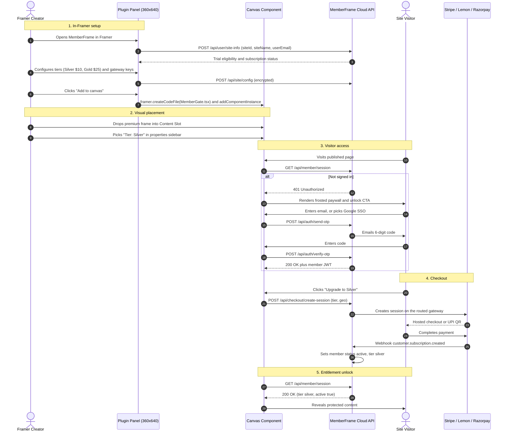
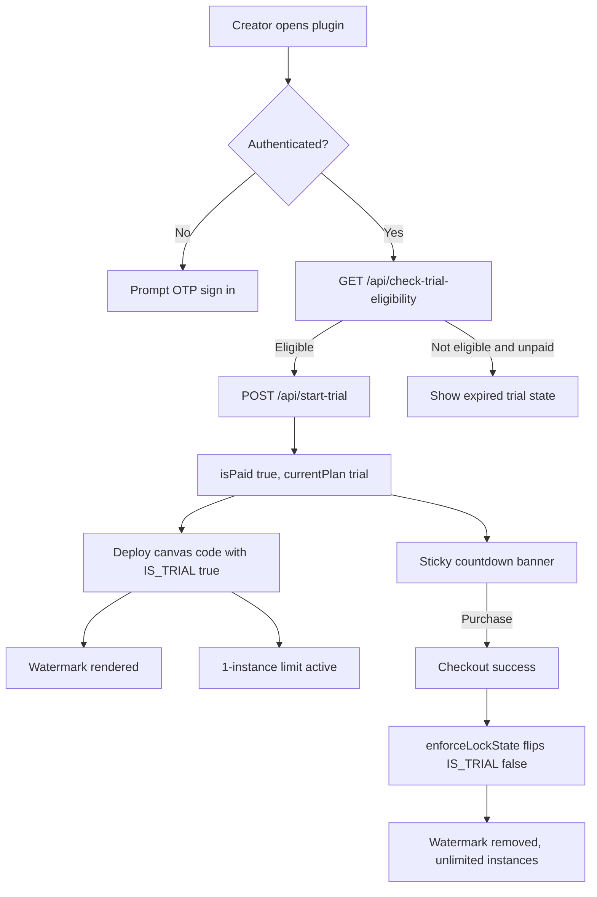

# MemberFrame: Complete Product Requirements Document

> **Document Status**: Draft for Approval
> **Version**: 1.0.0
> **Date**: 2026-10-11
> **Owner**: Product and Engineering
> **Supersedes**: Nothing. Consolidates `final-feature-specifications.md`, `list-the-features-of-the-competitors.md`, and `missing-scopes-we-can-implement.md`.

This is the authoritative PRD for MemberFrame. Where the three source documents in `docs/` disagreed, this document records the resolved decision and cites the source of truth. Section 17 lists every conflict that was found and how it was settled. Section 18 lists what remains genuinely open.

---

## Table of Contents

| Section | Title |
| :--- | :--- |
| 1 | Document Control and Source Reconciliation |
| 2 | Executive Summary and Product Identity |
| 3 | Market Context and Competitive Position |
| 4 | Goals, Non-Goals, and Success Metrics |
| 5 | Personas and Jobs To Be Done |
| 6 | System Architecture and Topology |
| 7 | Plugin UI Specification (Creator Cockpit) |
| 8 | Feature Specifications (F01 to F24) |
| 9 | Canvas Component Inventory |
| 10 | Backend API Contract (External Dependency) |
| 11 | Data Model |
| 12 | Monetization, Pro-Lock, and Trial Lifecycle |
| 13 | Telemetry and Analytics |
| 14 | Non-Functional Requirements |
| 15 | Step-by-Step Work Process (8 Weeks, 4 Phases) |
| 16 | Verification, QA, and Release |
| 17 | Resolved Conflicts and Decision Log |
| 18 | Open Questions and Known Repo Defects |
| 19 | Appendix: Traceability Matrix and Glossary |

---

## 1. Document Control and Source Reconciliation

### 1.1. Inputs Read

| Source | Lines | Role in This PRD |
| :--- | :--- | :--- |
| `docs/final-feature-specifications.md` | 593 | Primary feature catalog (15 features), canvas component table, sequence diagram. |
| `docs/list-the-features-of-the-competitors.md` | 364 | Competitive intelligence, TCO model, parity gap source. |
| `docs/missing-scopes-we-can-implement.md` | 370 | Gap analysis, property control samples, 8-week roadmap, sub-agent allocation. |
| `.agents/rules/framer-sdd-standards.md` | 157 | Binding engineering standards. Overrides the feature docs on shell, CSS, icons, and scope. |
| `.agents/rules/feature-development-docs.md` | 93 | Mandates `docs/development-docs/<slug>.md` per feature. |
| `.agents/skills/framer-plugin-suite/references/pricing-and-trial-lifecycle.md` | 243 | Binding pricing and trial mechanics. Overrides the feature docs on price points. |
| `.agents/skills/framer-plugin-suite/references/sdd-template.md` | 107 | Document shape, tab layout, API contract shape. |
| `.agents/skills/framer-plugin-suite/references/tdd-and-verification.md` | 50+ | Three-layer test strategy. |
| `.agents/skills/framer-plugin-suite/references/boilerplate-scaffolder.md` | 60+ | Scaffold runbook for Phase 0. |
| `instruction/INSTRUCTION.md` | 102 | UX writing rules (Title Case headings, no dashes, no jargon). |
| `instruction/Doc-Instruction.md` | 173 | Documentation tone and structure rules. |

### 1.2. Precedence Order

When two sources conflict, the higher row wins:

1. `.agents/rules/*.md` (binding engineering standards, `alwaysApply: true`).
2. `.agents/skills/framer-plugin-suite/references/*.md` (company ecosystem standards).
3. `instruction/*.md` (workspace writing and process rules).
4. `docs/*.md` (product feature proposals).

This ordering is why creator pricing in this PRD is $4.99 / $49.99 / $99.99 and not the $9.99 / $89 / $149 proposed in `final-feature-specifications.md`.

### 1.3. Current Repository State

As of this document's date the plugin source tree was deliberately reset to a minimal skeleton:

```
src/
  main.tsx    React root, imports framer-plugin/framer.css and App.css
  App.tsx     framer.showUI({ position: "top right", width: 360, height: 640 })
  App.css     box-sizing reset, body margin, one .app layout rule
```

`framer.json` permissions were emptied to `[]` so each permission is re-declared as the build actually needs it. Everything in Section 15 therefore starts from a clean slate, not from a partial implementation. This is intentional and is the correct baseline for the work process below.

---

## 2. Executive Summary and Product Identity

### 2.1. What MemberFrame Is

MemberFrame is a native Framer plugin that turns a static Framer site into a membership and recurring revenue business, with 100 percent of the configuration happening inside the Framer workspace.

### 2.2. The Problem

A Framer creator who wants to sell memberships today has four options, and all four are bad:

1. **FrameAuth** works well but costs $19.99 to $124.99 per month and still requires code overrides for advanced gating.
2. **Thenty** charges a monthly fee AND a 0.5 to 1.5 percent cut of every payment, plus $29 per month for each additional client site.
3. **Subscription Payments** is $29 once and supports UPI, but has no accounts, no database, and no gating at all. It is a button, not a platform.
4. **Outseta** is a full business suite at $47 to $127+ per month plus a 1 to 2 percent cut, delivered through external script embeds and iframes that clash visually with Framer designs.

Across all four, five pain points repeat: double taxation (subscription plus commission), Stripe-only geographic lock-in, mandatory code overrides, broken light and dark theme inheritance, and missing creator workflows such as metered paywalls and CMS item gating.

### 2.3. The In-Framer-First Mandate

Every competitor sends the creator to an external dashboard to configure tiers, prices, and webhooks. MemberFrame does not. The mandate is absolute:

* Tiers, prices, and gateway keys are configured inside the 360x640 plugin panel.
* Subscribers are listed, re-tiered, and revoked inside the plugin panel.
* Lock cards, auth modals, and member states are previewed inside the plugin panel, before publishing.
* Gating is applied by dropping a wrapper component on the canvas and picking a tier in Framer's native properties sidebar. Zero code overrides.

A headless backend service handles persistence, payment webhooks, OTP dispatch, and token verification. The creator never sees it.

### 2.4. Product Identity

| Attribute | Value |
| :--- | :--- |
| **Plugin Name** | MemberFrame |
| **Plugin ID** | `memfrm` |
| **Modes** | `canvas` |
| **Window Geometry** | 360 x 640, `position: "top right"` |
| **Target Audience** | Framer creators, course creators, digital publishers, template sellers, design agencies |
| **Creator Monetization** | 7-day free trial, then Monthly / Yearly / Lifetime |
| **Platform Transaction Fee** | 0 percent, guaranteed across all tiers |
| **Supported Gateways** | Stripe, Lemon Squeezy, Razorpay (UPI) |

---

## 3. Market Context and Competitive Position

### 3.1. Positioning Statement

For Framer creators who want recurring revenue without leaving Framer and without surrendering a cut of their earnings, MemberFrame is the only membership plugin that combines full gating, tri-gateway global payments, and a 0 percent platform fee, configured entirely inside the canvas.

### 3.2. Where MemberFrame Wins

| Strategic Capability | FrameAuth | Thenty | Subscription Payments | Outseta | MemberFrame |
| :--- | :--- | :--- | :--- | :--- | :--- |
| Platform transaction fee | 0% | 0.5 to 1.5% | 0% | 1.0 to 2.0% | **0%** |
| Payment gateways | Stripe, Lemon Squeezy | Stripe | Stripe, Razorpay | Stripe | **All three** |
| Code override required | Yes | Partial | No | No (script tag) | **No (wrapper slots)** |
| In-plugin live studio | No | Partial | Button only | No | **Full component studio** |
| Light and dark sync | Manual CSS | Partial | Fixed | Manual embed CSS | **Automatic via tokens** |
| Metered soft paywall | Static blur | No | No | No | **Dynamic read meter** |
| Framer CMS item gating | Redirect hack | No | No | Path-based | **CMS field-aware** |
| SEO structured paywall | No | No | No | No | **Schema.org JSON-LD** |
| Secure asset downloads | Basic URL check | No | No | No | **60-second signed URL** |
| Passwordless OTP | Yes | No | No | No | **Yes, with resend ticker** |
| Social SSO providers | Google, GitHub | Google | No | Google | **Google, Apple, GitHub, Discord** |
| B2B team seats | No | No | No | Yes ($87/mo+) | **Yes, in-portal invites** |
| LMS video progress | Checkbox only | No | No | No | **Player listener plus % bar** |
| Agency multi-site | Standard tier | +$29/mo per site | One-time | High tier | **Pooled, no per-site fee** |

### 3.3. Total Cost of Ownership

Modelled for a creator at $5,000 monthly subscription revenue with 1,000 active members:

| Metric | Subscription Payments | FrameAuth | Thenty | Outseta | MemberFrame |
| :--- | :--- | :--- | :--- | :--- | :--- |
| Software subscription | $0 ($29 once) | $19.99/mo | $29.00/mo | $47.00/mo | **$4.99/mo** |
| Platform transaction fee | 0% ($0) | 0% ($0) | 1.5% ($75.00) | 2.0% ($100.00) | **0% ($0)** |
| Total monthly software cost | $0.00 | $19.99 | $104.00 | $147.00 | **$4.99** |
| Annual software expense | $29 year one | $239.88 | $1,248.00 | $1,764.00 | **$49.99 (yearly plan)** |

At $99.99 once for Lifetime, MemberFrame undercuts a single year of every competitor except Subscription Payments, which has no membership capability at all.

### 3.4. Competitor Features MemberFrame Does Not Yet Plan

Honest parity gaps found during research. None of these appear in any of the three source documents. They are carried into Section 8 as P2 and P3 items so the decision to ship or skip is explicit rather than accidental:

| Gap | Who Has It | Risk If Skipped |
| :--- | :--- | :--- |
| ReCAPTCHA or bot defense on auth forms | FrameAuth, Outseta | OTP endpoint abuse, email bombing, cost exposure |
| Multi-language localization | FrameAuth | Blocks non-English creators, a stated target market |
| Shared or group password access | FrameAuth | Loses agency client-review and staging-preview use case |
| Email and password accounts | FrameAuth, Thenty, Outseta | Some buyers distrust OTP-only or SSO-only login |
| Custom profile fields at signup | FrameAuth, Thenty, Outseta | Partially covered by the onboarding modal, not by basic signup |
| Zapier or outbound webhooks | Thenty | No path to Mailchimp, ConvertKit, Airtable, Notion |
| Affiliate and referral tracking | Thenty (Rewardful) | Creators cannot run referral growth |
| Email broadcast and drip campaigns | Outseta | Transactional only. Creators keep paying a separate ESP |
| Integrated help desk | Outseta (Thenty via Intercom) | Acceptable to skip. Not core to the gating job |

---

## 4. Goals, Non-Goals, and Success Metrics

### 4.1. Product Goals

| ID | Goal | Measure |
| :--- | :--- | :--- |
| G1 | Zero code overrides for all gating | A creator gates a frame, a CMS item, and a download without typing code |
| G2 | Full configuration without leaving Framer | Tier creation to first paid subscriber completed entirely in-panel |
| G3 | Global payment reach | A buyer in the US, the EU, and India each complete checkout in a local method |
| G4 | Visual fidelity with the host site | Every component passes light and dark contrast checks with zero hardcoded hex |
| G5 | Honest creator economics | 0 percent platform fee on every tier, stated on the listing |
| G6 | Confidence before publishing | Creator previews all five member states in-panel before inserting |

### 4.2. Non-Goals for Version 1.0

1. Email broadcast marketing and drip campaign authoring. Transactional email only.
2. A built-in help desk or ticketing system.
3. A full CRM with activity timelines and lead scoring.
4. Native mobile applications for members.
5. Server code in this repository. See Section 10.
6. Gateways beyond Stripe, Lemon Squeezy, and Razorpay.
7. Crypto or Web3 wallet payments.

### 4.3. Success Metrics

| Metric | Target | Window |
| :--- | :--- | :--- |
| Trial to paid conversion | 12 percent or better | First 90 days post-launch |
| Time from install to first tier configured | Under 10 minutes, median | Ongoing |
| Time from install to first gated frame published | Under 30 minutes, median | Ongoing |
| Marketplace listing rating | 4.5 or better | First 6 months |
| Support tickets per 100 active sites | Under 8 per month | Ongoing |
| Checkout completion rate, India (Razorpay) | Within 5 points of the Stripe global rate | First 90 days |
| Zero-inline-CSS lint violations | 0, enforced in CI | Every commit |

---

## 5. Personas and Jobs To Be Done

### 5.1. Maya, the Course Creator

Sells a $49 per month design course. Not a developer. Abandoned FrameAuth because code overrides broke on a Framer update.

* **Job**: Gate 40 video lessons behind one paid tier and show students their progress.
* **Needs**: `<MemberGate>`, `<CourseProgress>`, `<LessonChecklist>`, `<VideoProgressListener>`.
* **Success**: Gates 40 lessons in an afternoon without touching code.

### 5.2. Arjun, the Indian Indie Hacker

Sells a 299 rupee per month newsletter from Bangalore. Stripe-only tools lose most of his buyers at checkout.

* **Job**: Accept UPI and Netbanking, with gating, at a price that works in rupees.
* **Needs**: Razorpay routing, geolocation detection, INR as default currency.
* **Success**: UPI QR checkout completes without the buyer leaving the site.

### 5.3. Priya, the Agency Lead

Runs a six-person studio shipping 20 Framer client sites a year. Thenty's $29 per extra site is disqualifying.

* **Job**: Deploy membership on many client sites under one license, then hand off cleanly.
* **Needs**: Pooled Agency licensing, no per-domain penalty, white-label handoff.
* **Success**: Membership on 20 client sites with one Lifetime purchase.

### 5.4. Daniel, the Digital Publisher

Runs a Framer news site with 300 CMS articles. Needs Google traffic preserved while converting readers.

* **Job**: Give away 3 articles a month, then require payment, without losing search rankings.
* **Needs**: `<MeteredPaywall>`, `<CMSGatedTemplate>`, Schema.org JSON-LD injection.
* **Success**: Googlebot indexes full articles. Humans hit the meter at article 4.

### 5.5. Sofia, the Site Member (End User)

Not a MemberFrame customer. A customer of a MemberFrame customer. Her experience decides whether creators keep paying.

* **Job**: Sign in fast, pay once, access content, and manage billing without emailing support.
* **Needs**: `<MemberAuth>` OTP or SSO, `<MemberDashboard>` self-serve billing.
* **Success**: Signs in with no password and cancels without contacting anyone.

---

## 6. System Architecture and Topology

### 6.1. Three-Tier Topology

```
┌─────────────────────────────────────────────────────────────────────────────────────────┐
│                              MEMBERFRAME SYSTEM TOPOLOGY                                │
├───────────────────────────────┬─────────────────────────────┬───────────────────────────┤
│ 1. FRAMER PLUGIN PANEL        │ 2. CANVAS RUNTIME           │ 3. HEADLESS BACKEND       │
│    (Creator Cockpit 360x640)  │    (Published Site)         │    (External Repository)  │
│    THIS REPOSITORY            │    THIS REPOSITORY          │    NOT THIS REPOSITORY    │
├───────────────────────────────┼─────────────────────────────┼───────────────────────────┤
│ • Home tab (hero, guides)     │ • <MemberGate>              │ • Identity and session    │
│ • Builder tab (live studio)   │ • <MemberAuth>              │   engine (JWT, HTTP-only) │
│ • Manage tab (members, tiers) │ • <MemberDashboard>         │ • Stripe, Lemon Squeezy,  │
│ • Settings tab (keys, theme)  │ • <MeteredPaywall>          │   Razorpay webhooks       │
│ • Account sheet (plan, trial) │ • <CMSGatedTemplate>        │ • PostgreSQL and Prisma   │
│ • Tri-gateway key vault UI    │ • <ProtectedDownload>       │ • 6-digit OTP dispatch    │
│ • Property controls injector  │ • <CourseProgress> trio     │ • S3 or R2 signed URLs    │
│ • Dual-theme token sync       │ • <DonationSlider>          │ • Telemetry ingestion     │
│ • Client Pro-Lock licensing   │ • <MemberDirectory>         │ • Dunning and grace jobs  │
│ • Site telemetry sync         │ • 6 more (see Section 9)    │ • AES-256-GCM key vault   │
└───────────────────────────────┴─────────────────────────────┴───────────────────────────┘
```

The repository boundary is load bearing. `.agents/rules/framer-sdd-standards.md` section 1 states the agent ecosystem is 100 percent focused on frontend plugin development and that backend servers are maintained separately. Section 10 of this PRD specifies the backend as a consumed contract, not as a deliverable of this repo.

### 6.2. End-to-End Sequence



### 6.3. Repository File Layout (Target)

```
memberframe/
├── framer.json                  Plugin manifest, permissions declared incrementally
├── index.html                   Mounts /src/main.tsx
├── vite.config.ts               react(), framer(), basicSsl(), port 5173
├── src/
│   ├── main.tsx                 React root
│   ├── App.tsx                  showUI geometry, shell, enforceLockState effect
│   ├── App.css                  Reset and app layout only
│   ├── components/
│   │   ├── shell/               PluginShell, PluginHeader, TabBar, PluginFooter
│   │   ├── tabs/                HomeTab, BuilderTab, ManageTab, SettingsTab
│   │   ├── manage/              MembersTable, MemberFlyout, TierEditor
│   │   ├── studio/              PreviewStudio, StateSwitcher
│   │   ├── account/             AccountSheet, PlanCard, TrialBanner
│   │   └── ui/                  Button, IconButton, FieldRow, Toggle, Toast, Banner, EmptyState
│   ├── canvas-components/       Source of truth for generated canvas code
│   ├── hooks/                   useMemberSession, useFramerTheme, usePluginStorage, useSiteTelemetry, useProLock
│   ├── services/                framerCanvasService, canvasComponentCodeGenerator, storageService, apiClient
│   ├── styles/                  design-tokens.css, components.css, per-feature CSS
│   ├── types/                   index.ts, framer-canvas.d.ts
│   └── utils/                   framerMock.ts, compression.ts, lockPatcher.ts
├── docs/
│   ├── memberframe-complete-prd.md    This document
│   └── development-docs/              One file per feature, mandated by rule
└── .agents/                     Rules, skills, scripts
```

---

## 7. Plugin UI Specification (Creator Cockpit)

### 7.1. Window Geometry

Initialized once in `src/App.tsx`, per `.agents/rules/framer-sdd-standards.md` section 3:

```typescript
framer.showUI({
  position: "top right",
  width: 360,
  height: 640,
});
```

The collapse toggle shrinks the panel to 48px height by calling `showUI` again with `height: 48`, and restores to 640 when tapped a second time.

### 7.2. Four-Part Shell

Mandated by `.agents/rules/framer-sdd-standards.md` section 6. All four parts are required.

| Part | Height | Contents |
| :--- | :--- | :--- |
| **Plugin Header** | 48px | 24px logo (`.framefic-header-logo`), plugin name in Title/Small, collapse toggle (`<ChevronDown size={14} />`), close button (`<X size={14} />` calling `framer.closePlugin()`) |
| **Tab Bar** | 36px | Four tabs with a 2px bottom gradient pill on the active tab (`.framefic-tab.active`), spacer, then the account icon button (`<UserRound size={16} />`) |
| **Content Scroll Area** | Flexible | `.framefic-content-area`, scrolls between header and pinned footer |
| **Plugin Footer** | 40px | Pinned (`.framefic-footer`), company link (`<ExternalLink size={12} />`), spacer, version tag opening the changelog |

### 7.3. Tab Structure

Resolved decision. The feature doc proposed five tabs (Home, Builder, Members, Tiers, Settings). The shell standard permits two to four. Members and Tiers are folded into a single **Manage** tab with a segmented control, because they share the same data domain and the same backend calls.

| Tab | Title | Purpose | Primary CTA (exactly one) |
| :--- | :--- | :--- | :--- |
| 1 | `Home` | Hero card, quick-start guide, docs links, cross-promo | "Open builder" |
| 2 | `Builder` | Component picker, customizer, Live Preview Studio, state switcher | "Add to canvas" |
| 3 | `Manage` | Segmented control: Members table, Tiers editor | "Create tier" (Tiers) / none (Members) |
| 4 | `Settings` | Gateway key vault, theme switcher, telemetry toggle, locale | "Save settings" |
| Icon | Account sheet | Plan badge, trial countdown, invoices, upgrade checkout | "Upgrade to Pro" |

### 7.4. Builder Tab Detail

The Builder tab is the product's centre of gravity and the main competitive differentiator. No competitor offers an in-panel component studio.

```
┌──────────────────────────────────────────┐
│ Component picker (dropdown, 15 entries)  │
├──────────────────────────────────────────┤
│  Live Preview Studio                     │
│  ┌────────────────────────────────────┐  │
│  │  Rendered component at true scale  │  │
│  │  Reads live design-tokens.css      │  │
│  └────────────────────────────────────┘  │
│  State switcher (segmented, 5 states)    │
│  [Guest][Free][Silver][VIP][Failed]      │
├──────────────────────────────────────────┤
│  Customizer (.field-row stack)           │
│  Lock title        [________________]    │
│  Lock message      [________________]    │
│  Blur amount       [====O=========] 8px  │
│  Required tier     [ Silver        v]    │
│  Fallback action   [ Frosted blur  v]    │
├──────────────────────────────────────────┤
│  [+ Add to canvas]      <- .primary-cta  │
└──────────────────────────────────────────┘
```

The five simulated states are `Logged Out (Guest)`, `Free Member`, `Silver Tier Subscriber`, `VIP Member`, and `Expired / Payment Failed`. The studio drives them through a simulated `MemberSessionContext`, entirely client side, with no backend calls.

### 7.5. Binding UI Standards

Non-negotiable, from `.agents/rules/framer-sdd-standards.md`:

| Rule | Requirement |
| :--- | :--- |
| **Zero inline CSS** | Never `style={{ ... }}` in JSX. All styling in external `.css`. Canvas components consolidate into a `cssContent` string injected via `<style>` |
| **One primary CTA per view** | Exactly one `.primary-cta` per view. Never two |
| **CTA gradient** | 180 degrees `#5271ff` to `#3b51b8`, 10px radius medium or 8px small, `inset 0 1px 0 rgba(255,255,255,0.20)` lit top, `0 2px 6px -2px rgba(82,113,255,0.14)` glow |
| **Flat brand fill prohibited** | Never flat `#5271FF`. White on it fails WCAG AA at 4.07:1. Use the gradient or `#3358FF` at 5.28:1 |
| **Icons** | Lucide React or Framer SVG only, `stroke="currentColor"`. Zero unicode emojis anywhere |
| **Icon buttons** | 30x30px, 8px radius, 16px icon, always `aria-label` plus `title` |
| **Zero hardcoded hex** | Reference tokens: `var(--framefic-page-bg)`, `var(--framefic-surface)`, `var(--title)`, `var(--paragraph)`, `var(--secondary-default)` |
| **Theme sync** | React to `body[data-framer-theme]` and `html[data-user-theme]` |
| **Field rows** | `.field-row` horizontal flex, space-between, min-height 30px, gap 12px. Label left at 12px weight 500, control right at fixed 160px or `.fill` |
| **Control geometry** | Inputs, selects, segmented controls strictly 30px tall, 8px radius, `var(--framer-color-bg-tertiary)` fill |
| **Focus state** | 1px tint ring plus 3px halo `0 0 0 3px rgba(82, 113, 255, 0.20)` |
| **Select contrast fix** | `select option { background-color: var(--framer-color-bg-tertiary, var(--bg-card-inner)) !important; color: var(--title) !important; }` |
| **Toggle vs checkbox** | Toggle (28x16 pill, `role="switch"`) for instant-apply only. Checkbox (16x16, 4px radius) when a Save is required |
| **Feedback hierarchy** | Toast for finished actions (max 45 chars, auto-dismiss 5s+). Banner for persistent state (max 2 per screen). Empty state with exactly one next-step action. Field errors inline under the field via `aria-describedby`, never a banner |

### 7.6. UX Writing Rules

From `instruction/INSTRUCTION.md` section 2, binding on every user-visible string:

1. Headings use Title Case. Buttons, field labels, options, and body text use sentence case.
2. Never use em-dashes or en-dashes in any UI string. Use a period, colon, semicolon, or parentheses. The only permitted dash glyph is the lone empty-value placeholder in tables.
3. Field help is one sentence in `helpText`. Anything longer uses the shared info icon with `HelpTooltip`.
4. No developer jargon. Never expose raw enum values such as `free_member` or `past_due`. Use friendly label maps.
5. Pluralize counts properly: "1 member", "2 members". Never "member(s)".
6. Every sentence starts with a capital and ends with a period, including fragments after a separator.
7. Action copy is verb plus object, sentence case, two to four words, 25 characters or fewer.

---

## 8. Feature Specifications

24 features across six domains. Each carries a stable ID for traceability, a priority tier, and verifiable acceptance criteria.

**Priority tiers**: P0 is core MVP and ships in Phase 1 or 2. P1 is creator enhancement. P2 is global expansion or parity. P3 is post-1.0 candidate.

### 8.1. Feature Index

| ID | Feature | Domain | Priority | Phase | Entitlement |
| :--- | :--- | :--- | :--- | :--- | :--- |
| F01 | Zero-Code Visual Canvas Gating | Gating | P0 | 1 | All plans |
| F02 | In-Plugin Member and Tier Cockpit | Administration | P0 | 1 | All plans |
| F03 | Tri-Gateway Smart Payment Connect | Payments | P0 | 1 and 2 | Stripe on trial, all three on paid |
| F04 | Live Preview Studio with State Simulator | Designer DX | P0 | 1 | All plans |
| F05 | Multi-Provider Auth and Passwordless OTP | Identity | P0 | 1 | All plans |
| F06 | Canvas-Native Member Billing Portal | Self-Serve | P0 | 3 | Paid plans |
| F07 | Dynamic Metered Soft Paywall | Metering | P1 | 2 | Paid plans |
| F08 | SEO-Preserving Schema.org Injection | SEO | P1 | 2 | All plans |
| F09 | Framer CMS Item-Level Gating | CMS | P1 | 3 | Paid plans |
| F10 | Expiring Secure Asset Vault | Digital Goods | P1 | 3 | Paid plans |
| F11 | Creator LMS Suite | E-Learning | P1 | 2 | Paid plans |
| F12 | B2B Team Accounts and Seat Invites | B2B | P2 | 3 | Lifetime only |
| F13 | Pay-What-You-Want Donation Slider | Monetization | P1 | 4 | All plans |
| F14 | Member Bookmarks and Saved Tray | Engagement | P2 | 4 | Paid plans |
| F15 | Member Directory with Tier Badges | Community | P2 | 4 | Paid plans |
| F16 | Progressive Onboarding Questionnaire | Identity | P2 | 3 | Paid plans |
| F17 | Targeted Member Announcement Bar | Engagement | P2 | 4 | Paid plans |
| F18 | Grace Period and Automated Dunning | Payments | P1 | 2 | All plans |
| F19 | Client Pro-Lock and Trial Licensing | Licensing | P0 | 2 | Plugin infrastructure |
| F20 | Framer Site Telemetry Sync | Infrastructure | P0 | 2 | Plugin infrastructure |
| F21 | Bot Defense on Auth Endpoints | Security | P1 | 2 | All plans |
| F22 | Shared Password Access | Gating | P2 | 3 | Paid plans |
| F23 | Multi-Language Localization | Reach | P2 | 4 | All plans |
| F24 | Outbound Webhooks and Zapier Events | Integration | P3 | 4 | Paid plans |

---

### F01: Zero-Code Visual Canvas Gating (`<MemberGate>`)

* **Domain**: Content Protection and Gating
* **Priority**: P0. **Phase**: 1. **Entitlement**: All plans.
* **Competitor limitation**: FrameAuth requires Framer code overrides attached to frames, which creates high friction for visual designers and breaks on Framer updates.

**Creator use case**: Gate video lessons, resource links, or whole page sections without writing or maintaining code overrides.

**In-plugin configuration flow**:
1. Creator opens the Builder tab and picks "Member Gate" from the component picker.
2. Creator customizes lock card title, description, button text, and blur radius. The Live Preview Studio updates live.
3. Creator clicks "Add to canvas". The component is deployed via `framer.createCodeFile` and inserted via `addComponentInstance`.
4. In Framer's properties sidebar, the creator connects the target frame to the `Content Slot` and picks the required tier.

**Visitor runtime flow**:
1. Unauthenticated visitor lands on a page containing gated content.
2. Visitor sees a frosted glass preview or lock teaser explaining the required tier.
3. Visitor clicks "Sign in to unlock" or "Upgrade to view".
4. Once signed in with an eligible active tier, the gate dissolves and content is revealed.

**Technical implementation**:
* **Component**: `MemberGate.tsx`, deployed via `framer.createCodeFile`.
* **Slot architecture**: `ControlType.ComponentInstance` accepts any native Framer frame or component.
* **Runtime hook**: `useMemberSession()` checks the local JWT and cached tier entitlement against `requiredTier`.
* **Styling**: Injected CSS module with `.memberframe-gate-container`, `.memberframe-blur-overlay`, `.memberframe-lock-card`. Zero inline styles.
* **Fallback behaviors**: `Frosted Blur`, `Hide Completely`, `Redirect to Page`, `Custom Locked Card`.

**Property controls**:

```typescript
addPropertyControls(MemberGate, {
  contentSlot: {
    type: ControlType.ComponentInstance,
    title: "Protected Frame",
  },
  requiredTier: {
    type: ControlType.Enum,
    title: "Access Tier",
    options: ["signed_in", "free_member", "tier_1", "tier_2", "vip"],
    optionTitles: ["Any Signed In", "Free Member", "Tier 1: Silver", "Tier 2: Gold", "VIP Member"],
    defaultValue: "signed_in",
  },
  fallbackAction: {
    type: ControlType.Enum,
    title: "Locked State",
    options: ["blur", "hide", "redirect", "custom_card"],
    optionTitles: ["Frosted Blur", "Hide Completely", "Page Redirect", "Lock Card"],
    defaultValue: "blur",
  },
  redirectUrl: {
    type: ControlType.Link,
    title: "Redirect Target",
    hidden: (props) => props.fallbackAction !== "redirect",
  },
  cardTitle: {
    type: ControlType.String,
    title: "Lock Title",
    defaultValue: "Members Only Content",
    hidden: (props) => props.fallbackAction !== "custom_card",
  },
  cardDescription: {
    type: ControlType.String,
    title: "Lock Message",
    defaultValue: "Join or sign in to read this full guide.",
    hidden: (props) => props.fallbackAction !== "custom_card",
  },
  blurIntensity: {
    type: ControlType.Number,
    title: "Blur Amount",
    min: 2, max: 20, unit: "px", defaultValue: 8,
    hidden: (props) => props.fallbackAction !== "blur",
  },
});
```

**Data contract**:

```typescript
interface MemberSessionData {
  memberId: string;
  email: string;
  name: string | null;
  activeTier: string;              // "free" | "silver" | "gold" | "vip"
  status: "active" | "trialing" | "past_due" | "canceled";
  currentPeriodEnd: number;        // Unix timestamp, seconds
  siteId: string;
}
```

**Acceptance criteria**:
- [ ] A frame dropped into `Content Slot` renders unmodified for an entitled member.
- [ ] Each of the four fallback actions produces its distinct visual result.
- [ ] `redirectUrl` is hidden in the sidebar unless `fallbackAction` is `redirect`.
- [ ] Tier comparison is hierarchical: a VIP member passes a `tier_1` gate.
- [ ] A canceled member with `currentPeriodEnd` in the future still passes until that timestamp.
- [ ] Gate renders its locked state, not a crash or blank frame, when the API is unreachable.
- [ ] Zero inline CSS, verified by the linter.
- [ ] Light and dark contrast verified at WCAG AA against `data-framer-theme`.

---

### F02: In-Plugin Member and Tier Cockpit

* **Domain**: In-Framer Administration
* **Priority**: P0. **Phase**: 1. **Entitlement**: All plans. Batch actions on paid plans.
* **Competitor limitation**: Every competitor sends the creator to an external web dashboard to manage members and prices.

**Creator use case**: Monitor subscribers, change tiers, grant manual access, and adjust prices without leaving the Framer canvas.

**Creator flow**:
1. Creator opens the Manage tab. The segmented control defaults to "Members".
2. The live member table renders with search, tier filter pills, and status badges.
3. Clicking a row opens an action flyout: "Change tier", "Grant VIP", "Revoke access", "Send magic link".
4. Switching the segment to "Tiers" allows editing tier names, monthly and annual prices, and permissions.

**Technical implementation**:
* **Plugin UI**: `ManageTab.tsx` containing `MembersTable.tsx`, `MemberFlyout.tsx`, `TierEditor.tsx`.
* **Creator authentication**: Verified via `framer.getCurrentUser()` and `framer.getProjectInfo()`, exchanged for a creator session token.
* **Pagination**: Server-side, 25 rows per page. The 360px panel cannot render large tables.
* **Empty state**: `.empty-state` with exactly one action, "Create your first tier".

**Data contract**:

```typescript
interface SiteMemberRecord {
  id: string;
  email: string;
  name: string | null;
  avatarUrl: string | null;
  tier: string;
  status: "active" | "trialing" | "past_due" | "canceled";
  createdAt: string;               // ISO 8601
  lifetimeSpend: number;           // Minor units
  currency: string;
  gateway: "stripe" | "lemonsqueezy" | "razorpay";
}

interface SiteTierRecord {
  id: string;
  siteId: string;
  key: string;                     // "tier_1" | "tier_2" | "vip" | custom
  name: string;                    // Creator-facing: "Silver"
  monthlyPriceMinor: number | null;
  annualPriceMinor: number | null;
  lifetimePriceMinor: number | null;
  currency: string;
  rank: number;                    // Hierarchy for entitlement comparison
  isActive: boolean;
}
```

**Acceptance criteria**:
- [ ] Member search filters by email and name, debounced at 300ms.
- [ ] Tier filter pills and status badges use token colors, never hardcoded hex.
- [ ] Changing a member tier reflects within 2 seconds and shows a confirmation toast under 45 characters.
- [ ] "Revoke access" requires a confirmation step before acting.
- [ ] Tier `rank` drives hierarchical entitlement and cannot be duplicated across tiers.
- [ ] Empty member list renders `.empty-state`, never a blank area.
- [ ] Table remains usable at 360px width with no horizontal page scroll.

---

### F03: Tri-Gateway Smart Payment Connect

* **Domain**: Payments and Monetization
* **Priority**: P0. **Phase**: 1 (Stripe), 2 (Lemon Squeezy, Razorpay). **Entitlement**: Stripe on trial, all three on paid.
* **Competitor limitation**: Thenty and Outseta are Stripe-only, excluding India, Southeast Asia, and parts of Latin America. Subscription Payments has Razorpay but no gating.

**Creator use case**: Sell to buyers in the US, the EU, and India without tax compliance work and without losing buyers who want UPI.

**Visitor flow**:
1. Visitor clicks "Subscribe" on a pricing table.
2. MemberFrame detects visitor location and routes the gateway:
   * India: Razorpay with UPI QR, Google Pay UPI, Netbanking.
   * Europe: Lemon Squeezy as Merchant of Record with automated EU VAT.
   * Global: Stripe with cards, Apple Pay, Google Pay, Link.
3. Payment completes and access unlocks.

**In-plugin configuration flow**:
1. Creator opens Settings and expands the gateway key vault.
2. Creator pastes keys: Stripe publishable and secret, Lemon Squeezy store ID and API key, Razorpay key ID and secret.
3. The plugin validates each key against the backend and shows a verified indicator.

**Technical implementation**:
* **Routing**: Backend normalizes all three into a single `SubscriptionUpdated` event shape.
* **Key encryption**: Secret keys encrypted AES-256-GCM before PostgreSQL storage. Secrets are never returned to the client, only a masked suffix.
* **Key prefix detection**: `pk_live_` or `pk_test_` is Stripe. `rzp_live_` or `rzp_test_` is Razorpay. Store ID plus API key is Lemon Squeezy.
* **Geolocation**: Server-side IP country lookup with a manual currency override in Settings.

**Data contract**:

```typescript
interface SiteGatewayConfig {
  siteId: string;
  stripePublishableKey?: string;
  stripeSecretKeyEncrypted?: string;
  lemonSqueezyStoreId?: string;
  lemonSqueezyApiKeyEncrypted?: string;
  razorpayKeyId?: string;
  razorpayKeySecretEncrypted?: string;
  defaultCurrency: "USD" | "EUR" | "GBP" | "INR";
  autoDetectGeolocation: boolean;
}
```

**Acceptance criteria**:
- [ ] A secret key is never present in any client-side response payload.
- [ ] An invalid key shows an inline field error under the field, not a banner.
- [ ] Test keys route to gateway test mode and are clearly labelled in the UI.
- [ ] With `autoDetectGeolocation` off, all buyers get the `defaultCurrency` gateway.
- [ ] An Indian IP receives a Razorpay session when a Razorpay key is configured.
- [ ] If the routed gateway has no key configured, routing falls back to Stripe with a logged warning.
- [ ] Zero platform fee is applied on every gateway. No fee line item exists in the codebase.

---

### F04: Live Preview Studio with Auth State Simulator

* **Domain**: Developer and Designer Experience
* **Priority**: P0. **Phase**: 1. **Entitlement**: All plans.
* **Competitor limitation**: FrameAuth and Thenty offer no in-panel preview. Designers must insert on canvas and publish to see results.

**Creator use case**: See how login modals, lock cards, and member badges look across themes and subscription states without publishing.

**Creator flow**:
1. Creator opens the Builder tab.
2. The preview viewport renders the selected component at true scale.
3. Creator picks a state from the segmented switcher: Guest, Free, Silver, VIP, or Payment Failed.
4. The preview updates instantly, allowing inspection of contrast, copy, and layout.

**Technical implementation**:
* **Component**: `PreviewStudio.tsx` with a simulated `MemberSessionContext` provider.
* **Styling**: Reads live `design-tokens.css` variables with dynamic CSS variable overrides for the customizer values.
* **No network**: Entirely client side. No backend calls, so it works offline and during trial.

**Data contract**: Local preview state only. Nothing persisted, nothing transmitted.

**Acceptance criteria**:
- [ ] All five states render distinctly with no console errors.
- [ ] Customizer changes reflect in the preview within one animation frame.
- [ ] Preview respects `data-framer-theme` and re-renders on workspace theme change.
- [ ] Preview never issues a network request, verified in the network panel.
- [ ] Preview renders correctly for all 15 canvas components in the picker.

---

### F05: Multi-Provider Auth and Passwordless OTP (`<MemberAuth>`)

* **Domain**: Identity and Authentication
* **Priority**: P0. **Phase**: 1. **Entitlement**: All plans.
* **Competitor limitation**: FrameAuth has Google and GitHub only. Thenty has Google only. No competitor supports Apple Sign In or Discord.

**Creator use case**: Give members a modern frictionless sign-in with no forgotten passwords.

**Visitor flow**:
1. Visitor clicks "Sign in" or triggers a locked gate.
2. The modal shows Google, Apple, GitHub, and Discord buttons plus an email field.
3. Choosing email dispatches a 6-digit OTP with a 60-second resend countdown.
4. Entering the code signs the visitor in and sets an HTTP-only session cookie.

**In-plugin configuration flow**:
1. Creator enables or disables providers with checkboxes in the Builder tab.
2. Creator customizes the headline, welcome copy, and brand accent color.
3. Creator clicks "Add to canvas".

**Technical implementation**:
* **Component**: `MemberAuth.tsx`, supporting modal overlay and inline page modes.
* **OTP security**: 6-digit crypto-random codes, SHA-256 hashed at rest, 10-minute expiry, maximum 3 verification attempts per code.
* **Rate limiting**: Per email and per IP on the send endpoint. See F21.
* **OAuth**: Secure popup with `postMessage` callback so the visitor stays on the page with no full-page redirect.

**Data contract**:

```typescript
interface MemberAuthPayload {
  email: string;
  authProvider: "otp" | "google" | "apple" | "github" | "discord";
  code?: string;
  metadata?: Record<string, string>;
}
```

**Acceptance criteria**:
- [ ] A 4th verification attempt on one code is rejected and the code is invalidated.
- [ ] An expired code past 10 minutes is rejected with a distinct message from a wrong code.
- [ ] The resend button is disabled for 60 seconds with a visible countdown.
- [ ] Session cookie is HTTP-only, Secure, and SameSite.
- [ ] A disabled provider does not render its button.
- [ ] OAuth popup blocked by the browser produces an actionable inline error, not a silent failure.
- [ ] Modal is keyboard navigable, traps focus, and closes on Escape.
- [ ] Zero unicode emoji in any provider button. Lucide or brand SVG only.

---

### F06: Canvas-Native Member Billing Portal (`<MemberDashboard>`)

* **Domain**: Self-Serve Member Management
* **Priority**: P0. **Phase**: 3. **Entitlement**: Paid plans.
* **Competitor limitation**: Thenty and Outseta redirect members to external hosted pages or iframes that look disconnected from the site design.

**Creator use case**: Let subscribers manage billing, download invoices, update cards, and cancel on the creator's own site.

**Visitor flow**:
1. Authenticated member visits `/account` or clicks their profile badge.
2. The dashboard shows active plan, next renewal date, and billing history.
3. "Update payment card" opens a secure portal session on the originating gateway.
4. Member updates name, avatar, and notification settings inline.

**Technical implementation**:
* **Component**: `MemberDashboard.tsx` with property controls for visible tabs, avatar upload, and theme mode.
* **Backend**: `POST /api/member/billing-portal-session` returns a single-use portal link.
* **Team seats**: When the member's tier includes seats, a "Team seats" tab appears, rendering `TeamManagement` (F12).

**Data contract**:

```typescript
interface MemberBillingSummary {
  planName: string;
  billingInterval: "month" | "year" | "lifetime";
  amount: number;                  // Minor units
  currency: string;
  nextBillingDate: number;         // Unix timestamp
  paymentMethodSummary: string;    // "Visa ending 4242"
  invoices: Array<{ id: string; date: number; amount: number; pdfUrl: string }>;
}
```

**Acceptance criteria**:
- [ ] Portal link is single-use and expires. A reused link is rejected.
- [ ] A lifetime member sees no renewal date and no cancel action.
- [ ] Invoice PDFs open without exposing another member's invoice ID.
- [ ] Avatar upload enforces a size and MIME type limit with an inline field error.
- [ ] Dashboard renders a signed-out state rather than crashing when the session expires mid-session.
- [ ] Team seats tab is hidden for tiers without seat allocation.

---

### F07: Dynamic Metered Soft Paywall (`<MeteredPaywall>`)

* **Domain**: Content Metering and Conversion
* **Priority**: P1. **Phase**: 2. **Entitlement**: Paid plans.
* **Competitor limitation**: Competitors offer binary access or a static fade-out with no meter tracking.

**Creator use case**: Let casual readers view 3 free articles a month before requiring payment.

**Visitor flow**:
1. Visitor reads article 1. A floating pill reads "Article 1 of 3 free articles this month".
2. Visitor reads articles 2 and 3. The counter updates.
3. On article 4, content blurs after paragraph 2 and a frosted lock card appears with an unlock CTA.

**Technical implementation**:
* **Component**: `MeteredPaywall.tsx`.
* **Tracking**: Article slugs recorded in encrypted client storage keyed to a device fingerprint, reconciled with the member session when signed in.
* **Known limitation**: Client-side metering is defeatable by clearing storage or using a private window. This is industry standard behavior (the New York Times has the same property) and is accepted. Server-side metering per authenticated member is exact.

**Property controls**:

```typescript
addPropertyControls(MeteredPaywall, {
  freeQuotaCount: {
    type: ControlType.Number,
    title: "Free Articles",
    min: 1, max: 10, step: 1, defaultValue: 3,
    displayStepper: true,
  },
  quotaPeriod: {
    type: ControlType.Enum,
    title: "Reset Window",
    options: ["weekly", "monthly"],
    optionTitles: ["Every 7 Days", "Every 30 Days"],
    defaultValue: "monthly",
  },
  blurIntensity: {
    type: ControlType.Number,
    title: "Blur Amount",
    min: 2, max: 20, unit: "px", defaultValue: 8,
  },
  showCounterPill: {
    type: ControlType.Boolean,
    title: "Show Counter",
    defaultValue: true,
  },
  ctaLabel: {
    type: ControlType.String,
    title: "Unlock Button",
    defaultValue: "Subscribe to continue reading",
  },
});
```

**Data contract**:

```typescript
interface MeteredSession {
  deviceFingerprint: string;
  articlesRead: string[];          // Article slugs
  cycleStartTimestamp: number;
  quotaLimit: number;
}
```

**Acceptance criteria**:
- [ ] Re-reading an already-counted article does not decrement the remaining quota.
- [ ] The cycle resets exactly at `cycleStartTimestamp` plus the configured window.
- [ ] An entitled member never sees the counter pill or the paywall.
- [ ] Counter copy pluralizes correctly at 1 remaining article.
- [ ] With `showCounterPill` false, metering still enforces at quota exhaustion.
- [ ] Client storage payload stays within the browser quota for 500 tracked slugs.

---

### F08: SEO-Preserving Schema.org Paywall Injection

* **Domain**: Search Engine Optimization
* **Priority**: P1. **Phase**: 2. **Entitlement**: All plans.
* **Competitor limitation**: No competitor does this. Gated content on competitor platforms either hides from crawlers, destroying rankings, or risks Google cloaking penalties.

**Creator use case**: Let Google index full article content for rankings while humans must subscribe to read.

**Flow**:
1. Googlebot requests the page and receives full semantic content plus valid structured data.
2. A human visitor receives the same markup, masked behind an accessible CSS frosted overlay with a CTA.

**Technical implementation**:
* Integrated inside `<MemberGate>` and `<MeteredPaywall>`, not a standalone component.
* Content is present in the DOM and masked with CSS. It is not removed. This is what keeps it compliant rather than cloaking: crawler and human receive identical markup.
* JSON-LD injected into the document head:

```json
{
  "@context": "https://schema.org",
  "@type": "NewsArticle",
  "isAccessibleForFree": "False",
  "hasPart": {
    "@type": "WebPageElement",
    "isAccessibleForFree": "False",
    "cssSelector": ".memberframe-gated-body"
  }
}
```

**Security note**: Because gated body text is present in the DOM, a determined visitor can read it through developer tools. This is an explicit and deliberate trade of absolute secrecy for search ranking. Creators gating genuinely sensitive material must use `fallbackAction: "hide"` on F01, which omits content from the DOM entirely and disables JSON-LD injection. This trade-off must be stated in the help docs.

**Data contract**: Non-personal page metadata only (headline, author, canonical URL).

**Acceptance criteria**:
- [ ] Emitted JSON-LD validates in the Google Rich Results Test.
- [ ] The `cssSelector` value matches the actual gated container class.
- [ ] Crawler and human user agents receive byte-identical markup.
- [ ] Setting `fallbackAction: "hide"` suppresses JSON-LD injection and removes content from the DOM.
- [ ] The frosted overlay does not trap screen readers inside unreadable content.

---

### F09: Framer CMS Item-Level Gating (`<CMSGatedTemplate>`)

* **Domain**: CMS and Dynamic Templates
* **Priority**: P1. **Phase**: 3. **Entitlement**: Paid plans.
* **Competitor limitation**: Framer CMS pages share one route template. Competitors cannot gate individual items without URL redirect hacks.

**Creator use case**: One CMS detail template serves hundreds of articles, where some are premium and the rest are free.

**Creator flow**:
1. Creator adds a boolean `isPremium` or single-select `accessTier` field to the CMS collection.
2. Creator adds `<CMSGatedTemplate>` to the CMS detail page template.
3. In the properties sidebar, creator binds the `Premium Flag` control to the CMS field.
4. Free items render open. Premium items enforce access automatically.

**Technical implementation**:
* **Component**: `CMSGatedTemplate.tsx` using Framer property control bindings for dynamic per-item values.
* **Binding support**: Both a boolean field and an enum field, since creators model premium either way.

**Data contract**: Bound CMS field values (`isPremium: boolean`, `requiredTier: string`).

**Acceptance criteria**:
- [ ] A bound boolean field gates only items where it is true.
- [ ] A bound enum field maps each value to the matching tier rank.
- [ ] An unbound control defaults to open, never accidentally gating an entire collection.
- [ ] Gating is evaluated per CMS item, verified across a collection with mixed values.
- [ ] Works on a CMS template with 300+ items without a per-item network call.

---

### F10: Expiring Secure Digital Asset Vault (`<ProtectedDownload>`)

* **Domain**: Digital Goods and File Protection
* **Priority**: P1. **Phase**: 3. **Entitlement**: Paid plans.
* **Competitor limitation**: FrameAuth download gating uses standard button links that can be copied or extracted through developer tools.

**Creator use case**: Sell downloadable design assets, PDF guides, or source code without members sharing direct URLs.

**Visitor flow**:
1. Unauthenticated visitor sees a locked button reading "Join Pro to download".
2. An active subscriber clicks "Download asset".
3. MemberFrame verifies entitlement and generates a signed URL valid for 60 seconds.
4. The file downloads. The URL is useless to anyone else once expired.

**Technical implementation**:
* **Component**: `ProtectedDownload.tsx`.
* **Backend**: `POST /api/assets/sign-download-url` validates the member JWT and returns an S3 or Cloudflare R2 presigned URL with a 60-second expiry.
* **Asset identity**: `assetId`, never a raw storage path, so bucket structure is never exposed to the client.

**Data contract**:

```typescript
interface AssetDownloadRequest {
  assetId: string;
  memberId: string;
  siteId: string;
}
```

**Acceptance criteria**:
- [ ] A signed URL replayed after 61 seconds is rejected by storage.
- [ ] A member without an allowed tier receives 403 and never a URL.
- [ ] `assetId` belonging to another site is rejected, verified by cross-site attempt.
- [ ] The raw bucket path never appears in a client response.
- [ ] Button shows a distinct loading state while signing, preventing double submission.

---

### F11: Creator LMS Suite

* **Domain**: E-Learning and Courses
* **Priority**: P1. **Phase**: 2. **Entitlement**: Paid plans.
* **Competitor limitation**: FrameAuth offers a standalone "Mark as complete" button with no progress visualization and no video integration.

**Creator use case**: Turn a Framer site into an academy where students track progress and lessons auto-complete when videos finish.

**Visitor flow**:
1. Student watches a video lesson.
2. `<VideoProgressListener>` detects 95 percent completion and checks the lesson off.
3. Student can also toggle lessons manually via `<LessonChecklist>`.
4. `<CourseProgress>` updates across all pages, for example "80% complete".

**Technical implementation**:
* **Components**: `CourseProgress.tsx`, `LessonChecklist.tsx`, `VideoProgressListener.tsx`.
* **Player integration**: Listens to iframe `postMessage` events from YouTube, Vimeo, and Wistia.
* **Persistence**: Optimistic UI, synced via `PATCH /api/member/progress`.
* **Origin validation**: `postMessage` handlers validate `event.origin` against the known player origins. An unvalidated handler is a cross-origin injection vector.

**Data contract**:

```typescript
interface CourseProgressRecord {
  courseId: string;
  completedLessons: string[];
  lastActiveLessonId: string;
  percentComplete: number;
  updatedAt: number;
}
```

**Acceptance criteria**:
- [ ] `postMessage` from an unexpected origin is ignored.
- [ ] Reaching 95 percent marks complete exactly once, not repeatedly on each tick.
- [ ] Manual uncheck after auto-complete persists as uncompleted.
- [ ] Progress bar reflects the correct percentage across page navigations.
- [ ] A failed sync retains the optimistic state and retries, without losing the student's progress.
- [ ] Each of the three supported players is verified independently.

---

### F12: B2B Team Accounts and Seat Invites (`<TeamManagement>`)

* **Domain**: B2B and Organizations
* **Priority**: P2. **Phase**: 3. **Entitlement**: Lifetime plan exclusive.
* **Competitor limitation**: Only Outseta supports team accounts, starting at $87 per month. FrameAuth and Thenty support individuals only.

**Creator use case**: Sell corporate licenses with 5 to 50 seats to companies and agencies.

**Visitor flow**:
1. An organization manager purchases a team plan with 10 seats.
2. A "Team seats" tab appears in their `<MemberDashboard>`.
3. The manager enters colleague email addresses to send invites.
4. Invited colleagues activate through a unique link with no credit card.

**Technical implementation**:
* **Component**: `TeamManagement.tsx`, embedded inside `MemberDashboard`, not inserted standalone.
* **Backend model**: `Organization` with `ownerMemberId`, `maxSeats`, and `memberInvites`.

**Data contract**:

```typescript
interface OrganizationSeatRecord {
  orgId: string;
  ownerEmail: string;
  allocatedSeats: number;
  usedSeats: number;
  invites: Array<{ email: string; status: "pending" | "accepted"; invitedAt: number }>;
}
```

**Acceptance criteria**:
- [ ] Inviting beyond `allocatedSeats` is rejected with a clear message.
- [ ] A revoked seat frees capacity immediately.
- [ ] An invite link is single-use and expires.
- [ ] An invite link cannot be redeemed by an email other than the invited one.
- [ ] Downgrading below `usedSeats` is blocked, or prompts the owner to choose which seats to release.
- [ ] The owner's own seat counts against `usedSeats`.

---

### F13: Pay-What-You-Want Donation Slider (`<DonationSlider>`)

* **Domain**: Flexible Monetization
* **Priority**: P1. **Phase**: 4. **Entitlement**: All plans.
* **Competitor limitation**: No Framer membership plugin offers donation sliders or custom recurring contributions.

**Creator use case**: An indie creator or non-profit accepting flexible recurring contributions.

**Visitor flow**:
1. Visitor drags the slider or types a custom amount, for example $15 per month.
2. Visitor selects "Monthly" or "One-time".
3. Visitor clicks "Contribute" and pays through Stripe or Razorpay.

**Technical implementation**:
* **Component**: `DonationSlider.tsx` with property controls for minimum, maximum, and preset amounts.
* **Server-side validation**: The amount is re-validated against `minAmount` and `maxAmount` on the backend. A client-only bound is trivially bypassed.

**Data contract**:

```typescript
interface DonationSessionRequest {
  amount: number;                  // Minor units
  currency: string;
  interval: "one_time" | "monthly" | "yearly";
  donorEmail?: string;
}
```

**Acceptance criteria**:
- [ ] An amount below `minAmount` is rejected by the backend, not only by the slider.
- [ ] Currency symbol matches the routed gateway currency.
- [ ] Keyboard arrow keys adjust the slider and the input stays in sync.
- [ ] Slider has an accessible name and announces its value to screen readers.
- [ ] A one-time contribution creates no subscription record.

---

### F14: Member Bookmarks and Saved Tray

* **Domain**: Member Engagement. **Priority**: P2. **Phase**: 4. **Entitlement**: Paid plans.
* **Competitor limitation**: FrameAuth bookmarking is rigid, slow to load, and hard to style.

**Visitor flow**: A member clicks `<BookmarkButton>` on a resource card. The icon fills with an optimistic animation. `<BookmarksTray>` opens a slide-out drawer of saved items.

**Technical implementation**: `BookmarkButton.tsx` and `BookmarksTray.tsx`, synced via `PATCH /api/member/bookmarks` with optimistic local state.

```typescript
interface BookmarkItem {
  itemSlug: string;
  title: string;
  url: string;
  savedAt: number;
}
```

**Acceptance criteria**:
- [ ] Icon fills instantly before the network call resolves.
- [ ] A failed sync reverts the icon and shows a toast.
- [ ] Rapid double-click does not create a duplicate bookmark.
- [ ] Tray is keyboard navigable and closes on Escape.
- [ ] An unauthenticated click prompts sign-in rather than silently failing.

---

### F15: Member Directory with Verified Tier Badges

* **Domain**: Community and Social. **Priority**: P2. **Phase**: 4. **Entitlement**: Paid plans.
* **Competitor limitation**: No competitor lets creators display a member listing on Framer.

**Visitor flow**: Visitors browse the roster, filter by tier pills, search by name, and open a member card showing badge and social links.

**Technical implementation**: `MemberDirectory.tsx` querying `GET /api/public/members-directory?siteId=...`.

```typescript
interface PublicMemberProfile {
  name: string;
  avatarUrl: string;
  bio: string;
  tierBadge: string;
  socialLinks: { twitter?: string; linkedin?: string; github?: string };
}
```

**Privacy requirement**: This endpoint is public. It must never return an email address, a payment identifier, or `lifetimeSpend`. Members must opt in to directory listing, defaulting to off. Shipping this opt-out rather than opt-in would expose member identities without consent.

**Acceptance criteria**:
- [ ] Response contains no email, no gateway ID, and no spend figure.
- [ ] A member who has not opted in is absent from the response.
- [ ] Pagination caps page size server-side so the endpoint cannot be used to enumerate the full roster in one call.
- [ ] Tier filter pills reflect only tiers that exist on the site.

---

### F16: Progressive Onboarding Questionnaire (`<OnboardingModal>`)

* **Domain**: Identity and Onboarding. **Priority**: P2. **Phase**: 3. **Entitlement**: Paid plans.
* **Competitor limitation**: Competitors offer single-step forms with basic text fields, producing high drop-off when creators need detailed data.

**Technical implementation**: `OnboardingModal.tsx` with a visual step indicator, conditional field display, and metadata sync to the member profile on completion. Doubles as MemberFrame's answer to the custom-fields capability that FrameAuth, Thenty, and Outseta all ship.

**Acceptance criteria**:
- [ ] Partial progress survives a page reload mid-flow.
- [ ] A skipped optional step does not block completion.
- [ ] Conditional fields appear and hide based on prior answers.
- [ ] Collected metadata appears on the member record in the Manage tab.
- [ ] Step indicator is announced to screen readers as "Step 2 of 4".

---

### F17: Targeted Member Announcement Bar

* **Domain**: Member Engagement. **Priority**: P2. **Phase**: 4. **Entitlement**: Paid plans.
* **Competitor limitation**: Creators must use external broadcast email to reach existing members.

**Technical implementation**: `MemberAnnouncementBar.tsx`, a canvas banner shown only to signed-in members of selected tiers, for example "VIP live Q and A starts in 2 hours".

**Acceptance criteria**:
- [ ] Hidden entirely for guests and for non-targeted tiers.
- [ ] Dismissal persists per member, not per device.
- [ ] Scheduled start and end times are respected in the member's local timezone.

---

### F18: Grace Period and Automated Dunning

* **Domain**: Payments. **Priority**: P1. **Phase**: 2. **Entitlement**: All plans.
* **Competitor limitation**: Failed renewals immediately lock members out, generating support tickets and avoidable churn.

**Flow**: On a failed renewal webhook, the member enters `past_due` with a configurable grace window, default 3 days. During grace, access continues and a warning banner appears: "Your latest payment was unsuccessful. Update your billing details within 3 days to keep your access." After the window, access revokes.

**Technical implementation**: Backend-owned state machine. The canvas components read `status: "past_due"` plus `gracePeriodEndsAt` from the session and render the banner. Dunning email cadence is a backend concern.

**Acceptance criteria**:
- [ ] A `past_due` member retains access until `gracePeriodEndsAt`.
- [ ] The banner renders once, never duplicated, and never more than 2 banners total on a screen.
- [ ] A successful retry clears `past_due` and removes the banner without a reload.
- [ ] Access revokes at the grace boundary, verified against the exact timestamp.
- [ ] Grace window is configurable per site in Settings.

---

### F19: Client Pro-Lock and Trial Licensing

* **Domain**: Plugin Licensing Infrastructure. **Priority**: P0. **Phase**: 2.
* **Source of truth**: `.agents/rules/framer-sdd-standards.md` sections 10 and 11, plus `pricing-and-trial-lifecycle.md`.

This is MemberFrame's own monetization, not the creator's. It gates the plugin itself.

**Lock mechanics**:
* Every generated canvas component contains `const IS_LOCKED = true/false;` and `// @plugin-lock-state: (locked|unlocked)`.
* When `IS_LOCKED === true`, the component renders the frosted glass Pro Lock banner on canvas.
* `App.tsx` runs an `enforceLockState` effect that regex-rewrites deployed CodeFiles when subscription status changes.
* Primary CTA swaps by state: `<Lock /> Sign in to unlock` when unauthenticated, `<Lock /> Upgrade to unlock` when unpaid or expired, `<Plus /> Add to canvas` when subscribed or trialing.

**Trial mechanics**:
* 7-day trial, auto-started on first authenticated open if eligible.
* Sticky top countdown banner. Under 24 hours remaining shows a live `HH:MM:SS` ticker updating every second. Over 24 hours shows "X days left".
* Anti-abuse eligibility checked across three identifiers: `email`, `site_id`, and `framer_user_id`. A match on any one rejects eligibility.
* **1-instance limit**: During trial each component can be added once. A pre-insert scan via `framer.getNodesWithType("ComponentInstanceNode")` blocks the second. CTA swaps to `<Crown size={16} /> Upgrade to add more`.
* **Canvas duplicate protection**: A runtime registry detects copy-pasted duplicates and renders `.framefic-duplicate-limit-container`.
* **Trial watermark**: Every canvas component rendered during trial shows `.framefic-trial-watermark`.

**Post-purchase**: On payment, `isTrial` flips false, `enforceLockState` rewrites all CodeFiles to `IS_LOCKED = false` and `IS_TRIAL = false`, the watermark is removed from every component, and the instance limit lifts permanently.

**Acceptance criteria**:
- [ ] An unauthenticated user cannot deploy an unlocked component to canvas.
- [ ] Trial eligibility is rejected when any one of the three identifiers has trialed before.
- [ ] The countdown switches format at exactly the 24-hour boundary.
- [ ] A second insertion attempt during trial is blocked with a notification.
- [ ] Watermark disappears from all existing canvas components within one refresh of purchase.
- [ ] `enforceLockState` does not corrupt a CodeFile that a creator has manually edited.
- [ ] Lock state survives closing and reopening the plugin.

---

### F20: Framer Site Telemetry Sync

* **Domain**: Plugin Infrastructure. **Priority**: P0. **Phase**: 2.
* **Source of truth**: `.agents/rules/framer-sdd-standards.md` section 12.

**Technical implementation**:
* Extract metadata strictly through official SDK calls: `getProjectInfo()`, `getPublishInfo()`, `getCurrentUser()`.
* Push `{ email, siteId, userId, siteName, siteUrl, framerSiteName, framerSiteUrl }` to `POST /api/user/site-info` on login and on each subscription check. Non-blocking: a telemetry failure must never block the UI.
* Transmit `componentsCount` as a query parameter on `GET /api/subscription-status`.
* **`framer.mode` guardrail**: Always verify `framer.mode` before calling `framer.getCodeFiles()`. Never call it during `configureManagedCollection` or `syncManagedCollection`, which raises sandbox permission errors.
* **2kB compression**: `setPluginData` has a hard 2kB limit. Use differential compression on config payloads.

**Acceptance criteria**:
- [ ] A telemetry network failure produces no visible error and no blocked interaction.
- [ ] `getCodeFiles()` is never invoked outside `canvas` mode, verified by a mode-guard unit test.
- [ ] A config payload exceeding 2kB is compressed below the limit, or rejected with a clear error rather than silently truncated.
- [ ] Telemetry can be disabled by the creator in Settings, and the toggle is respected.

---

### F21: Bot Defense on Auth Endpoints

* **Domain**: Security. **Priority**: P1. **Phase**: 2. **Entitlement**: All plans.
* **Parity gap**: FrameAuth ships ReCAPTCHA. Outseta has built-in protection. None of the three MemberFrame source documents mention bot defense at all.

**Why this matters**: `POST /api/auth/send-otp` dispatches an email on every call. Without defense it is an email bombing vector pointed at arbitrary third-party inboxes, and a direct cost liability on the email provider bill.

**Technical implementation**: Layered, cheapest first.
1. Per-IP and per-email rate limits on the send endpoint, backend enforced.
2. A proof-of-work or invisible challenge before dispatch.
3. Optional creator-configured ReCAPTCHA or Turnstile site key in Settings for sites under active abuse.

**Acceptance criteria**:
- [ ] More than N sends per email per hour is rejected, with N configurable.
- [ ] Rate limit responses do not reveal whether an email is a registered member.
- [ ] A legitimate member hitting the limit sees an actionable message with a retry time.
- [ ] Challenge widget respects light and dark theme.

---

### F22: Shared Password Access

* **Domain**: Gating. **Priority**: P2. **Phase**: 3. **Entitlement**: Paid plans.
* **Parity gap**: FrameAuth ships shared and individual passwords. MemberFrame's source docs mention it once in the competitor strategic blueprint and never specify it.

**Creator use case**: Priya the agency lead needs a single password for a client review page, with no member accounts involved.

**Technical implementation**: A `sharedPassword` mode on `<MemberGate>` that bypasses the member session and validates a site-scoped password hash. Grants a short-lived scoped token, not a member session.

**Acceptance criteria**:
- [ ] A shared password grant creates no member record.
- [ ] The grant token expires within a configurable window, default 24 hours.
- [ ] The password is stored hashed, never retrievable in plaintext in the plugin UI.
- [ ] Rotating the password invalidates all outstanding grants.

---

### F23: Multi-Language Localization

* **Domain**: Global Reach. **Priority**: P2. **Phase**: 4. **Entitlement**: All plans.
* **Parity gap**: FrameAuth ships localization for UI strings, system emails, and error messages. MemberFrame's source docs never mention it, while simultaneously targeting creators in India, Europe, and Latin America.

**Technical implementation**: Externalize every canvas component string into a locale map. Creator picks a default locale in Settings and can override any individual string. Transactional email templates are localized backend-side.

**Acceptance criteria**:
- [ ] No user-facing string is hardcoded in a canvas component.
- [ ] A missing translation falls back to English rather than rendering a key.
- [ ] Right-to-left locales do not break the lock card or modal layout.
- [ ] Locale choice is included in the checkout session so gateway pages match.

---

### F24: Outbound Webhooks and Zapier Events

* **Domain**: Integration. **Priority**: P3. **Phase**: 4 or post-1.0. **Entitlement**: Paid plans.
* **Parity gap**: Thenty ships Zapier triggers on signup, cancel, and upgrade, which is how creators reach Mailchimp, ConvertKit, Airtable, and Notion. MemberFrame has no integration story at all.

**Technical implementation**: Backend emits signed webhooks on `member.created`, `member.upgraded`, `member.downgraded`, `member.canceled`, `payment.failed`. Creator pastes a destination URL in Settings. A Zapier app wraps the same events.

**Acceptance criteria**:
- [ ] Payloads are signed and the signature is verifiable by the recipient.
- [ ] Delivery retries with backoff and surfaces failures in Settings.
- [ ] No payment credential or secret appears in any payload.
- [ ] Creator can send a test event and see the result inline.

---

## 9. Canvas Component Inventory

### 9.1. Reconciled Count

The source documents disagreed: `final-feature-specifications.md` section 4 claims nine components, `missing-scopes-we-can-implement.md` section 4 claims eight, and both tables omit components that their own prose specifies (`TeamManagement`, `BookmarksTray`, `BookmarkButton`, `OnboardingModal`, `MemberAnnouncementBar`, `LessonChecklist`, `VideoProgressListener`). The authoritative count is **15 canvas-insertable components plus 1 embedded**.

### 9.2. Authoritative Inventory

| # | Component File | Display Name | Feature | Insertable | Key Property Controls |
| :-- | :--- | :--- | :--- | :--- | :--- |
| 1 | `MemberGate.tsx` | Member Gate | F01, F22 | Yes | `contentSlot`, `requiredTier`, `fallbackAction`, `redirectUrl`, `cardTitle`, `cardDescription`, `blurIntensity` |
| 2 | `MemberAuth.tsx` | Member Auth | F05 | Yes | `authMode`, `providers`, `accentColor`, `borderRadius`, `headline` |
| 3 | `MemberDashboard.tsx` | Member Dashboard | F06 | Yes | `showBillingTab`, `showAvatarUpload`, `showInvoices`, `portalReturnUrl`, `themeMode` |
| 4 | `MeteredPaywall.tsx` | Metered Paywall | F07, F08 | Yes | `freeQuotaCount`, `quotaPeriod`, `blurIntensity`, `showCounterPill`, `ctaLabel` |
| 5 | `CMSGatedTemplate.tsx` | CMS Gated Template | F09 | Yes | `premiumBinding`, `requiredTier`, `fallbackAction` |
| 6 | `ProtectedDownload.tsx` | Protected Download | F10 | Yes | `assetId`, `buttonText`, `allowedTiers`, `expirationSeconds`, `iconType` |
| 7 | `CourseProgress.tsx` | Course Progress | F11 | Yes | `courseId`, `showPercentage`, `barHeight`, `activeFillColor` |
| 8 | `LessonChecklist.tsx` | Lesson Checklist | F11 | Yes | `courseId`, `lessonIds`, `allowManualToggle` |
| 9 | `VideoProgressListener.tsx` | Video Progress Listener | F11 | Yes | `courseId`, `lessonId`, `provider`, `completionThreshold` |
| 10 | `DonationSlider.tsx` | Donation Slider | F13 | Yes | `minAmount`, `maxAmount`, `defaultAmount`, `currencySymbol`, `frequency` |
| 11 | `MemberDirectory.tsx` | Member Directory | F15 | Yes | `filterByTier`, `itemsPerPage`, `showSocialLinks`, `layoutColumns`, `searchPlaceholder` |
| 12 | `BookmarkButton.tsx` | Bookmark Button | F14 | Yes | `itemSlug`, `itemTitle`, `iconStyle`, `filledColor` |
| 13 | `BookmarksTray.tsx` | Bookmarks Tray | F14 | Yes | `drawerSide`, `emptyStateText`, `maxItems` |
| 14 | `OnboardingModal.tsx` | Onboarding Modal | F16 | Yes | `steps`, `showStepIndicator`, `allowSkip`, `completionRedirect` |
| 15 | `MemberAnnouncementBar.tsx` | Announcement Bar | F17 | Yes | `targetTiers`, `message`, `ctaLabel`, `startsAt`, `endsAt`, `dismissible` |
| 16 | `TeamManagement.tsx` | Team Management | F12 | No, embedded in MemberDashboard | `showSeatCount`, `allowRevoke` |

### 9.3. Universal Component Requirements

Every component in the table above must satisfy all of the following before it is considered done:

1. All styling in a `cssContent` string injected via `<style>`. Zero `style={{ ... }}` in JSX.
2. Semantic class names prefixed `memberframe-`.
3. `const IS_LOCKED = true/false;` plus the `// @plugin-lock-state:` marker, per F19.
4. Trial watermark rendered when `IS_TRIAL === true`.
5. Theme tokens only. Zero hardcoded hex values.
6. Lucide React or Framer SVG icons with `stroke="currentColor"`. Zero unicode emoji.
7. A graceful degraded state when the API is unreachable, never a crash or blank frame.
8. Keyboard accessible with visible focus states.
9. A corresponding file at `docs/development-docs/<nn>-<slug>.md`, mandated by `.agents/rules/feature-development-docs.md`.

---

## 10. Backend API Contract (External Dependency)

### 10.1. Scope Boundary

`.agents/rules/framer-sdd-standards.md` section 1 states the agent ecosystem is 100 percent frontend and that backend servers are maintained separately. This section therefore specifies the backend as a **consumed contract**, not as a deliverable of this repository.

```
┌─────────────────────────────────────────────────────────────┐
│ THIS REPOSITORY                                             │
│   Plugin panel, canvas components, API client               │
│   Owns: request shapes, error handling, retry, degraded UI  │
├─────────────────────────────────────────────────────────────┤
│ SEPARATE BACKEND REPOSITORY                                 │
│   Base URL: https://api.memberframe.framefic.com            │
│   Owns: persistence, webhooks, OTP dispatch, signing, jobs  │
│   This PRD defines the contract. It does not build it.      │
└─────────────────────────────────────────────────────────────┘
```

The base URL is configured in `src/config/backend.ts`, never hardcoded at call sites.

### 10.2. Creator and Licensing Endpoints

These serve the plugin panel and MemberFrame's own monetization.

| Method | Path | Request | Response |
| :--- | :--- | :--- | :--- |
| POST | `/api/auth/send-otp` | `{ email, siteId, framerUserId, framerSiteName, framerSiteUrl }` | `{ ok: true }` |
| POST | `/api/auth/verify-otp` | `{ email, code }` | `{ token, user }` |
| GET | `/api/subscription-status` | `?siteId=&userId=&email=&componentsCount=` | `{ isPaid, plan, status, trialSecondsRemaining }` |
| GET | `/api/check-trial-eligibility` | `?email=&siteId=&framerUserId=` | `{ eligible: boolean }` |
| POST | `/api/start-trial` | `{ email, siteId, framerUserId }` | `{ trialEndsAt }` |
| GET | `/api/payment-config` | none | `{ publishableKey }` |
| POST | `/api/create-payment-intent` | `{ plan, siteId, userId, email }` | `{ clientSecret, publishableKey }` |
| POST | `/api/user/site-info` | `{ email, siteId, userId, siteName, siteUrl, framerSiteName, framerSiteUrl }` | `204 No Content`, non-blocking |

### 10.3. Site Configuration Endpoints

These serve the Manage and Settings tabs.

| Method | Path | Purpose |
| :--- | :--- | :--- |
| POST | `/api/site/config` | Write encrypted tier and gateway configuration |
| GET | `/api/site/members` | `?siteId=&page=&search=&tier=&status=`, paginated at 25 |
| PATCH | `/api/site/members/:id` | Change tier, grant, or revoke |
| POST | `/api/site/members/:id/magic-link` | Dispatch a sign-in link to a member |
| GET | `/api/site/tiers` | `?siteId=` |
| POST | `/api/site/tiers` | Create a tier |
| PATCH | `/api/site/tiers/:id` | Update name, prices, rank, active flag |
| POST | `/api/site/gateway/validate` | Validate a pasted key without storing it |

### 10.4. Member Runtime Endpoints

These serve the canvas components on the published site.

| Method | Path | Purpose |
| :--- | :--- | :--- |
| GET | `/api/member/session` | Verify JWT, return `MemberSessionData`. `401` when unauthenticated |
| POST | `/api/checkout/create-session` | `{ tier, interval, siteId, geo }`, returns the routed gateway session |
| POST | `/api/member/billing-portal-session` | Single-use portal link |
| PATCH | `/api/member/progress` | LMS progress sync |
| PATCH | `/api/member/bookmarks` | Bookmark sync |
| POST | `/api/assets/sign-download-url` | 60-second presigned URL |
| GET | `/api/public/members-directory` | `?siteId=&page=`, opt-in members only, no PII |
| POST | `/api/org/invites` | Team seat invitations |
| POST | `/api/gate/shared-password` | Validate a shared password, return a scoped grant |

### 10.5. Webhook Receivers (Backend Inbound)

Normalized by the backend into a single internal `SubscriptionUpdated` event so the plugin and components never branch on gateway identity.

| Gateway | Representative Events |
| :--- | :--- |
| Stripe | `customer.subscription.created`, `.updated`, `.deleted`, `invoice.payment_failed`, `invoice.paid` |
| Lemon Squeezy | `subscription_created`, `subscription_updated`, `subscription_cancelled`, `subscription_payment_failed` |
| Razorpay | `subscription.activated`, `subscription.charged`, `subscription.halted`, `subscription.cancelled` |

Every receiver must verify the gateway signature and be idempotent on the gateway event ID. A replayed webhook must not double-apply.

### 10.6. Client-Side Error Handling Contract

Owned by this repository. Every call site must handle all five cases:

| Case | Required Plugin Behavior | Required Canvas Behavior |
| :--- | :--- | :--- |
| `200` | Render data | Render data |
| `401` | Swap CTA to "Sign in to unlock" | Render the locked state |
| `403` | Swap CTA to "Upgrade to unlock" | Render the locked state with upgrade CTA |
| `429` | Inline message with a retry time | Locked state, no retry storm |
| `5xx` or network failure | Banner with retry action, panel stays usable | Locked state, never a crash or blank frame |

Failing closed is the rule: when entitlement cannot be verified, content stays locked.

---

## 11. Data Model

Owned by the backend repository. Specified here so the plugin's TypeScript types and the server's schema cannot drift.

### 11.1. Entity Relationships

```
Site (1) ──── (n) Tier
 │
 ├──── (1) GatewayConfig
 ├──── (n) Member ──── (0..1) Subscription ──── (n) Invoice
 │                 ├──── (0..1) CourseProgress
 │                 ├──── (n) Bookmark
 │                 └──── (0..1) OrganizationSeat
 ├──── (n) Organization ──── (n) SeatInvite
 ├──── (n) Asset
 └──── (n) MeteredSession   (device-scoped, pre-authentication)

PluginTrial (anti-abuse ledger, keyed on email, site_id, framer_user_id)
```

### 11.2. Key Field Rules

| Rule | Rationale |
| :--- | :--- |
| All money stored as integer minor units | Floating point currency produces rounding errors |
| All timestamps stored UTC | Local timezone conversion happens at render only |
| `Tier.rank` is unique per site | Drives hierarchical entitlement. Duplicates make comparison ambiguous |
| Gateway secrets stored AES-256-GCM encrypted | Never returned to any client, only a masked suffix |
| `Member.email` unique per site, not globally | The same person may be a member of two different creators' sites |
| `PluginTrial` rows are never deleted | Deletion would reopen the trial abuse vector |
| Soft delete on `Member` | Preserves invoice history and lifetime spend after cancellation |

### 11.3. Entitlement Resolution

A single function, implemented identically in the plugin, the canvas components, and the backend. Divergence between the three is a security defect.

```typescript
function isEntitled(
  session: MemberSessionData | null,
  requiredTier: string,
  tiers: SiteTierRecord[]
): boolean {
  if (requiredTier === "anyone") return true;
  if (!session) return false;

  const statusOk =
    session.status === "active" ||
    session.status === "trialing" ||
    (session.status === "past_due" && Date.now() / 1000 < session.gracePeriodEndsAt) ||
    (session.status === "canceled" && Date.now() / 1000 < session.currentPeriodEnd);

  if (!statusOk) return false;
  if (requiredTier === "signed_in") return true;

  const required = tiers.find((t) => t.key === requiredTier);
  const held = tiers.find((t) => t.key === session.activeTier);
  if (!required || !held) return false;

  return held.rank >= required.rank;
}
```

Three behaviors this encodes deliberately:
1. A canceled member keeps access until the period they paid for actually ends.
2. A `past_due` member keeps access through the grace window (F18).
3. Tier comparison is hierarchical by rank, so a VIP passes a Silver gate without the creator configuring anything.

---

## 12. Monetization, Pro-Lock, and Trial Lifecycle

### 12.1. Creator Pricing (MemberFrame's Own Revenue)

**Resolved decision.** `pricing-and-trial-lifecycle.md` section 1 defines the standard 3-tier model used across all company Framer plugins, and `.agents/skills/` outranks `docs/` in the precedence order from Section 1.2. The $9.99 / $89 / $149 figures in `final-feature-specifications.md` section 5 are superseded.

| Tier | Price | Model | Stripe Mode | Target |
| :--- | :--- | :--- | :--- | :--- |
| **Trial** | Free, 7 days | Full features, 1 instance per component, watermark | none | Evaluation |
| **Monthly** | $4.99 / mo | Recurring | Subscription | Short-term projects |
| **Yearly** | $49.99 / yr | Recurring, saves about 16 percent | Subscription | Active creators |
| **Lifetime** | $99.99 | One-time | PaymentIntent | Power users, agencies |

Agency multi-site pooling attaches to the Lifetime tier: unlimited client sites, pooled member capacity, zero per-domain penalty. This is the direct answer to Thenty's $29 per extra site.

**Flagged for review**: Section 18 notes that $4.99 per month may not cover the per-site cost of a backend carrying PostgreSQL, OTP email dispatch, webhook processing, and S3 signing. The other plugins on this price model are frontend-only. MemberFrame is not.

### 12.2. End-Member Tiers (Configured by Creators)

| Tier Type | Description |
| :--- | :--- |
| Free member | Unlocks basic gated content after OTP or SSO sign-in |
| Paid recurring | Silver, Gold, VIP on monthly or annual cycles |
| Lifetime pass | One-time payment for permanent access |
| Team seat plan | Multi-seat corporate license with an admin seat (F12) |

Tier names are creator-defined. `tier_1`, `tier_2`, and `vip` are internal keys and must never surface in member-facing copy, per the no-jargon rule in `instruction/INSTRUCTION.md`.

### 12.3. Trial Lifecycle



Anti-abuse query, enforced backend-side:

```sql
SELECT id FROM plugin_trials
WHERE email = ? OR site_id = ? OR (framer_user_id IS NOT NULL AND framer_user_id = ?)
LIMIT 1;
```

For local QA, the backend honors `TRIAL_DURATION_MINUTES=7` so a full trial expiry can be exercised in seven minutes rather than seven days.

---

## 13. Telemetry and Analytics

| Signal | Source | Destination | Blocking |
| :--- | :--- | :--- | :--- |
| `siteId`, `siteName`, `siteUrl` | `getProjectInfo()`, `getPublishInfo()` | `POST /api/user/site-info` | No |
| `userId`, `userEmail` | `getCurrentUser()` | `POST /api/user/site-info` | No |
| `componentsCount` | `framer.getCodeFiles()`, mode-guarded | `GET /api/subscription-status` query param | No |
| Payment completion | Post-checkout confirmation | `trackPaymentCompletion` | No |
| Lifecycle emails | Backend jobs | Signup, payment success, recurring billing, trial ended | No |

Three guardrails, all from `.agents/rules/framer-sdd-standards.md` section 12:

1. **Mode safety**: never call `getCodeFiles()` during `configureManagedCollection` or `syncManagedCollection`.
2. **Non-blocking**: a telemetry failure must never block or visibly degrade the panel.
3. **2kB limit**: `setPluginData` payloads use differential compression and must never silently truncate.

A creator-facing telemetry toggle lives in Settings and must be honored.

---

## 14. Non-Functional Requirements

### 14.1. Security

| ID | Requirement |
| :--- | :--- |
| S1 | Gateway secret keys encrypted AES-256-GCM at rest, never returned to any client |
| S2 | Member sessions use HTTP-only, Secure, SameSite cookies. No JWT in `localStorage` |
| S3 | OTP codes are crypto-random, SHA-256 hashed at rest, 10-minute expiry, 3 attempts maximum |
| S4 | Rate limiting on every auth endpoint, per IP and per email |
| S5 | Signed download URLs expire in 60 seconds and are scoped to one `assetId` and one member |
| S6 | All webhook receivers verify gateway signatures and are idempotent on event ID |
| S7 | Entitlement is enforced server-side. Client checks are a UX optimization, never the control |
| S8 | `postMessage` handlers validate `event.origin` against an allowlist |
| S9 | The public directory endpoint returns no email, no payment ID, and no spend figure |
| S10 | Cross-site access is impossible: every query is scoped by `siteId` from the authenticated token, never from a client parameter |
| S11 | Fail closed. When entitlement cannot be verified, content stays locked |

### 14.2. Performance

| ID | Requirement |
| :--- | :--- |
| P1 | Plugin panel interactive within 1.5 seconds of open |
| P2 | Live Preview Studio updates within one animation frame of a customizer change |
| P3 | Canvas component adds under 40kB gzipped to the published page, per component |
| P4 | Session verification cached client-side with a short TTL. No request per gated element |
| P5 | A CMS template with 300+ items performs no per-item network call |
| P6 | Member table paginates server-side at 25 rows |

### 14.3. Accessibility

| ID | Requirement |
| :--- | :--- |
| A1 | WCAG AA contrast, 4.5:1 minimum, in both light and dark themes, for all text and icon pairings |
| A2 | Every interactive element reachable by keyboard with a visible focus state |
| A3 | Modals trap focus, close on Escape, and restore focus on close |
| A4 | Errors never signalled by color alone. Always an icon plus explanatory copy |
| A5 | Field errors linked to their field via `aria-describedby` |
| A6 | Toggles use `role="switch"` with `aria-checked`. Toasts use `role="status"`, error toasts `role="alert"` |
| A7 | The frosted overlay does not trap screen readers inside unreadable gated content |
| A8 | Icon buttons always carry both `aria-label` and `title` |

### 14.4. Compatibility and Reach

| ID | Requirement |
| :--- | :--- |
| C1 | Panel renders correctly at exactly 360px width with no horizontal scroll |
| C2 | Canvas components are responsive on mobile, tablet, and desktop breakpoints |
| C3 | Light and dark mode synchronized through `data-framer-theme` and `data-user-theme` |
| C4 | Supports the current and previous major Framer plugin SDK versions |
| C5 | Right-to-left locales do not break lock card or modal layout (F23) |

---

## 15. Step-By-Step Work Process

### 15.1. Execution Order (Binding)

`.agents/rules/framer-sdd-standards.md` section 1 fixes the phase order. Pro-Lock is added only AFTER the core plugin workflow is complete. Building licensing before the product it licenses is explicitly prohibited.

```
Step 0  Feature analysis, instructions and research intake        DONE (this PRD)
Phase 1 SPEC.md, SDD.md, TDD plan
Phase 2 Plugin UI panel, customization controls, theme sync
Phase 3 Canvas code components and property controls
Phase 4 Pro-Lock, 7-day trial, subscription management
Phase 5 Frontend site telemetry
Phase 6 Verification and packaging
```

The 8-week delivery plan below maps onto that order. The naming differs because the rule's phases are workstreams while the weeks are calendar. The mapping is given in 15.3.

### 15.2. Phase 0: Scaffold From the Clean Slate (Week 0, 2 to 3 days)

`src/` currently holds only `main.tsx`, `App.tsx`, and `App.css`. These steps bring it to a working shell without building any feature.

| # | Task | Output | Done When |
| :-- | :--- | :--- | :--- |
| 0.1 | Fix the lint script path defect | `package.json` | `npm run lint:css` executes. See Section 18.1 |
| 0.2 | Copy the reference design tokens into the project | `src/styles/design-tokens.css` | Imported by `main.tsx`, tokens resolve in devtools |
| 0.3 | Create `docs/development-docs/` | Directory plus `README.md` index | Exists, satisfying the mandatory rule |
| 0.4 | Build the four-part shell | `src/components/shell/*` | Header, tab bar, scroll area, footer all render at 360x640 |
| 0.5 | Build the shared UI kit | `src/components/ui/*` | Button, IconButton, FieldRow, Toggle, Checkbox, Segmented, Toast, Banner, EmptyState |
| 0.6 | Wire the theme hook | `src/hooks/useFramerTheme.ts` | Switching Framer theme re-renders the panel with no hardcoded hex |
| 0.7 | Add the four empty tabs | `src/components/tabs/*` | Home, Builder, Manage, Settings navigate and persist the active tab |
| 0.8 | Add the SDK mock | `src/utils/framerMock.ts` | Unit tests run with no Framer desktop app |
| 0.9 | Add the collapse toggle | `src/App.tsx` | Collapses to 48px, restores to 640px |

**Phase 0 exit criteria**: panel opens in Framer with zero console errors, all four tabs navigate, theme switches cleanly, `npm run lint:css` passes, `tsc --noEmit` passes, `npm run build` succeeds.

### 15.3. Phase-to-Rule Mapping

| Calendar | Rule Phase | Primary Sub-Agent |
| :--- | :--- | :--- |
| Week 0 | Phase 1 and 2 start | `framer-frontend-ui` |
| Weeks 1 to 2 | Phase 2 and 3 | `framer-frontend-ui`, `framer-canvas-codegen` |
| Weeks 3 to 4 | Phase 3 continues, Phase 4 and 5 | `framer-canvas-codegen`, `framer-licensing-lock`, `framer-telemetry-tracking` |
| Weeks 5 to 6 | Phase 3 continues | `framer-canvas-codegen` |
| Weeks 7 to 8 | Phase 6 | All, coordinated by `framer-orchestrator` |

### 15.4. Phase 1: Foundation and Core Gating (Weeks 1 to 2)

**Goal**: a creator can configure a tier, gate a frame, and take a Stripe payment.

#### Week 1

| # | Task | Feature | Files |
| :-- | :--- | :--- | :--- |
| 1.1 | Build the Live Preview Studio with the five-state switcher | F04 | `components/studio/PreviewStudio.tsx`, `StateSwitcher.tsx` |
| 1.2 | Build the simulated session context | F04 | `hooks/useMemberSession.ts` with a simulation mode |
| 1.3 | Build the Builder tab customizer using `.field-row` | F01, F04 | `components/tabs/BuilderTab.tsx` |
| 1.4 | Build the canvas code generator service | F01 | `services/canvasComponentCodeGenerator.ts` |
| 1.5 | Build the Framer canvas service wrapper | F01 | `services/framerCanvasService.ts` |
| 1.6 | Declare the first `framer.json` permissions | F01 | `createCodeFile`, `CodeFile.setFileContent`, `addComponentInstance`, `setParent` |
| 1.7 | Author `<MemberGate>` with all seven property controls | F01 | `canvas-components/MemberGate.tsx` |
| 1.8 | Implement the shared `isEntitled` resolver | F01 | `utils/entitlement.ts` |

#### Week 2

| # | Task | Feature | Files |
| :-- | :--- | :--- | :--- |
| 2.1 | Build the API client with the five-case error contract | All | `services/apiClient.ts`, `config/backend.ts` |
| 2.2 | Build the Manage tab with the members and tiers segments | F02 | `components/tabs/ManageTab.tsx`, `manage/*` |
| 2.3 | Build the tier editor with rank uniqueness validation | F02 | `components/manage/TierEditor.tsx` |
| 2.4 | Build the Settings tab with the gateway key vault | F03 | `components/tabs/SettingsTab.tsx` |
| 2.5 | Author `<MemberAuth>` with OTP and Google SSO | F05 | `canvas-components/MemberAuth.tsx` |
| 2.6 | Wire Stripe checkout session creation | F03 | `services/checkoutService.ts` |
| 2.7 | Build the Home tab with the hero card and quick start | F02 | `components/tabs/HomeTab.tsx` |
| 2.8 | Write development docs for F01 through F05 | Rule | `docs/development-docs/01` to `05-*.md` |

**Phase 1 exit criteria**: a creator creates a tier, gates a frame with `<MemberGate>`, a visitor signs in by OTP, pays through Stripe, and the gate unlocks on the published site. Linter and typecheck pass. Five development docs exist.

### 15.5. Phase 2: Global Payments, Paywalls, and LMS (Weeks 3 to 4)

**Goal**: all three gateways live, metering and SEO shipped, licensing and telemetry in place.

#### Week 3

| # | Task | Feature | Files |
| :-- | :--- | :--- | :--- |
| 3.1 | Integrate Lemon Squeezy routing and key validation | F03 | `services/checkoutService.ts`, Settings vault |
| 3.2 | Integrate Razorpay with UPI, including the INR currency path | F03 | `services/checkoutService.ts` |
| 3.3 | Implement geolocation routing with a manual override | F03 | `services/gatewayRouter.ts` |
| 3.4 | Author `<MeteredPaywall>` with the counter pill | F07 | `canvas-components/MeteredPaywall.tsx` |
| 3.5 | Build encrypted client-side read tracking | F07 | `utils/meteredStorage.ts` |
| 3.6 | Build the Schema.org JSON-LD injector | F08 | `utils/schemaInjector.ts` |
| 3.7 | Implement the grace period banner and `past_due` handling | F18 | `canvas-components/shared/GraceBanner.tsx` |

#### Week 4

| # | Task | Feature | Files |
| :-- | :--- | :--- | :--- |
| 4.1 | Author the LMS trio | F11 | `CourseProgress.tsx`, `LessonChecklist.tsx`, `VideoProgressListener.tsx` |
| 4.2 | Add origin-validated `postMessage` handlers for all three players | F11 | `utils/playerBridge.ts` |
| 4.3 | Implement the Pro-Lock engine and `enforceLockState` | F19 | `hooks/useProLock.ts`, `utils/lockPatcher.ts` |
| 4.4 | Implement the trial ticker banner and eligibility flow | F19 | `components/account/TrialBanner.tsx` |
| 4.5 | Implement the 1-instance limit and duplicate protection | F19 | `services/instanceGuard.ts` |
| 4.6 | Implement the trial watermark in every canvas component | F19 | All canvas components |
| 4.7 | Build the account sheet with checkout for the three plans | F19 | `components/account/AccountSheet.tsx` |
| 4.8 | Implement telemetry sync with the mode guardrail | F20 | `hooks/useSiteTelemetry.ts` |
| 4.9 | Implement 2kB differential compression | F20 | `utils/compression.ts`, `services/storageService.ts` |
| 4.10 | Implement bot defense on the auth surface | F21 | `canvas-components/MemberAuth.tsx`, Settings |
| 4.11 | Write development docs for F07, F08, F11, F18 to F21 | Rule | `docs/development-docs/07` to `21-*.md` |

**Phase 2 exit criteria**: a buyer in India completes UPI checkout. The meter blocks at article 4. JSON-LD validates in Google's Rich Results Test. The trial counts down, the watermark appears, the 1-instance limit blocks a second insert, and purchasing removes the watermark from existing canvas components.

### 15.6. Phase 3: B2B, CMS, and Member Self-Service (Weeks 5 to 6)

#### Week 5

| # | Task | Feature | Files |
| :-- | :--- | :--- | :--- |
| 5.1 | Author `<MemberDashboard>` with billing portal integration | F06 | `canvas-components/MemberDashboard.tsx` |
| 5.2 | Implement invoice listing with cross-member access protection | F06 | Dashboard billing tab |
| 5.3 | Author `<CMSGatedTemplate>` with boolean and enum bindings | F09 | `canvas-components/CMSGatedTemplate.tsx` |
| 5.4 | Verify CMS gating on a 300-item collection with no per-item call | F09 | Verification task |
| 5.5 | Author `<ProtectedDownload>` with signed URL handling | F10 | `canvas-components/ProtectedDownload.tsx` |
| 5.6 | Declare the remaining `framer.json` permissions | All | `CodeFile.remove`, `Node.remove`, `setPluginData`, `getPluginData` |

#### Week 6

| # | Task | Feature | Files |
| :-- | :--- | :--- | :--- |
| 6.1 | Author `<TeamManagement>` embedded in the dashboard | F12 | `canvas-components/TeamManagement.tsx` |
| 6.2 | Implement seat allocation, invites, and revocation limits | F12 | `services/orgService.ts` |
| 6.3 | Author `<OnboardingModal>` with conditional steps | F16 | `canvas-components/OnboardingModal.tsx` |
| 6.4 | Implement shared password gating mode | F22 | `MemberGate.tsx`, Settings |
| 6.5 | Write development docs for F06, F09, F10, F12, F16, F22 | Rule | `docs/development-docs/*` |

**Phase 3 exit criteria**: a member updates their card and downloads an invoice from the site. A mixed CMS collection gates correctly per item. A signed download URL dies at 61 seconds. A team owner invites and revokes seats within their allocation.

### 15.7. Phase 4: Community, Localization, and Packaging (Weeks 7 to 8)

#### Week 7

| # | Task | Feature | Files |
| :-- | :--- | :--- | :--- |
| 7.1 | Author `<BookmarkButton>` and `<BookmarksTray>` | F14 | `canvas-components/Bookmark*.tsx` |
| 7.2 | Author `<MemberDirectory>` with opt-in enforcement | F15 | `canvas-components/MemberDirectory.tsx` |
| 7.3 | Author `<DonationSlider>` with server-side amount validation | F13 | `canvas-components/DonationSlider.tsx` |
| 7.4 | Author `<MemberAnnouncementBar>` | F17 | `canvas-components/MemberAnnouncementBar.tsx` |
| 7.5 | Externalize every component string into locale maps | F23 | `locales/*.json` |
| 7.6 | Finalize agency pooled licensing across multiple sites | F19 | `hooks/useProLock.ts` |

#### Week 8

| # | Task | Output |
| :-- | :--- | :--- |
| 8.1 | Run the full TDD triad across all three layers | Green test suite |
| 8.2 | Light and dark contrast audit on all 16 components | WCAG AA evidence |
| 8.3 | Zero-inline-CSS lint on `src` with zero violations | Clean lint |
| 8.4 | Keyboard and screen reader pass on every modal and form | A11y sign-off |
| 8.5 | Cross-site and cross-member access penetration checks | Security sign-off |
| 8.6 | Write the help docs and highlighted features per `Doc-Instruction.md` | `docs/help/`, `docs/highlighted-features/` |
| 8.7 | Complete development docs for every remaining feature | 24 files total |
| 8.8 | `tsc --noEmit`, `vite build`, then `npm run pack` | `plugin.zip` |
| 8.9 | Marketplace listing copy, screenshots, and demo video | Submission package |

**Phase 4 exit criteria**: `npm run pack` produces a valid bundle, every checklist in Section 16 passes, and the listing is submitted.

### 15.8. Dependency Order (What Blocks What)

```
Phase 0 scaffold
   └─> F04 Preview Studio ──┐
   └─> F02 Manage cockpit ──┼─> F01 MemberGate ──┬─> F09 CMSGatedTemplate
                            │                    ├─> F07 MeteredPaywall ──> F08 Schema.org
                            │                    └─> F22 Shared password
   └─> F03 Stripe ──────────┼─> F05 MemberAuth ──┬─> F06 MemberDashboard ──> F12 Teams
                            │                    └─> F16 Onboarding
                            ├─> F03 Lemon, Razorpay ──> F18 Grace and dunning
                            └─> F20 Telemetry ──> F19 Pro-Lock ──> everything watermarked

F01 and F05 complete ──> F10 ProtectedDownload, F11 LMS, F13 to F17, F23, F24
```

Three hard sequencing rules:
1. **F19 Pro-Lock comes after the core workflow.** Mandated by the rules, and practically: it rewrites generated components, so those components must exist and be stable first.
2. **F08 depends on F07 and F01.** It injects into their containers and is not a standalone component.
3. **F23 localization comes last among features but before packaging.** Externalizing strings after every component exists is one pass. Doing it per-component is 16 passes.

---

## 16. Verification, QA, and Release

### 16.1. The TDD Triad

From `.agents/skills/framer-plugin-suite/references/tdd-and-verification.md`. Framer plugins run both inside an iframe sandbox and on the canvas, so testing has three layers.

```
┌────────────────────────────────────────────────────────────────────────┐
│                        FRAMER PLUGIN TDD TRIAD                         │
├──────────────────────────┬─────────────────────────────────────────────┤
│ 1. Unit and Mock Testing │ • Framer SDK mocking (framerMock.ts)        │
│    (Vitest)              │ • Auth and token storage verification       │
│                          │ • 2kB differential compression tests        │
│                          │ • Regex lock-state patcher tests            │
│                          │ • isEntitled resolver truth table           │
├──────────────────────────┼─────────────────────────────────────────────┤
│ 2. Visual and Theme      │ • Zero inline CSS linter                    │
│    (DOM and CSS tokens)  │ • Light and dark synchronization            │
│                          │ • .primary-cta styling verification         │
│                          │ • Frosted lock banner appearance            │
├──────────────────────────┼─────────────────────────────────────────────┤
│ 3. Marketplace Pack      │ • tsc --noEmit                              │
│    (framer-plugin-tools) │ • vite build                                │
│                          │ • npm run pack                              │
└────────────────────────────────────────────────────────────────────────┘
```

### 16.2. Per-Feature Gate

No feature is done until all six items pass. Taken from `.agents/rules/feature-development-docs.md` section 2.

- [ ] Light and dark contrast verified against `data-framer-theme`.
- [ ] Zero inline CSS verified by the linter.
- [ ] Framer property controls render cleanly in the canvas sidebar.
- [ ] Backend endpoints return correct status codes and the client handles all five error cases.
- [ ] Every action button uses the `.primary-cta` standard, one per view.
- [ ] Lucide or Framer SVG icons only, zero unicode emoji.
- [ ] A development doc exists at `docs/development-docs/<nn>-<slug>.md`.

### 16.3. Release Gate

- [ ] Plugin loads with zero console errors in the Framer developer sandbox.
- [ ] Theme switches cleanly between light and dark with no hardcoded hex anywhere.
- [ ] Unauthenticated state renders "Sign in to unlock".
- [ ] Signing up starts the 7-day trial and shows the sticky countdown.
- [ ] Every canvas component compiles in Framer with no missing exports.
- [ ] Lock state toggles correctly and the frosted banner appears when locked.
- [ ] Watermark appears during trial and disappears on purchase across existing components.
- [ ] `npm run lint:css` reports zero violations.
- [ ] `tsc --noEmit` passes.
- [ ] `npm run pack` generates `plugin.zip`.
- [ ] Help docs and highlighted features written per `instruction/Doc-Instruction.md`.
- [ ] All 24 development docs present.

### 16.4. Security Review Checklist

Run before submission, independent of feature testing:

- [ ] No gateway secret appears in any client response, verified by inspecting every payload.
- [ ] A member of site A cannot read any record belonging to site B.
- [ ] A member cannot read another member's invoice by guessing an ID.
- [ ] A signed download URL is dead at 61 seconds.
- [ ] A shared-password grant creates no member record and expires.
- [ ] The public directory endpoint leaks no email, payment ID, or spend figure.
- [ ] A replayed webhook does not double-apply.
- [ ] OTP send is rate limited and cannot be used to bomb a third-party inbox.
- [ ] Every `postMessage` handler validates origin.
- [ ] Disabling JavaScript or blocking the API leaves gated content locked, never revealed.

---

## 17. Resolved Conflicts and Decision Log

Seven contradictions were found across the three source documents and the binding rules. Each is resolved here with its rationale.

| # | Conflict | Sources | Decision | Rationale |
| :-- | :--- | :--- | :--- | :--- |
| 1 | **Creator pricing**: $4.99 / $49.99 / $99.99 vs $9.99 / $89 / $149 | `pricing-and-trial-lifecycle.md` §1 vs `final-feature-specifications.md` §5 | **$4.99 / $49.99 / $99.99** | `.agents/skills/` outranks `docs/` per §1.2. Flagged for review in §18.2 because MemberFrame carries backend cost the other plugins do not |
| 2 | **Timeline**: 14-day 3-sprint vs 8-week 4-phase | `final-feature-specifications.md` §6 vs `missing-scopes-we-can-implement.md` §7 | **8-week, 4-phase** | 24 features, 16 components, and three gateway integrations in 14 days is not credible. The 14-day plan is a cut-scope MVP at best |
| 3 | **Tab count**: 5 tabs vs 2 to 4 tab standard | `final-feature-specifications.md` §6 vs `framer-sdd-standards.md` §6 | **4 tabs**: Home, Builder, Manage, Settings | Rules outrank docs. Members and Tiers share a data domain, so they fold into Manage behind a segmented control. Five tabs is also cramped at 360px |
| 4 | **Component count**: 9 vs 8, with 7 more specified only in prose | `final-feature-specifications.md` §4 vs `missing-scopes-we-can-implement.md` §4 | **15 insertable plus 1 embedded** | Both tables were incomplete. Section 9.2 reconciles against every component either document actually specifies |
| 5 | **Backend ownership**: full backend specified vs frontend-only scope | `final-feature-specifications.md` §2 vs `framer-sdd-standards.md` §1 | **Specified as an external contract** | Rules are explicit that backend servers are maintained separately. Section 10 defines the contract without claiming the build |
| 6 | **Tab naming**: Home/Builder/Members/Tiers/Settings vs Home/Builder/Settings/Profile | `final-feature-specifications.md` §6 vs `missing-scopes-we-can-implement.md` §7.1 and `sdd-template.md` §3 | **Home, Builder, Manage, Settings, plus an account sheet** | Profile becomes the account icon sheet per the shell standard, not a fifth tab |
| 7 | **Script path**: `.agent/scripts/` vs `.agents/scripts/` | `package.json`, `final-feature-specifications.md` §7, `framer-sdd-standards.md` §4 vs the filesystem | **`.agents/scripts/` is correct** | Verified: `.agent/` does not exist and `npm run lint:css` fails with `MODULE_NOT_FOUND`. See §18.1 |

---

## 18. Open Questions and Known Repo Defects

### 18.1. Confirmed Defect: The Lint Script Is Broken

`package.json` declares:

```json
"lint:css": "node .agent/scripts/lint-zero-inline-css.js src"
```

The directory is `.agents/scripts/`, not `.agent/scripts/`. Verified by running it:

```
npm run lint:css
  code: 'MODULE_NOT_FOUND'
```

**Impact**: the zero-inline-CSS rule is called mandatory in three separate places and is listed in the verification standards of both feature documents, but the command that enforces it has never run successfully. Every claim of compliance to date is unverified.

**Fix**: change `.agent/scripts/` to `.agents/scripts/` in `package.json`. The same wrong path appears in `final-feature-specifications.md` §7 and `.agents/rules/framer-sdd-standards.md` §4 and should be corrected in both. This is task 0.1 in Section 15.2.

**Status: RESOLVED on 2026-10-11** (task 0.1). Fixed in `package.json` plus eight further files carrying the same stale path: `.agents/rules/feature-development-docs.md`, `.agents/rules/framer-sdd-standards.md`, `.agents/scripts/lint-zero-inline-css.js`, `.agents/skills/framer-plugin-suite/references/orchestrator-and-subagents.md`, `.agents/skills/framer-plugin-suite/references/tdd-and-verification.md`, `.github/agents/reviewer.agent.md`, `.github/agents/tester.agent.md`, and `docs/final-feature-specifications.md`. The `.agent/` paths inside `Framer-Agent/` and `instruction/` were left alone: those are vendored copies of the agent ecosystem where `.agent/` is the real directory name. First successful run: `[Zero-Inline-CSS Linter PASSED] Successfully checked 2 files. 0 inline style violations found!`

### 18.2. Open: Does $4.99 Per Month Cover Backend Cost?

The company standard price was set for frontend-only plugins. MemberFrame carries PostgreSQL, OTP email dispatch, webhook processing, S3 or R2 signing, and dunning jobs for every creator site. At $4.99 per month, and especially at $99.99 once for unlimited agency sites, per-site infrastructure cost is a real question.

Needed: a unit-economics model at 100, 1,000, and 10,000 active creator sites, with the Lifetime tier modelled over a 36-month horizon. This may justify either member-count caps per tier or an exception to the standard pricing.

### 18.3. Open: Missing Document Directories

Two directories are mandated by rules and do not exist:

| Path | Mandated By | Status |
| :--- | :--- | :--- |
| `docs/development-docs/` | `.agents/rules/feature-development-docs.md` §1 | Missing. Task 0.3 |
| `docs/help/` and `docs/highlighted-features/` | `instruction/Doc-Instruction.md` §1 | Missing. Tasks 8.6 |

### 18.4. Open: Product Decisions Not Settled by Any Source

| # | Question | Why It Matters |
| :-- | :--- | :--- |
| 1 | Are there member-count caps per creator tier? | Every competitor caps members (FrameAuth at 1,000 to 10,000, Thenty at 100 to 10,000+). MemberFrame's docs never mention a cap. Uncapped at $4.99 is an unbounded cost |
| 2 | What happens to members when a creator stops paying? | Not specified anywhere. Hard-locking a creator's paying subscribers is a serious trust event. Needs an explicit grace and read-only policy |
| 3 | Does the creator or MemberFrame own the member relationship? | Decides whether members can be exported, and whether a creator can leave without losing their list |
| 4 | Is there data export for creators? | Lock-in without export is a purchase objection for agencies |
| 5 | GDPR: who is controller and who is processor? | MemberFrame stores EU member PII. Needs a DPA and a member deletion path. No source document mentions GDPR, data retention, or deletion |
| 6 | Is email and password login supported at all? | Three of four competitors offer it. MemberFrame plans OTP and SSO only. Some buyers will see that as a gap |
| 7 | What is the refund policy? | Subscription Payments advertises 30 days money back. MemberFrame has no stated policy |
| 8 | Which Framer SDK versions are supported? | `framer-plugin ^3.10.3` and `@framer/plugin ^5.1.0` are both installed. Two plugin SDKs in one project needs a decision on which is canonical |

### 18.5. Recommended Next Action

Three things, in order:

1. **Fix the lint script** (one line, unblocks the mandatory compliance gate).
2. **Answer 18.4 questions 1, 2, and 5.** Member caps, creator-lapse policy, and GDPR all change the data model, so settling them after Phase 1 means reworking it.
3. **Begin Phase 0.** The scaffold does not depend on any open question above.

---

## 19. Appendix

### 19.1. Feature to Component Traceability

| Feature | Components | Plugin UI | Backend Endpoints |
| :--- | :--- | :--- | :--- |
| F01 | MemberGate | BuilderTab | `/api/member/session` |
| F02 | none | ManageTab, MembersTable, TierEditor | `/api/site/members`, `/api/site/tiers` |
| F03 | none | SettingsTab key vault | `/api/site/gateway/validate`, `/api/checkout/create-session` |
| F04 | none | PreviewStudio, StateSwitcher | none, client only |
| F05 | MemberAuth | BuilderTab | `/api/auth/send-otp`, `/api/auth/verify-otp` |
| F06 | MemberDashboard | none | `/api/member/billing-portal-session` |
| F07 | MeteredPaywall | BuilderTab | `/api/member/session` |
| F08 | inside MemberGate, MeteredPaywall | none | none |
| F09 | CMSGatedTemplate | BuilderTab | `/api/member/session` |
| F10 | ProtectedDownload | BuilderTab | `/api/assets/sign-download-url` |
| F11 | CourseProgress, LessonChecklist, VideoProgressListener | BuilderTab | `/api/member/progress` |
| F12 | TeamManagement | none | `/api/org/invites` |
| F13 | DonationSlider | BuilderTab | `/api/checkout/create-session` |
| F14 | BookmarkButton, BookmarksTray | BuilderTab | `/api/member/bookmarks` |
| F15 | MemberDirectory | BuilderTab | `/api/public/members-directory` |
| F16 | OnboardingModal | BuilderTab | `/api/site/config` |
| F17 | MemberAnnouncementBar | BuilderTab | `/api/member/session` |
| F18 | shared GraceBanner | SettingsTab | webhook driven |
| F19 | all, via IS_LOCKED and IS_TRIAL | AccountSheet, TrialBanner | `/api/subscription-status`, `/api/start-trial` |
| F20 | none | none, background | `/api/user/site-info` |
| F21 | MemberAuth | SettingsTab | `/api/auth/send-otp` |
| F22 | MemberGate | SettingsTab | `/api/gate/shared-password` |
| F23 | all | SettingsTab locale | none |
| F24 | none | SettingsTab webhooks | backend emitted |

### 19.2. Glossary

| Term | Meaning |
| :--- | :--- |
| **Creator** | The Framer user who installs MemberFrame and pays for it |
| **Member** | An end user of the creator's published site. Not a MemberFrame customer |
| **Visitor** | An unauthenticated person on the creator's published site |
| **Canvas component** | A React code file deployed to the Framer canvas via `createCodeFile` |
| **Plugin panel** | The 360x640 creator cockpit inside the Framer workspace |
| **Pro-Lock** | MemberFrame's own licensing gate on itself, distinct from member gating |
| **Entitlement** | Whether a given session satisfies a given tier requirement |
| **Tier rank** | The integer that makes tier comparison hierarchical |
| **Gate** | A wrapper that conditionally reveals its content slot |
| **Meter** | A quota counter that permits N free views before gating |
| **Grace period** | The window a `past_due` member retains access while payment is retried |
| **MoR** | Merchant of Record. Lemon Squeezy assumes tax liability in this role |
| **Fail closed** | When entitlement cannot be verified, content stays locked |

### 19.3. Terms Used Consistently

Per `instruction/Doc-Instruction.md`, one word per concept across all documentation. Do not substitute synonyms.

| Use This | Never These |
| :--- | :--- |
| member | subscriber, user, customer, contact |
| creator | merchant, owner, admin, designer |
| tier | plan, level, package, product |
| gate | lock, block, restrict, protect |
| canvas component | widget, element, block, module |
| plugin panel | dashboard, console, window, cockpit |
| sign in | log in, login, authenticate |

---

*End of document. 24 features, 16 canvas components, 4 phases, 8 weeks. Section 18 is the part to read before writing code.*
