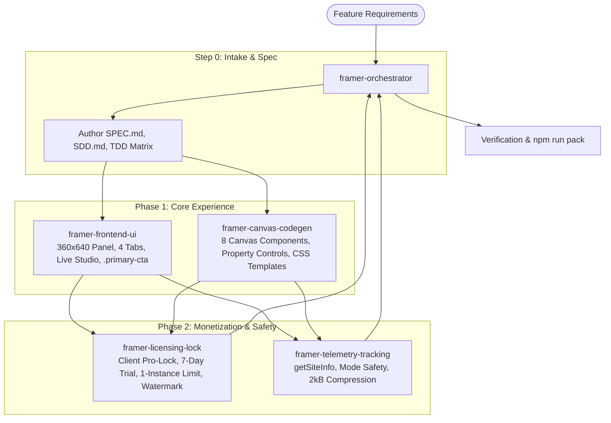

# Missing Scopes and Competitive Implementation Blueprint for MemberFrame

A comprehensive architectural analysis and implementation plan identifying market white spaces, competitor feature gaps, and strategic opportunities for MemberFrame within the Framer plugin ecosystem.

---

## 1. Executive Summary and Strategic Opportunity

The Framer membership and subscription market has reached an inflection point. While competitors such as FrameAuth, Thenty, Subscription Payments, and Outseta have validated customer demand, every existing solution suffers from critical architectural compromises:

1. **High Transaction Fees and Double Taxation:** Competitors charge up to $127.00 per month while taking an additional 0.5% to 2.0% transaction fee on every sale.
2. **Geographic Payment Lock-in:** The majority of solutions support only Stripe, leaving creators in India, Southeast Asia, and emerging markets without UPI or local wallet support.
3. **Manual Code Overrides and Friction:** Existing native tools force designers to write custom code overrides (`withAuth`, `withSubscription`) that break when Framer updates.
4. **Rigid Visuals and Broken Theme Inheritance:** Embedded scripts and external modals clash with Framer typography, lack dark mode synchronization, and degrade brand aesthetics.
5. **Missing Creator Workflows:** Advanced creator workflows like dynamic metered paywalls, Framer CMS collection-level gating, video progress tracking, and B2B team seats remain unaddressed.

MemberFrame combines the best aspects of these platforms: a 0% platform fee model, native Framer canvas components, tri-gateway payment routing (Stripe, Lemon Squeezy, Razorpay/UPI), deep theme synchronization via company design tokens, an in-plugin live preview studio, and a clean zero inline CSS architecture.

---

## 2. Competitive Gap Analysis Matrix

This matrix maps market vulnerabilities across current solutions against MemberFrame capabilities:

| Strategic Capability | FrameAuth | Thenty | Subscription Payments | Outseta | MemberFrame Scope |
| :--- | :--- | :--- | :--- | :--- | :--- |
| **Platform Transaction Fee** | 0% | 0.5% to 1.5% | 0% | 1.0% to 2.0% | **Guaranteed 0% Fee** |
| **Payment Gateways** | Stripe, Lemon Squeezy | Stripe | Stripe, Razorpay | Stripe | **Stripe + Lemon Squeezy + Razorpay (UPI)** |
| **Canvas Integration** | Native Overrides | Drag-and-Drop | Drop-in Button | External Embeds | **Native Code Components with Property Controls** |
| **Code Override Required** | Yes (for gating) | Partial | No | No (Script tag) | **Zero Code Overrides Required (Wrapper Slots)** |
| **In-Plugin Live Studio** | No | Partial | Yes (Button only) | No | **Full Modal and Component Studio in Plugin UI** |
| **Framer Light/Dark Sync** | Manual CSS | Partial | Fixed | Manual Embed CSS | **Automatic via `data-framer-theme` Tokens** |
| **Zero Inline CSS Compliance** | No | No | No | No | **100% External CSS and Template Modules** |
| **Metered Soft Paywall** | Static blur only | No | No | No | **Dynamic Reading Meter (e.g. 3 Free Articles/mo)** |
| **Framer CMS Item Gating** | Clunky redirect | No | No | Path-based | **Direct CMS Field-Aware Gating Component** |
| **SEO Structured Paywall** | No | No | No | No | **Schema.org JSON-LD Metadata Preservation** |
| **Secure Asset Downloads** | Basic URL check | No | No | No | **Time-Expiring Signed Token Vault** |
| **Passwordless OTP Login** | Yes | No | No | No | **6-Digit OTP with Resend Ticker** |
| **Social SSO Providers** | Google, GitHub | Google | No | Google | **Google, Apple, GitHub, and Discord** |
| **B2B Team Accounts (Seats)** | No | No | No | Yes ($87/mo+) | **Multi-Seat Member Invitations in Portal** |
| **LMS Video Progress Sync** | Checkbox only | No | No | No | **Video Player Listener with Course % Bar** |
| **Agency Multi-Site Pricing** | Standard tier | +$29/mo per site | One-time license | High tier | **Pooled Agency License (No Per-Site Penalty)** |

---

## 3. High-Impact Missing Scopes to Implement

The following five domains outline the specific features and components MemberFrame will deliver to outperform existing solutions.

---

### Domain 1: Advanced Content Gating and Paywall Mechanics

#### 1. Zero-Code Visual Canvas Gating (`<MemberGate>`)
* **Competitor Limitation:** FrameAuth requires Framer code overrides attached to canvas frames, creating high technical friction for visual designers.
* **MemberFrame Scope:** Deliver a native Framer canvas component (`MemberGate.tsx`) that functions as a visual container slot. Designers drop any frame or component into the slot. In the Framer properties sidebar, they select the required access level (`Anyone`, `Signed In`, `Free Member`, `Tier 1: Silver`, `Tier 2: Gold`, `VIP`). When an unauthorized visitor views the page, the component automatically renders a customizable locked state without requiring a single line of custom code.

#### 2. Dynamic Metered Paywall ("Read X Free Articles per Month")
* **Competitor Limitation:** Existing tools offer only binary access (all locked or all public), or a basic static fade-out with no meter tracking.
* **MemberFrame Scope:** Build a dynamic metered paywall component (`MeteredPaywall.tsx`). Creators configure the allowed free article quota (e.g. 3 free articles every 30 days). The component tracks reads via encrypted local storage and user session data, displays a non-intrusive floating counter banner ("You have 2 free articles left this month"), and triggers a frosted glass paywall modal upon quota exhaustion.

#### 3. SEO-Preserving Paywall with Schema.org JSON-LD Integration
* **Competitor Limitation:** Gated content on competitor platforms either hides content from search engine web crawlers (destroying organic SEO rankings) or risks Google penalties for cloaking.
* **MemberFrame Scope:** The gated component automatically generates Google-compliant Schema.org structured data (`isAccessibleForFree: false`, `hasPart: WebPageElement`) and renders search-crawlable semantic HTML under an accessible frosted overlay with a CSS gradient mask. Search engines index the full article content, while unauthorized visitors see an elegant teaser with an unlock prompt.

#### 4. Native Framer CMS Collection Item-Level Gating (`<CMSGatedTemplate>`)
* **Competitor Limitation:** Framer CMS pages share a single route template. Competitors struggle to gate specific CMS items without complex URL redirect hacks.
* **MemberFrame Scope:** Create a dedicated CMS wrapper component that reads Framer CMS item fields (such as a boolean `is_premium` or select field `required_tier`). The component conditionally gates the specific CMS article while leaving free items in the same collection accessible to the public.

#### 5. Time-Expiring Secure Digital Asset Vault (`<ProtectedDownload>`)
* **Competitor Limitation:** File downloads in FrameAuth rely on standard button links that can be shared or extracted through browser developer tools.
* **MemberFrame Scope:** Provide a protected download component (`ProtectedDownload.tsx`). When a verified member clicks the download button, MemberFrame generates a temporary signed URL that expires within 60 seconds, preventing direct asset leakage and link sharing.

---

### Domain 2: Modern Authentication, Identity, and Onboarding

#### 1. Multi-Provider SSO Suite (Google, Apple, GitHub, Discord)
* **Competitor Limitation:** FrameAuth supports only Google and GitHub. Thenty supports only Google. No competitor supports Apple Sign In or Discord.
* **MemberFrame Scope:** Deploy an all-in-one auth component (`MemberAuth.tsx`) supporting:
  * **Google SSO:** Universal one-click authentication.
  * **Apple Sign In:** Essential for iOS visitors and privacy-focused users.
  * **GitHub SSO:** Ideal for developer docs and tech communities.
  * **Discord SSO:** High-converting for community builders, gaming sites, and Web3 creators.
  * **Passwordless 6-Digit OTP:** Secure email login with an automatic 60-second resend countdown.

#### 2. Self-Serve Member Portal and Billing Dashboard (`<MemberDashboard>`)
* **Competitor Limitation:** Thenty and Outseta redirect customers to external hosted websites or open iframe popups that look completely disconnected from the Framer project design.
* **MemberFrame Scope:** Deliver a 100% canvas-native member dashboard component (`MemberDashboard.tsx`). Members update their name, view subscription tier status, open the Stripe or Lemon Squeezy billing portal to change payment cards, download past invoices, and manage security settings directly on the Framer site.

#### 3. Multi-Step Progressive Onboarding Questionnaire (`<OnboardingModal>`)
* **Competitor Limitation:** Existing tools offer only single-step registration forms with basic text fields, resulting in high drop-off rates when creators need detailed member data.
* **MemberFrame Scope:** Provide a multi-step modal component (`OnboardingModal.tsx`) with a visual step indicator, conditional field display, and automatic metadata synchronization to the member profile record upon completion.

#### 4. B2B Team Accounts and Multi-Seat License Invites (`<TeamManagement>`)
* **Competitor Limitation:** Only Outseta supports team accounts, but at an expensive $87.00+ monthly fee. FrameAuth and Thenty support only individual accounts.
* **MemberFrame Scope:** Introduce team license tiers where a business purchaser receives an administrative seat and can invite colleagues by email from their self-serve dashboard, filling allocated seats automatically.

---

### Domain 3: Global Payment Orchestration and Creator Economics

#### 1. Tri-Gateway Smart Routing (Stripe + Lemon Squeezy + Razorpay/UPI)
* **Competitor Limitation:** Stripe-only tools exclude creators and buyers across India, Southeast Asia, and parts of Latin America. Subscription Payments offers Razorpay but completely lacks membership gating.
* **MemberFrame Scope:** Provide unified payment gateway routing in one plugin:
  * **Stripe:** Direct credit/debit card processing, Apple Pay, Google Pay, and Link across 46+ countries.
  * **Lemon Squeezy:** Merchant of Record solution handling EU VAT, international sales taxes, and invoice compliance automatically.
  * **Razorpay:** Direct UPI, Indian Netbanking, and domestic wallet payments to unlock the massive Indian creator market.
  * **Automatic Geolocation Detection:** Detects the visitor country and suggests the optimal local payment gateway and currency.

#### 2. Guaranteed 0% Platform Transaction Fee
* **Competitor Limitation:** Thenty charges up to 1.5% and Outseta charges up to 2.0% on top of payment processing costs.
* **MemberFrame Scope:** Maintain a strict 0% platform fee policy across all MemberFrame tiers. Merchants pay only their standard gateway fees (such as Stripe 2.9% + 30¢), saving hundreds of dollars monthly.

#### 3. Pay-What-You-Want (PWYW) and Recurring Donation Slider (`<DonationSlider>`)
* **Competitor Limitation:** No existing Framer membership plugin provides flexible donation sliders or custom recurring contributions.
* **MemberFrame Scope:** Deploy an interactive slider component (`DonationSlider.tsx`) with customizable minimum amounts, suggested tier presets, and a monthly or yearly billing toggle.

#### 4. Grace Period Management and Automated Dunning Flow
* **Competitor Limitation:** Failed subscription renewals immediately lock out members, triggering customer support tickets and accidental member churn.
* **MemberFrame Scope:** Built-in grace period handling displaying a friendly warning banner ("Your latest payment was unsuccessful. Update your billing details within 3 days to maintain access") with a direct card update link.

---

### Domain 4: Creator Community, LMS, and Engagement Micro-Features

#### 1. Complete LMS Suite: Video Progress Listener and Course Progress Bar
* **Competitor Limitation:** FrameAuth offers only a standalone "Mark as Complete" button with no progress visualization or video integration.
* **MemberFrame Scope:** Deliver a cohesive LMS trio:
  * **`<CourseProgressBar>`:** Displays a live percentage progress bar across all modules in a course.
  * **`<LessonChecklist>`:** Interactive lesson checkboxes that automatically persist completion status in the member record.
  * **`<VideoProgressListener>`:** Listens to video events from YouTube, Vimeo, and Wistia players, automatically marking a lesson complete when the video finishes playing.

#### 2. Optimistic Member Bookmarking Tray (`<BookmarksTray>`)
* **Competitor Limitation:** Existing bookmarking implementations are rigid, slow to load, and difficult to customize visually.
* **MemberFrame Scope:** Deliver a fast, responsive `<BookmarkButton>` and `<BookmarksTray>` pairing with optimistic UI updates, allowing visitors to save favorite resources with zero latency.

#### 3. Member Directory with Verified Badges (`<MemberDirectory>`)
* **Competitor Limitation:** No competitor enables creators to display a public or private member listing on Framer.
* **MemberFrame Scope:** Provide a searchable member directory component with tier-based filter pills and customizable member avatar cards.

#### 4. Targeted Member Announcement Bar (`<MemberAnnouncementBar>`)
* **Competitor Limitation:** Creators must rely on external broadcast email tools to notify existing members about site updates.
* **MemberFrame Scope:** A canvas banner component that displays announcements exclusively to signed-in members of specific tiers (for example, "VIP Live Q&A starts in 2 hours").

---

### Domain 5: Framer Plugin Workflow, UX, and Company Design System

#### 1. In-Plugin 360x640 Live Preview Studio with Auth State Simulator
* **Competitor Limitation:** FrameAuth and Thenty provide no live interactive preview inside the plugin panel. Designers must repeatedly insert components onto the canvas and publish the site to verify styling.
* **MemberFrame Scope:** Within the plugin Builder tab, provide a live interactive preview studio displaying the login modal, paywall card, or member badge in real time as colors, radii, and fonts are customized. Include an interactive state switcher (`Logged Out`, `Free Member`, `Tier 1: Silver`, `VIP`, `Payment Failed`) so designers can preview all customer states instantly inside Framer.

#### 2. Automatic Design Token Synchronization with Framer Workspace
* **Competitor Limitation:** Competitor canvas components generate hardcoded colors that fail when switching between light and dark modes.
* **MemberFrame Scope:** Full compliance with the company design system (`design-tokens.css`). All components dynamically read `data-framer-theme` (`light` or `dark`) and project tokens, ensuring pixel-perfect harmony with Framer site styles.

#### 3. Strict Zero Inline CSS Compliance
* **Competitor Limitation:** Competitor code components clutter the Framer canvas with inline `style={{ ... }}` blocks, hindering maintenance and Framer performance.
* **MemberFrame Scope:** 100% of generated styling is consolidated into modular CSS string templates (`cssContent`), adhering to the workspace zero inline CSS standard validated by automated linting scripts.

#### 4. Mandatory `.primary-cta` Double-Gradient Button Standard
* **Competitor Limitation:** Competitors generate generic flat buttons that fail WCAG contrast guidelines or look unpolished.
* **MemberFrame Scope:** Every primary action button uses the company signature double-gradient border technique, providing lit top highlights and refined focus states.

#### 5. Agency Multi-Site License Model (Zero Per-Domain Penalties)
* **Competitor Limitation:** Thenty charges an extra $29.00 per month for every additional site domain, penalizing design agencies.
* **MemberFrame Scope:** Offer a unified Agency plan with pooled member capacity across unlimited client sites, monitored transparently via `getSiteInfo()` telemetry.

---

## 4. Canvas Component Inventory and Property Controls Specification

MemberFrame delivers eight production-ready Framer canvas components. Each component includes comprehensive Framer Property Controls for visual configuration:

| Component File | Display Name | Purpose | Key Framer Property Controls |
| :--- | :--- | :--- | :--- |
| `MemberGate.tsx` | Member Gate | Gating container slot for canvas frames | `requiredTier`, `fallbackAction` (Redirect/Blur/Hide), `redirectUrl`, `customErrorMessage` |
| `MeteredPaywall.tsx` | Metered Paywall | Quota-based soft paywall with counter | `freeQuotaCount`, `quotaPeriod` (Weekly/Monthly), `blurIntensity`, `ctaLabel`, `badgeColor` |
| `MemberAuth.tsx` | Member Auth | Login and registration modal or embed | `authMode` (Modal/Inline), `providers` (Google, Apple, GitHub, Discord, OTP), `accentColor`, `borderRadius` |
| `MemberDashboard.tsx` | Member Dashboard | Self-serve profile and billing portal | `showBillingTab`, `showAvatarUpload`, `showInvoices`, `portalReturnUrl`, `themeMode` |
| `CourseProgress.tsx` | Course Progress | LMS progress bar and lesson checklist | `courseId`, `showPercentage`, `barHeight`, `activeFillColor`, `completeSoundEffect` |
| `ProtectedDownload.tsx`| Protected Download | Expiring secure asset download link | `fileAssetUrl`, `allowedTiers`, `buttonText`, `expirationSeconds`, `iconType` |
| `DonationSlider.tsx` | Donation Slider | Pay-what-you-want contribution slider | `minAmount`, `maxAmount`, `defaultAmount`, `currencySymbol`, `frequency` (One-time/Monthly) |
| `MemberDirectory.tsx` | Member Directory | Searchable member community roster | `filterByTier`, `itemsPerPage`, `showSocialLinks`, `layoutColumns`, `searchPlaceholder` |

---

## 5. Property Controls Detail: `<MemberGate>` and `<MeteredPaywall>`

### `<MemberGate>` Property Controls Configuration
```typescript
addPropertyControls(MemberGate, {
  contentSlot: {
    type: ControlType.ComponentInstance,
    title: "Protected Frame",
  },
  requiredTier: {
    type: ControlType.Enum,
    title: "Access Tier",
    options: ["signed_in", "free_member", "tier_1", "tier_2", "vip"],
    optionTitles: ["Any Signed In", "Free Member", "Tier 1: Silver", "Tier 2: Gold", "VIP Member"],
    defaultValue: "signed_in",
  },
  fallbackAction: {
    type: ControlType.Enum,
    title: "Locked State",
    options: ["blur", "hide", "redirect", "custom_card"],
    optionTitles: ["Frosted Blur", "Hide Completely", "Page Redirect", "Lock Card"],
    defaultValue: "blur",
  },
  redirectUrl: {
    type: ControlType.Link,
    title: "Redirect Target",
    hidden: (props) => props.fallbackAction !== "redirect",
  },
  cardTitle: {
    type: ControlType.String,
    title: "Lock Title",
    defaultValue: "Members Only Content",
    hidden: (props) => props.fallbackAction !== "custom_card",
  },
  cardDescription: {
    type: ControlType.String,
    title: "Lock Message",
    defaultValue: "Join or sign in to read this full guide.",
    hidden: (props) => props.fallbackAction !== "custom_card",
  },
});
```

### `<MeteredPaywall>` Property Controls Configuration
```typescript
addPropertyControls(MeteredPaywall, {
  freeQuotaCount: {
    type: ControlType.Number,
    title: "Free Articles",
    min: 1,
    max: 10,
    step: 1,
    defaultValue: 3,
    displayStepper: true,
  },
  quotaPeriod: {
    type: ControlType.Enum,
    title: "Reset Window",
    options: ["weekly", "monthly"],
    optionTitles: ["Every 7 Days", "Every 30 Days"],
    defaultValue: "monthly",
  },
  blurIntensity: {
    type: ControlType.Number,
    title: "Blur Amount",
    min: 2,
    max: 20,
    unit: "px",
    defaultValue: 8,
  },
  showCounterPill: {
    type: ControlType.Boolean,
    title: "Show Counter",
    defaultValue: true,
  },
  ctaLabel: {
    type: ControlType.String,
    title: "Unlock Button",
    defaultValue: "Subscribe to continue reading",
  },
});
```

---

## 6. Integration with Company Agent Ecosystem and Standards

MemberFrame will be developed following the company multi-agent framework:



### Sub-Agent Allocations:
1. **`framer-orchestrator`**:
   - Manages SDD workflow, living task plans, and the Agent Work Preview table.
   - Enforces design token fidelity and cross-agent quality control.
2. **`framer-frontend-ui`**:
   - Builds the 360x640 plugin window with standard 4-part shell architecture.
   - Implements the interactive Live Preview Studio with member state simulation.
   - Uses exclusively Lucide React icons and the mandatory `.primary-cta` double-gradient button.
3. **`framer-canvas-codegen`**:
   - Generates production-ready React code files for Framer canvas deployment.
   - Embeds Framer Property Controls and external CSS string templates (`cssContent`).
4. **`framer-licensing-lock`**:
   - Implements the 3-tier catalog (Monthly, Yearly, Lifetime) and 7-day trial flow.
   - Enforces the 1-instance limit per component during trial and duplicate limits.
   - Automatically removes watermarks across all canvas components upon paid upgrade.
5. **`framer-telemetry-tracking`**:
   - Extracts site metadata via `getSiteInfo()` (`siteId`, `siteName`, `siteUrl`, `userId`, `userEmail`).
   - Syncs project telemetry to backend endpoints with non-blocking error handling.
   - Enforces `framer.mode` safety checks to avoid permission errors during collection syncs.
   - Compresses widget configuration payloads within Framer's 2kB `setPluginData` limit.

---

## 7. Phased Implementation Roadmap

```
Phase 1: Foundation & Core Gating ➔ Phase 2: Global Payments & LMS ➔ Phase 3: B2B Teams & CMS Gating ➔ Phase 4: Community & Agency Polish
```

### Phase 1: Foundation and Core Gating (Weeks 1 to 2)
* [ ] Scaffold plugin panel geometry (360x640) and 4-part navigation (`Home`, `Builder`, `Settings`, `Profile`).
* [ ] Integrate company `design-tokens.css` with dynamic light and dark theme synchronization.
* [ ] Build interactive Live Preview Studio inside the Builder tab with auth state simulation.
* [ ] Develop `<MemberGate>` visual container component with Framer Property Controls.
* [ ] Implement `<MemberAuth>` component with Google SSO and passwordless 6-digit OTP.
* [ ] Wire Stripe checkout sessions and direct customer billing portal links.
* [ ] Validate 100% Zero Inline CSS compliance via standalone linter script.

### Phase 2: Global Payment Expansion and Creator Kit (Weeks 3 to 4)
* [ ] Integrate Lemon Squeezy gateway for automated EU VAT and tax compliance.
* [ ] Integrate Razorpay gateway with instant UPI QR and phone checkout.
* [ ] Build `<MeteredPaywall>` component with dynamic read tracking and counter pills.
* [ ] Implement SEO-preserving Schema.org JSON-LD generation for gated content.
* [ ] Develop the LMS trio: `<CourseProgressBar>`, `<LessonChecklist>`, and `<VideoProgressListener>`.
* [ ] Wire client Pro-Lock, 7-day trial sticky ticker, and 1-instance trial limits.

### Phase 3: B2B Teams and Advanced CMS Support (Weeks 5 to 6)
* [ ] Build `<MemberDashboard>` canvas portal for member profile updates and billing self-service.
* [ ] Develop native Framer CMS field-aware gating component (`<CMSGatedTemplate>`).
* [ ] Implement time-expiring `<ProtectedDownload>` vault with signed download tokens.
* [ ] Build multi-seat B2B team licensing and email invite system (`<TeamManagement>`).
* [ ] Deploy multi-step progressive onboarding questionnaire modal (`<OnboardingModal>`).

### Phase 4: Community Features and Agency Packaging (Weeks 7 to 8)
* [ ] Develop optimistic `<BookmarkButton>` and `<BookmarksTray>` components.
* [ ] Build searchable `<MemberDirectory>` component with tier filter pills.
* [ ] Deploy `<DonationSlider>` with monthly and yearly contribution toggles.
* [ ] Finalize agency multi-site license handling with shared member pools.
* [ ] Run complete TDD test suite, Framer SDK mocks, and verify `npm run pack`.

---

## 8. Summary of Strategic Advantages for MemberFrame

By systematically addressing every competitor limitation, MemberFrame delivers five decisive advantages:

1. **Unbeatable Creator Economics:** 0% platform transaction fees compared to Thenty's 1.5% and Outseta's 2.0% cuts.
2. **True Global Reach:** Direct Razorpay/UPI alongside Stripe and Lemon Squeezy, welcoming creators across all continents.
3. **Framer-Native Designer Experience:** Visual canvas slots and Property Controls replace confusing code overrides.
4. **Live In-Plugin Preview Studio:** Test all member states (`Logged Out`, `Free`, `VIP`) inside the plugin before publishing.
5. **Standardized Company Quality:** Built with dual-theme token synchronization, `.primary-cta` double-gradient styling, zero inline CSS, and safe Framer telemetry.
