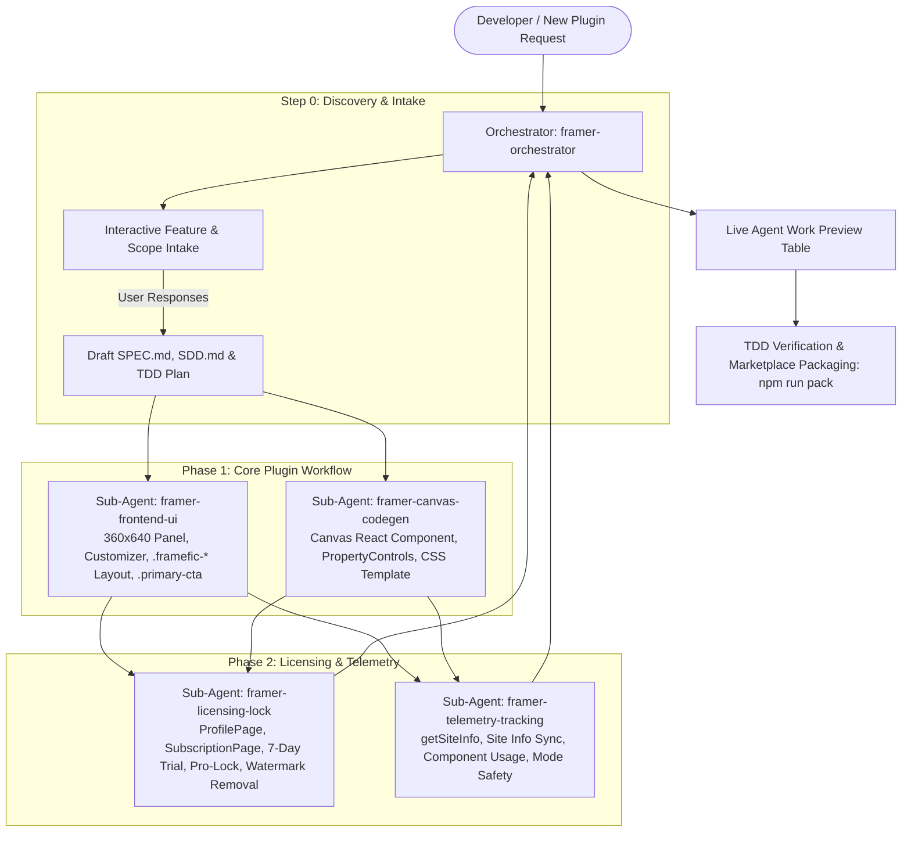
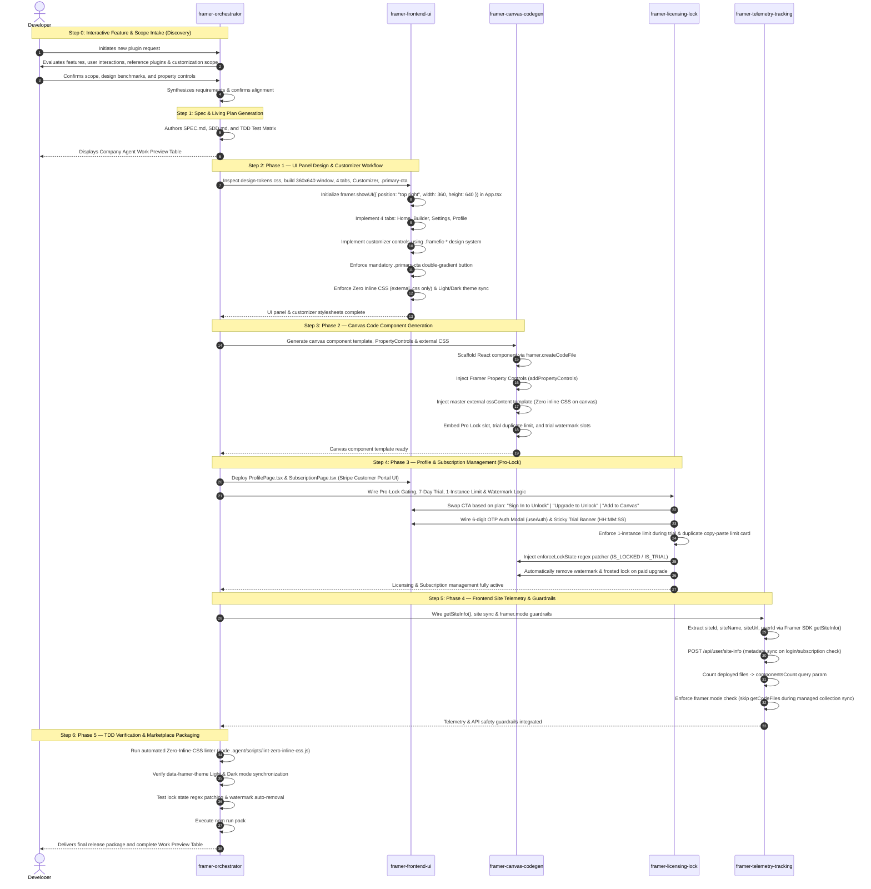

# Company Framer Plugin Agent Ecosystem

Welcome to the **Company Framer Plugin Development Ecosystem**. This workspace provides an autonomous, multi-agent AI pair-programming environment engineered to build **10 to 15+ commercial Framer plugins** adhering to a single, hardened engineering standard, unified visual identity, and rapid development workflow.

---

## 1. Architectural Overview

The agent ecosystem is supervised by the **Orchestrator Agent**, which interviews the developer, formulates the Spec-Driven Development (SDD) contract, maintains a live **Agent Work Preview** table, and dispatches domain tasks to four specialized frontend sub-agents.



---

## 2. End-to-End Sequence Architecture

This sequence diagram illustrates the lifecycle of scaffolding, designing, generating, and monetizing a new plugin:



---

## 3. The 5 Specialized Sub-Agents

| Sub-Agent | Role | Scope & Responsibilities |
| :--- | :--- | :--- |
| **`framer-orchestrator`** | Master Conductor | Conducts Step 0 intake interview, drafts `SPEC.md`/`SDD.md`, coordinates sub-agents, enforces cross-agent standards, and maintains the live Agent Work Preview table. |
| **`framer-frontend-ui`** | UI Panel Specialist | Builds the 360x640 plugin window, 4-tab navigation, customizer controls, `.framefic-*` components, `.primary-cta` double-gradient button, and external CSS stylesheets. |
| **`framer-canvas-codegen`** | Canvas Component Architect | Generates high-performance React/TypeScript code components deployed to canvas via `framer.createCodeFile`, `addPropertyControls`, and self-contained external CSS string templates (`cssContent`). |
| **`framer-licensing-lock`** | Client Pro-Lock Specialist | Manages client CTA swapping (`Sign In to Unlock` / `Upgrade` / `Add to Canvas`), passwordless OTP auth, 7-day trial flow, 1-instance limit during trial, `enforceLockState` regex patching, and automatic watermark removal post-upgrade. |
| **`framer-telemetry-tracking`** | Site Telemetry Specialist | Extracts project metadata via `getSiteInfo()`, synchronizes telemetry to `/api/user/site-info`, tracks `componentsCount`, differential 2kB storage compression, and enforces `framer.mode` safety guardrails. |

---

## 4. Phased Development Workflow

When a new plugin request is initiated, the agent follows this strict sequence:

### Step 0: Interactive Feature & Scope Intake (`framer-orchestrator`)
Before generating code or discussing payment plans, the orchestrator conducts an intake interview:
1. **Feature Analysis**: Core features, user interactions, layout requirements.
2. **References & Benchmarks**: Reference plugins, visual inspirations, layout patterns.
3. **Customization Levers**: Configurable parameters (colors, typography, radii, animation presets).
4. **Summary & Alignment**: Confirms understanding with the developer before proceeding.

### Phase 1: Specification & Design (`framer-orchestrator`)
- Generates [`SPEC.md`](SPEC.md) and [`SDD.md`](SDD.md) based on the standardized template.
- Establishes the Framer permissions manifest (`framer.json`) and TDD test matrix.
- Publishes the live **Agent Work Preview** table.

### Phase 2: UI Panel & Customizer (`framer-frontend-ui`)
- Initializes window geometry in `src/App.tsx`:
  ```typescript
  framer.showUI({
    position: "top right",
    width: 360,
    height: 640,
  });
  ```
- Builds the 4-part navigation: `Home`, `Builder/Customizer`, `Settings`, `Profile`.
- Deploys controls using the `.framefic-*` design system with 100% external CSS (Zero inline styles).
- Enforces the `.primary-cta` double-gradient button standard.

### Phase 3: Canvas Code Component (`framer-canvas-codegen`)
- Generates the canvas React component via `framer.createCodeFile`.
- Injects Framer Property Controls (`addPropertyControls`) for sidebar editing.
- Consolidates canvas styling into a master `<style>` string (`cssContent`) with zero inline CSS.
- Prepares slots for the Frosted Pro Lock Banner, 1-instance duplicate card, and trial watermark badge.

### Phase 4: Profile, Subscription & Pro-Lock (`framer-licensing-lock`)
*(Wired ONLY after core plugin functionality is fully implemented)*
- Deploys `ProfilePage.tsx` and `SubscriptionPage.tsx` with Stripe Customer Portal integration.
- Configures client CTA swapping based on auth and subscription state.
- Activates the sticky top trial countdown ticker (`HH:MM:SS` or `X days left`).
- Enforces the 1-instance limit per component during trial and duplicate protection (`__instances__`).
- Injects `enforceLockState` regex patcher into `App.tsx` to automatically remove watermarks post-purchase.

### Phase 5: Frontend Site Telemetry (`framer-telemetry-tracking`)
- Hooks Framer SDK `getSiteInfo()` (`siteId`, `siteName`, `siteUrl`, `userId`, `userEmail`).
- Pushes non-blocking site metadata to `/api/user/site-info`.
- Reports `componentsCount` to monitor project usage.
- Enforces `framer.mode` safety checks to avoid permission errors during managed collection syncs.

### Phase 6: TDD Verification & Marketplace Packaging (`framer-orchestrator`)
- Runs the automated Zero-Inline-CSS linter:
  ```bash
  node .agent/scripts/lint-zero-inline-css.js src
  ```
- Tests Light and Dark theme synchronization with `data-framer-theme`.
- Verifies regex auto-patching and mock Framer SDK calls.
- Executes `npm run pack` to generate the production `plugin.zip` for marketplace review.

---

## 5. Non-Negotiable Engineering Standards

### 5.1. 100% Frontend Scope Boundary
The agent ecosystem is exclusively responsible for the Framer plugin frontend panel (React + Vite + Framer SDK) and canvas code components. Backend servers, database migrations, and Stripe webhook listeners are maintained independently.

### 5.2. Pre-Flight Verification: `design-tokens.css` Adherence
Before writing or modifying any UI or CSS, the agent **MUST FIRST CHECK** if `design-tokens.css` or `variables.css` exists in the project. If tokens exist, **all styling must strictly adhere to the exact CSS variables and rules defined in the project**. Never introduce outside or arbitrary styling.

### 5.3. Strict Zero Inline CSS Rule (External CSS Only)
The AI agent **MUST NEVER USE INLINE CSS (`style={{ ... }}`) IN REACT JSX**.
- **FORBIDDEN**: `<div style={{ display: "flex", gap: "8px" }}>`
- **REQUIRED**: `<div className="form-row-group">` with styles in external `.css`.
- **Automated Validation**: Verified via `node .agent/scripts/lint-zero-inline-css.js`.

### 5.4. Mandatory `.primary-cta` Button Standard
Every primary call-to-action button in all plugins must use `.primary-cta`:
```css
.primary-cta {
  font-family: var(--font-sans, "Inter", sans-serif);
  font-size: 13px;
  font-weight: 500 !important;
  letter-spacing: 0.22px;
  line-height: 1;
  width: 100%;
  height: 36px;
  padding: 0 16px;

  /* Signature Double-Gradient Border */
  background: linear-gradient(var(--secondary-default, #5271ff), var(--secondary-default, #5271ff)) padding-box,
              linear-gradient(180deg, #708aff 0%, #3358ff 100%) border-box;
  color: #ffffff !important;
  border: 2px solid transparent !important;
  border-radius: var(--radius-md, 8px);
  display: inline-flex;
  align-items: center;
  justify-content: center;
  gap: 6px;
  cursor: pointer;
}
```

### 5.5. Strict Icon Standard: Lucide React or Framer SVG Only (Strictly Zero Emojis)
- **Allowed Icons**: Official Lucide React components (e.g. `<UserRound />`, `<Crown />`, `<Lock />`, `<Plus />`, `<Sparkles />`, `<ExternalLink />`, `<X />`, `<ChevronDown />`) or Framer SVG icons.
- **Strict Prohibition**: **Never use unicode emojis** anywhere in the plugin UI, buttons, tabs, modal headers, badges, alerts, or canvas components.
- **Color Inheritance**: All icons must use `stroke="currentColor"` or `fill="currentColor"`.

### 5.6. Light & Dark Mode Color Synchronization
All styling tokens must synchronize with Framer's workspace theme:
- Default: Dark mode (`:root`)
- Synced Light mode: `body[data-framer-theme="light"]:not([data-user-theme="dark"])`
- Explicit Dark override: `html[data-user-theme="dark"] body`
- Native `<select>` contrast fix:
  ```css
  select option {
    background-color: var(--bg-card-inner) !important;
    color: var(--title) !important;
  }
  ```

---

## 6. Canonical `.framefic-*` Class Reference

All UI components and layouts are standardized to the `.framefic-*` class naming convention:

| Component | Standard Class Names |
| :--- | :--- |
| **Plugin Shell** | `.framefic-shell`, `.framefic-header`, `.framefic-header-brand`, `.framefic-header-logo`, `.framefic-header-title`, `.framefic-header-actions` |
| **Navigation Tabs**| `.framefic-tab-bar`, `.framefic-tabs-list`, `.framefic-tab`, `.framefic-tab.active`, `.framefic-tab-spacer` |
| **Body & Footer** | `.framefic-content-area`, `.framefic-footer`, `.framefic-footer-link`, `.framefic-footer-version` |
| **Ecosystem Cards**| `.framefic-card-list`, `.framefic-card`, `.framefic-card-logo`, `.framefic-card-info`, `.framefic-card-name`, `.framefic-card-desc`, `.framefic-card-open` |
| **Form Controls** | `.framefic-input`, `.framefic-input-wrap`, `.framefic-input-icon`, `.framefic-select`, `.framefic-checkbox`, `.framefic-checkbox-box`, `.framefic-toggle`, `.framefic-toggle-track`, `.framefic-toggle-knob`, `.framefic-segmented`, `.framefic-segment` |
| **Pro-Lock & Trial**| `.framefic-trial-sticky-banner`, `.framefic-trial-ticker`, `.framefic-trial-watermark`, `.framefic-frosted-lock-container`, `.framefic-duplicate-limit-container` |

---

## 7. Ecosystem File & Reference Directory Map

```
d:/VS Code/Framer/Framer/
├── AGENTS.md                                    # Authoritative multi-agent instructions & protocols
├── README.md                                    # Complete architectural view and operational guide
├── .agent/
│   ├── rules/
│   │   └── framer-sdd-standards.md              # Enforced coding and architectural rules
│   ├── scripts/
│   │   └── lint-zero-inline-css.js              # Standalone Zero-Inline-CSS linter
│   └── skills/framer-plugin-suite/
│       ├── SKILL.md                             # Authoritative skill instructions & reference index
│       └── references/
│           ├── design-tokens.css                # Canonical 2000+ line dual-theme token stylesheet
│           ├── canvas-component-template.md     # Master Canvas Code Component template
│           ├── profile-and-subscription-ui.md   # Drop-in ProfilePage & SubscriptionPage code
│           ├── orchestrator-and-subagents.md    # Sub-agent roles, intake questions & preview table
│           ├── pricing-and-trial-lifecycle.md   # 3-tier catalog, trial flow & watermark removal
│           ├── pro-lock-engine.md               # Dual-layer Pro-Lock & enforceLockState patcher
│           ├── telemetry-and-tracking.md        # getSiteInfo(), site sync & framer.mode safety
│           ├── env-template.md                  # Safe frontend environment variables guide
│           ├── boilerplate-scaffolder.md        # Scaffolding runbook (360x640 geometry)
│           ├── plugin-case-studies.md           # Architectural patterns & reusability matrix
│           ├── plugin-components.md             # Standard UI kit components (.framefic-*)
│           ├── sdd-template.md                  # Standard SDD specification template
│           └── tdd-and-verification.md          # Framer SDK mock engine & test suites
```

---

## 8. Live Agent Work Preview Table Example

Whenever the orchestrator coordinates a plugin project, it maintains this live progress table:

```markdown
### Company Plugin Agent Work Preview: [Plugin Name]

| Domain | Responsible Agent | Status | Key Deliverables |
| :--- | :--- | :--- | :--- |
| **Orchestration** | `framer-orchestrator` | [Complete] | Feature research intake, SPEC.md, SDD.md, TDD plan |
| **Plugin UI Panel** | `framer-frontend-ui` | [In Progress] | 360x640 window, 4 tabs, Customizer, .primary-cta, Themes |
| **Canvas Component** | `framer-canvas-codegen` | [Queued] | React template, Property controls, CSS injection |
| **Pro-Lock & Trial** | `framer-licensing-lock` | [Queued] | ProfilePage, SubscriptionPage, 7-day trial, 1-instance limit, Watermark removal |
| **Site Telemetry** | `framer-telemetry-tracking` | [Queued] | getSiteInfo(), /api/user/site-info sync, mode safety |

#### Active Verification Checklist:
- [ ] Feature research and improvement scope confirmed with user.
- [ ] Pre-flight check: design-tokens.css inspected and project CSS rules followed.
- [ ] UI panel & customizer designed with 100% external CSS (Zero inline CSS).
- [ ] Mandatory `.primary-cta` applied to all primary actions.
- [ ] Strictly Lucide or Framer icons only (Zero unicode emojis).
- [ ] Light/Dark theme sync with `data-framer-theme`.
- [ ] Canvas Code Component deployed with Property Controls.
- [ ] 7-Day trial sticky top countdown ticker active.
- [ ] 1-Instance limit per component enforced on trial.
- [ ] Watermark automatically removed upon paid upgrade.
- [ ] `framer.mode` safety check before calling `getCodeFiles()`.
- [ ] TDD verification and `npm run pack` passed.
```
